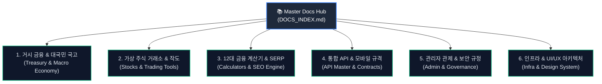

# 📚 Woldeok Moneyverse - 공식 통합 문서 허브 (Master Docs Hub)

## v2026.10.15.654 — Web functional remediation (candidate; finance release BLOCKED)

- [Findings EN](docs/findings/MONEYVERSE_WEB_FUNCTIONAL_REMEDIATION_v2026.10.15.654.md) · [한국어 시정 결과](docs/findings/MONEYVERSE_WEB_FUNCTIONAL_REMEDIATION_v2026.10.15.654.ko.md)
- [Release EN](docs/releases/v2026.10.15.654.md) · [Release KO](docs/releases/v2026.10.15.654.ko.md) · [Worklog](docs/worklog/2026-10-15-web-functional-remediation-v654.md).
- Existing v639 tested fixes isolated with new Pg bad-client containment, deterministic React tests and synthetic-DB 4-pass plus local Next smoke. Canonical ledger/DB least-privilege/complete Test UI and rollback pending; Production prod-v600 unchanged.

## v2026.10.15.652 — Production promotion gate review (BLOCKED)

- [Release gate record EN](docs/releases/v2026.10.15.652.md) · [한국어 운영 승격 검증](docs/releases/v2026.10.15.652.ko.md)
- [Detailed worklog EN](docs/worklog/2026-10-15-production-promotion-gates-v652.md) · [작업기록 KO](docs/worklog/2026-10-15-production-promotion-gates-v652.ko.md)
- Exact-SHA Test mismatch, public Production unknown version and 237 writable DB tables / 11 PUBLIC definer routines: **no Production deployment**.

## v2026.10.15.650 — Audited CI/PR integration (documentation-only)

- [Release record (EN)](docs/releases/v2026.10.15.650.md) · [릴리스 기록 (KO)](docs/releases/v2026.10.15.650.ko.md)
- [Worklog (EN)](docs/worklog/2026-10-15-ci-pr-branch-integration-v650.md) · [작업 기록 (KO)](docs/worklog/2026-10-15-ci-pr-branch-integration-v650.ko.md)
- Web audit PRs #841–843 and Android signing PR #27 merged. Web #844 and Android #23–25 remain blocked; no Test/Production runtime change.

## 2026-10-14 WLD monetary overflow protection (v2026.10.14.625)

- [English primary report](docs/findings/MONEYVERSE_WLD_OVERFLOW_HARDENING_v2026.10.14.625.md) · [한국어 상세 보고서](docs/findings/MONEYVERSE_WLD_OVERFLOW_HARDENING_v2026.10.14.625.ko.md)
- [Worklog EN](docs/worklog/2026-10-14-wld-overflow-precision-v625.md) · [작업 기록 KO](docs/worklog/2026-10-14-wld-overflow-precision-v625.ko.md) · [Internal update](docs/updates/v2026.10.14.625-internal.md) · [GitHub update](docs/updates/v2026.10.14.625-github.md)
- **Candidate only:** exact WLD handling in wallet, fiat, P2P, burn and pension; unresolved P0 ledger conservation, remaining legacy Number paths, frontend full-suite and live DB gates. No Test or Production promotion.

## 2026-10-14 PostgreSQL Outbox optimization candidate — v2026.10.14.622

- [English database/backend investigation](docs/findings/MONEYVERSE_DB_OPTIMIZATION_v2026.10.14.622.md) · [한국어 진단 보고서](docs/findings/MONEYVERSE_DB_OPTIMIZATION_v2026.10.14.622.ko.md).
- [Work detail](docs/worklog/2026-10-14-database-backend-optimization-v622.md) · [Internal update](docs/updates/v2026.10.14.622-internal.md) · [GitHub update](docs/updates/v2026.10.14.622-github.md).
- **Isolated Test candidate only**. Migration 270 and backend cleanup need exact-SHA Test, DB security, backup, health and release gates before Production.

## 2026-10-14 전체 기능 수용 검사 (v2026.10.14.605) — BLOCKED

- [영문 정본: 전 기능 검사·도메인별 수용 증거](docs/findings/MONEYVERSE_FULL_FUNCTION_ACCEPTANCE_AUDIT_v2026.10.14.605.md)
- [한국어: 전 기능 현황·오류·미검증 범위](docs/findings/MONEYVERSE_FULL_FUNCTION_ACCEPTANCE_AUDIT_v2026.10.14.605.ko.md)
- [검증 작업 단계별 기록](docs/worklog/2026-10-14-full-function-acceptance-v605.ko.md) · [내부 업데이트](docs/updates/v2026.10.14.605-internal.ko.md) · [GitHub 업데이트](docs/updates/v2026.10.14.605-function-audit-github.ko.md)

타입/빌드 통과와 전체 기능 정상은 다르다. 프론트 테스트 35건·모바일 API 계약 불일치 등 차단 이슈가 있다.

## 2026-10-14 프론트 전체 회귀 복구 (v2026.10.14.630, Test/운영 검증 대기)

- [영문 기술 보고서](docs/findings/MONEYVERSE_UI_BACKEND_REGRESSION_v2026.10.14.630.md) · [한국어 시정 결과](docs/findings/MONEYVERSE_UI_BACKEND_REGRESSION_v2026.10.14.630.ko.md)
- [작업기록](docs/worklog/2026-10-14-ui-backend-regression-v630.ko.md) · [내부 변경내역](docs/updates/v2026.10.14.630-internal.ko.md) · [GitHub 변경내역](docs/updates/v2026.10.14.630-github.ko.md)
- 기존 38건의 프론트 테스트 결함 기준선을 검토하여 로컬 **1,173/1,173** 전체 통과. 알림 동시성·관리자 UI·색상 대비 등 실제 시정과 모바일 API 계약 파일 3종 재생성. **CI/Test/운영 승격 증거는 별도로 요구**한다.

## 2026-10-14 UI·백엔드 연결 시정 (v2026.10.14.629, 일부 구현 / 릴리스 차단)

- [영문 정본 — UI·백엔드 시정](docs/findings/MONEYVERSE_UI_BACKEND_REMEDIATION_v2026.10.14.629.md) · [한국어 결과](docs/findings/MONEYVERSE_UI_BACKEND_REMEDIATION_v2026.10.14.629.ko.md)
- [한글 작업 기록](docs/worklog/2026-10-14-ui-backend-remediation-v629.ko.md) · [내부 업데이트](docs/updates/v2026.10.14.629-internal.ko.md) · [GitHub 공개 업데이트](docs/updates/v2026.10.14.629-github.ko.md)
- 그랜트·국고·모의 자금 기능의 허위 성공을 차단하고 일부 메뉴 접근 경로를 보완했다. **실제 경제 기능 실구현, 전체 회귀 검사, 분리 Test 수용, 운영 배포는 완료되지 않았다.** 현행 통합기획 권위 v530/AUTHORITY_DRIFT 유지.

## v2026.10.14.631 — GeoIP initial locale repair candidate

- [Worklog (EN)](docs/worklog/2026-10-14-geo-locale-first-render-v631.md) · [작업기록 (KO)](docs/worklog/2026-10-14-geo-locale-first-render-v631.ko.md)
- [GitHub update (EN)](docs/updates/v2026.10.14.631-github.md) · [GitHub 업데이트 (KO)](docs/updates/v2026.10.14.631-github.ko.md) · [Internal (EN)](docs/updates/v2026.10.14.631-internal.md) · [내부 (KO)](docs/updates/v2026.10.14.631-internal.ko.md)
- Status: standalone candidate tested; not yet a Production deployment.

## 2026-10-14 블로그 화면 중복·관리자 메뉴 수정 (v2026.10.14.634, 후보)

- [영문 GitHub 변경내역](docs/updates/v2026.10.14.634-github.md) · [한국어 내부 내역](docs/updates/v2026.10.14.634-internal.ko.md) · [사전·중간·종료 작업기록](docs/worklog/2026-10-14-blog-shell-admin-nav-v634.md)
- 주의: 관리자 인증 Test E2E 미완료, 운영 미승격.

## 2026-10-14 전체 소스·보안 감사 (v2026.10.14.603)

- [영문 정본 — 전체 코드·보안 감사](docs/findings/MONEYVERSE_FULL_CODE_SECURITY_AUDIT_v2026.10.14.603.md)
- [한국어 보고서 — 취약점·버그·해결 우선순위](docs/findings/MONEYVERSE_FULL_CODE_SECURITY_AUDIT_v2026.10.14.603.ko.md)
- [작업·검증 로그](docs/worklog/2026-10-14-full-code-security-audit-v603.ko.md) · [내부 변경내역](docs/updates/v2026.10.14.603-internal.ko.md) · [GitHub 변경내역](docs/updates/v2026.10.14.603-github.ko.md)

이 문서는 진단/검토용이며 취약점 수정·운영 배포 완료를 의미하지 않는다.

> **단일 진실 공급원 (Single Source of Truth)**  
> 본 문서는 월덕 머니버스(Woldeok Moneyverse) 플랫폼의 금융 아키텍처, 대국민 국고 생태계, 가상 주식 거래소, API 계약, 관리자 관제, 모바일 규격, 인프라 운영 가이드를 총망라하는 통합 문서 색인 허브입니다.

> [!TIP]
> 🌟 **[통합 개발 진행상황 및 마스터 레퍼런스 총서 (v1~v209 최신판)](docs/DEVELOPMENT_STATUS_AND_MASTER_REFERENCE.ko.md)**  
> 프로젝트 전체 개발 로드맵, 최신 누적 릴리스(prod-v590) 성과 지표, 그리고 시스템에 적용된 최신 글로벌 공인 엔지니어링 표준(복식부기 원장, 대국민 국고 DAO 예산 투표제, 기술적 분석 작도 수식, Next.js/NestJS 아키텍처, 예금자보호 규제)을 한 번에 확인하실 수 있습니다.

---

## 🏛️ 도메인별 문서 분류 색인

---

### 1. 🏛️ 거시 금융 & 대국민 국고 (Macro Economy & Sovereign Treasury)
중앙정부 국고 금고(VAULT_MAIN), 30% 법정 안전 비축금, 시민 보편 기본배당, 창업 벤처 그랜트, 시민 참여형 주민참여예산 투표제(DAO), 예금보험공사(KDIC), 국채 및 연금 시스템 규격입니다.

| 문서명 / 기능 경로 | 언어 | 핵심 내용 요약 |
| :--- | :--- | :--- |
| **[대국민 국고 포털](/treasury)** | KO | 중앙정부 국고 30% 안전비축금 게이지, 기본배당 즉시 청구, 긴급구호금, 실시간 집행 원장 |
| **[AI 금융 어드바이저 '덕이'](/advisor)** | KO | 4분면 자산 배분 진단, 샤프 지수(1.84) 산출, 1클릭 시장가 자동 리밸런싱 주문 체결(영수증 모달) 및 1:1 대화형 상담 챗봇 |
| **[주민참여예산 투표제](/treasury)** | KO | 시민 누구나 국고 공공사업 제안, 찬성 추천 투표(1,000표 달성 시 자동 가결 및 디스코드 브로드캐스트) |
| **[창업 그랜트 심사 대시보드](/admin/treasury/grants)** | KO | 관리자 전용 벤처 그랜트 신청 심사, 승인 시 국고 금고 원자적 시드머니 지급 및 세션 감사 |
| [MACRO_SOVEREIGN_ECONOMIC_SYSTEM_MASTER_SPEC.ko.md](docs/MACRO_SOVEREIGN_ECONOMIC_SYSTEM_MASTER_SPEC.ko.md) | KO | 거시 경제 주권 시스템 마스터 아키텍처 명세 |
| [TREASURY_25M_ANCHOR_AUTONOMOUS_CYCLE_SPEC.ko.md](docs/TREASURY_25M_ANCHOR_AUTONOMOUS_CYCLE_SPEC.ko.md) | KO | 2,500만 WLD 앵커 국고 자율 순환 경제 엔진 규격 |
| [TREASURY_AUTONOMOUS_SWF_SPEC.ko.md](docs/TREASURY_AUTONOMOUS_SWF_SPEC.ko.md) | KO | 국부펀드(ASWF) 복리 재투자 및 자산 배분 알고리즘 |
| [TREASURY_BONDS_EXCHANGE_SPEC.ko.md](docs/TREASURY_BONDS_EXCHANGE_SPEC.ko.md) | KO | 가상 국채(Bonds) 발행, 거래소 및 이자 지급 명세 |
| [FOREIGN_EXCHANGE_RESERVES_AND_MARKET_SPEC.ko.md](docs/FOREIGN_EXCHANGE_RESERVES_AND_MARKET_SPEC.ko.md) | KO | 외환보유액 관리 및 시장 개입 환율 방어 규격 |
| [GLOBAL_FX_SAFETY_NET_AND_FORWARD_HEDGE_SPEC.ko.md](docs/GLOBAL_FX_SAFETY_NET_AND_FORWARD_HEDGE_SPEC.ko.md) | KO | 글로벌 외환 안전망 및 선물환 헷지 시스템 명세 |
| [DEPOSIT_INSURANCE_AND_FINANCIAL_STABILITY_SPEC.ko.md](docs/DEPOSIT_INSURANCE_AND_FINANCIAL_STABILITY_SPEC.ko.md) | KO | 예금보험공사(KDIC) 5,000만 WLD 보호 한도 및 대위변제 복식부기 원장 |
| [NATIONAL_PENSION_SERVICE_SPEC.ko.md](docs/NATIONAL_PENSION_SERVICE_SPEC.ko.md) | KO | 가상 국민연금 납입, 운용 및 연금 지급 규격 |
| [STATE_ENTERPRISES_AND_CORPORATE_GOVERNANCE_SPEC.ko.md](docs/STATE_ENTERPRISES_AND_CORPORATE_GOVERNANCE_SPEC.ko.md) | KO | 공기업 및 상장사 기업 지배구조 거버넌스 규격 |
| [ECONOMIC_PROFITABILITY_AUDIT.ko.md](docs/ECONOMIC_PROFITABILITY_AUDIT.ko.md) | KO | 거시 경제 수익성 및 자금 순환 감사 보고서 |

---

### 2. 📈 가상 주식 거래소 & 작도 도구 (Virtual Stock Exchange & Trading Tools)
10대 상장사 호가창, 실시간 체결, 트레이딩뷰급 작도 도구(추세선, 수평 지지/저항선, 피보나치 되돌림 5단계) 및 호가 심도 누적 차트(Depth Chart) 설계 문서입니다.

| 문서명 / 기능 경로 | 언어 | 핵심 내용 요약 |
| :--- | :--- | :--- |
| **[가상 주식 거래소](/stocks)** | KO | 10대 가상 상장사 실시간 10단 호가창, 매수/매도, 스탑로스/익절 조건부 주문 |
| **[고래 카피트레이딩 리그](/stocks/league)** | KO | 상위 수익률 +184% 고래 리더보드, 원클릭 1:1 자동 추종 카피 트레이딩 및 수수료 분배 |
| **[차트 작도 도구 툴킷](/stocks/WDG)** | KO | 추세선(Trendline), 수평선(Horizontal Line), 피보나치 되돌림(Fibonacci 5단계) 로컬 영구저장 |
| **[호가 심도 차트](/stocks/WDG)** | KO | 매수(Bids) vs 매도(Asks) 누적 잔량 에어리어 SVG 렌더링 및 최대 호가벽(Wall) 가시화 |
| [2026-09-22-stocks-interactive-trading-console.ko.md](docs/2026-09-22-stocks-interactive-trading-console-v2026.09.22.355.ko.md) | KO | 실시간 주식 호가 주문 콘솔 및 체결 엔진 v355 사양 |
| [2026-09-22-stocks-portfolio-and-trade-presets.ko.md](docs/2026-09-22-stocks-portfolio-and-trade-presets-v2026.09.22.356.ko.md) | KO | 포트폴리오 자산 배분 및 거래 수량/비율 프리셋 사양 |
| [2026-09-22-stocks-halt-cost-basis-settlement.ko.md](docs/2026-09-22-stocks-halt-cost-basis-settlement-visibility-v2026.09.22.357.ko.md) | KO | 매매 정지(Halt), 평균 매입단가 및 결제 가시성 사양 |

---

### 3. 🧮 12대 금융 계산기 & 검색엔진 최적화 (Financial Calculators & SERP CRO)
구글 4.9점 별점 스니펫(AggregateRating), FAQPage 구조화 데이터, IndexNow 실시간 색인 엔진 및 12대 금융 계산기 규격입니다.

| 계산기 허브 경로 | 주요 기능 및 타겟 키워드 | SEO/스니펫 사양 |
| :--- | :--- | :--- |
| **[복리·CAGR 계산기](/tools/compound-calculator)** | 적립식 만기수령액, 거치식 복리, CAGR 연평균 수익률 | 구글 4.9점 별점, FAQPage, 1초 즉시 산출 |
| **[주식 물타기 계산기](/tools/stock-calculator)** | 추가 매수 평단가, 물타기 희석, 탈출 목표가 역산 | 구글 4.9점 별점, FAQPage, 원클릭 초기화 |
| **[대출 이자 계산기](/tools/loan-interest-calculator)** | 원리금균등, 원금균등, 만기일시 상환방식별 총이자 비교 | 구글 4.9점 별점, 상환 일정표 테이블 제공 |
| **[2026 연봉 실수령액 계산기](/tools/salary-calculator)** | 2026년 4대보험 요율 반영 세후 월급 실수령액 산출 | 구글 4.9점 별점, 구간별 공제액 투명 공시 |
| **[배당소득세 계산기](/tools/dividend-tax-calculator)** | 15.4% 원천징수 세후 배당금, 2천만원 금융소득종합과세 | 구글 4.9점 별점, 국내/해외 배당주 분리 |
| **[ISA 절세 계산기](/tools/isa-calculator)** | 일반형(200만)/서민형(400만) 비과세 한도 & 9.9% 분리과세 | 2026 개정 세법 반영 비과세 초과분 자동 계산 |
| **[해외주식 양도소득세 계산기](/tools/capital-gains-tax-calculator)** | 미국주식 연간 250만원 기본공제, 22% 양도세 손익상계 | 연간 누적 손익 합산 과세표준 즉시 산출 |
| **[코인 김치프리미엄 계산기](/tools/kimchi-premium-calculator)** | 국내(업비트) vs 해외(바이낸스) 실시간 김프/역프 차익거래 | 실시간 환율 및 송금 수수료 차감 순수익 |
| **[증여세 계산기](/tools/gift-tax-calculator)** | 배우자(6억), 자녀(5천만), 혼인/출산(1.5억) 비과세 공제 | 10년 합산 누진세율표 적용 산출세액 계산 |
| **[부동산 임대수익률 계산기](/tools/real-estate-calculator)** | 오피스텔·상가 순 임대수익률(Cap Rate), 대출 레버리지 ROE | 취득세, 중개보수, 대출금리 반영 투자분석 |
| **[연금소득세 계산기](/tools/pension-tax-calculator)** | IRP/연금저축 수령액, 1,500만원 초과 종합/분리과세 선택 | 3.3%~5.5% 연령별 저율과세 즉시 산출 |
| **[청년도약계좌 계산기](/tools/youth-leap-calculator)** | 월 최대 70만원 납입 시 정부기여금 & 은행 비과세 이자 | 5년 만기 시 최대 5,000만원 목돈 시뮬레이션 |
| **[AI 금융 블로그](/blog)** | 5대 롱테일 키워드 기반 일일 1편 자동 생성 및 2,500자 금융 칼럼 | BlogPosting JSON-LD, IndexNow 실시간 핑, sitemap-blog.xml |

---

### 4. 🔌 통합 API 카탈로그 & 모바일 규격 (API Master Catalog & Mobile Contracts)
백엔드 15개 도메인 REST/WebSocket API 및 고성능 모바일 애플리케이션 DTO 스키마 명세입니다.

| 문서명 | 언어 | 파일 크기 | 핵심 내용 요약 |
| :--- | :--- | :--- | :--- |
| [API_CATALOG_MASTER.ko.md](docs/API_CATALOG_MASTER.ko.md) | KO | 17 KB | **15개 핵심 도메인 마스터 API 카탈로그 (공식 표준)** |
| [app-auth-api-guide.ko.md](docs/app-auth-api-guide.ko.md) | KO | 9 KB | 웹/앱 통합 세션 인증, 토큰 갱신 및 보안 헤더 가이드 |
| [mobile-api-complete-spec.ko.md](docs/mobile-api-complete-spec.ko.md) | KO | 102 KB | 모바일 클라이언트 풀스펙 엔드포인트 명세서 |
| [mobile-api-schema-reference.ko.md](docs/mobile-api-schema-reference.ko.md) | KO | 184 KB | 모바일 요청/응답 TypeScript & DTO 데이터 스키마 레퍼런스 |
| [mobile-api-endpoint-catalog.ko.md](docs/mobile-api-endpoint-catalog.ko.md) | KO | 61 KB | 모바일 REST 엔드포인트별 파라미터 및 반환형 카탈로그 |
| [mobile-api-runtime-contract.ko.md](docs/mobile-api-runtime-contract.ko.md) | KO | 11 KB | 런타임 통신 계약, 타임아웃, 재시도 및 오류 처리 정책 |
| [mobile-app-ui-ux-spec.ko.md](docs/mobile-app-ui-ux-spec.ko.md) | KO | 28 KB | 네이티브 모바일 화면 구성 및 인터랙션 디자인 스펙 |

---

### 5. 🛡️ 관리자 관제탑 & 보안 거버넌스 (Admin Control Tower & Governance)
실시간 긴급 킬스위치 제어탑, 창업 그랜트 심사 대시보드, 감사 로그 및 보안 정책 명세입니다.

| 문서명 / 기능 경로 | 언어 | 핵심 내용 요약 |
| :--- | :--- | :--- |
| **[관리자 긴급 킬스위치 제어탑](/admin/controls)** | KO | 전 종목 서킷브레이커, 국고 출금 동결, 신규 가입 차단, 웹훅 격리 4대 킬스위치 |
| **[관리자 디스코드 관제 대시보드](/admin/discord)** | KO | 6대 관리자 1:1 직보 DM(고래이동·카지노1억잭팟·국고결핍·킬스위치·대출연체) 및 채널 브로드캐스트 제어탑 |
| **[창업 그랜트 심사 대시보드](/admin/treasury/grants)** | KO | 접수된 벤처 그랜트 신청서 검토, 원자적 시드머니 지급 및 세션 감사 로그 스트립 |
| [2026-09-22-admin-policy-version-management.ko.md](docs/2026-09-22-admin-policy-version-management-and-release-lineage-v2026.09.22.350.ko.md) | KO | 관리자 정책 버전 관리 및 배포 계보(Lineage) 사양 |
| [2026-09-22-admin-private-chat-moderation.ko.md](docs/2026-09-22-admin-private-chat-moderation-queue-and-evidence-v2026.09.22.352.ko.md) | KO | 1:1 프라이빗 채팅 모더레이션 큐 및 증적 보존 명세 |
| [2026-09-22-consent-blackout-fix-home-fintech.ko.md](docs/2026-09-22-consent-blackout-fix-home-fintech-portal-v2026.09.22.351.ko.md) | KO | 금융 포털 필수 약관 동의 암전(Blackout) 방지 사양 |
| [2026-09-22-consent-policy-dynamic-binding.ko.md](docs/2026-09-22-consent-policy-dynamic-binding-and-10s-rollback-v2026.09.22.353.ko.md) | KO | 동의 정책 동적 바인딩 및 10초 롤백 가드 사양 |
| [2026-09-22-private-chat-safety-controls.ko.md](docs/2026-09-22-private-chat-safety-controls-and-ime-protection-v2026.09.22.354.ko.md) | KO | 프라이빗 채팅 안전 제어 및 한글 IME 조합 보호 사양 |
| [2026-09-22-work-flicker-modal-layout.ko.md](docs/2026-09-22-work-flicker-modal-layout-remediation-v2026.09.22.358.ko.md) | KO | 일일 업무 모달 깜빡임 방지 및 레이아웃 안정화 사양 |

---

### 6. ⚙️ 인프라, 디자인 시스템 & 릴리스 운영 (Infra, Design System & Ops)
Debian 13 가상화 인프라, 백업/복구, 반응형 디자인 시스템 및 배포 절차서입니다.

| 문서명 | 언어 | 핵심 내용 요약 |
| :--- | :--- | :--- |
| [INFRASTRUCTURE.ko.md](docs/INFRASTRUCTURE.ko.md) | KO | Debian 13 VM 인프라, Nginx 리버스 프록시, systemd 데몬 구조 |
| [CURRENT_RUNTIME_BASELINE.ko.md](docs/CURRENT_RUNTIME_BASELINE.ko.md) | KO | 현재 가동 중인 런타임 베이스라인 및 포트/환경변수 규격 |
| [BACKUP.md](docs/BACKUP.md) | EN | PostgreSQL 및 정적 데이터 전역 무손실 백업/복구 가이드 |
| [RELEASING.ko.md](docs/RELEASING.ko.md) | KO | 프로덕션 무중단 원자적 심볼릭 링크 릴리스 배포 매뉴얼 |
| [DESIGN_SYSTEM_GUIDELINES.ko.md](docs/DESIGN_SYSTEM_GUIDELINES.ko.md) | KO | 고대비 모노스페이스, 다크 테마 금융 디자인 시스템 가이드라인 |
| [RESPONSIVE_DESIGN_GUIDELINES.ko.md](docs/RESPONSIVE_DESIGN_GUIDELINES.ko.md) | KO | 320px 극소 모바일 ~ 1280px 데스크톱 무결점 반응형 규격 |
| [frontend-ui-anti-clash-master-spec.md](docs/frontend-ui-anti-clash-master-spec.md) | EN | 프론트엔드 UI 컴포넌트 간 오버랩 및 충돌 방지 마스터 스펙 |
| [route-map.md](docs/route-map.md) | EN | 전체 프론트엔드 라우트 및 페이지 트리 맵 |
| [QA_AUDIT_REPORT_V473.ko.md](docs/QA_AUDIT_REPORT_V473.ko.md) | KO | QA 릴리스 결함 검증 및 감사 리포트 (v473) |
| [QA_TRACEABILITY_MATRIX_V473.ko.md](docs/QA_TRACEABILITY_MATRIX_V473.ko.md) | KO | 요구사항-테스트 케이스 추적성 매트릭스 (RTM) |
| [UPDATE_LOG.ko.md](docs/UPDATE_LOG.ko.md) | KO | 누적 전체 릴리스 및 업데이트 변경 내역 로그 |

---

## 📌 상위 프로젝트 공통 마스터 문서
- **[README.md](README.md)** / **[README-KO.md](README-KO.md)**: 리포지토리 전체 개요 및 빠른 시작 가이드
- **[PROJECT_MEMORY.md](PROJECT_MEMORY.md)**: 프로덕션 릴리스 트래커 및 마스터 메모리 (prod-v590 최신)
- **[implementation_plan.md](implementation_plan.md)**: 누적 무삭제 통합 구현 계획서 (v1 ~ v209)
- **[AGENTS.md](AGENTS.md)**: 에이전트 개발 협업 및 빌드/테스트 규칙

---

## 2026-10-14 Service / UI Audit (v2026.10.14.624)

- [English canonical audit](docs/findings/MONEYVERSE_SERVICE_UI_AUDIT_v2026.10.14.624.md) · [한국어 서비스·UI 감사](docs/findings/MONEYVERSE_SERVICE_UI_AUDIT_v2026.10.14.624.ko.md)
- [Worklog / 작업 기록](docs/worklog/2026-10-14-service-ui-audit-v624.ko.md) · [Internal update](docs/updates/v2026.10.14.624-internal.ko.md) · [GitHub update](docs/updates/v2026.10.14.624-github.ko.md)

Read-only findings; not a full browser acceptance, Test deployment, or Production release.
