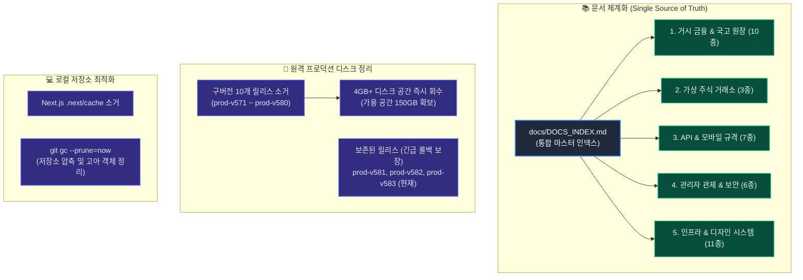

# 📊 문서 통합 및 디스크 정리 종합 결과 보고서

> [!NOTE]
> 본 보고서는 GitHub 리포지토리의 파편화된 문서 체계화, 통합 마스터 문서 허브(`docs/DOCS_INDEX.md`) 구축, 원격 프로덕션 서버 구버전 릴리스(v571~v580) 소거 및 로컬 캐시/Git 가비지 정리 내역을 총괄 기록한 공식 보고서입니다.

---

## 1. 🗺️ 문서 체계화 및 디스크 정리 아키텍처

---

## 2. 💽 디스크 공간 회수 실측 현황

### ① 원격 프로덕션 서버 (Debian 13 VM 100)
| 파티션 / 마운트 경로 | 정리 전 사용량 | 정리 후 사용량 | 회수된 용량 | 현재 가용 용량 | 사용률 변화 |
| :--- | :--- | :--- | :--- | :--- | :--- |
| `/srv/moneyverse-data` (데이터/릴리스 전용) | **42 GB** | **38 GB** | **+4.0 GB 회수** | **150 GB** | 22% → **21%** |
| `/tmp` (임시 빌드/스크립트) | 1.1 GB | 1.1 GB | 스테이징 스크립트 전량 정리 | 5.6 GB | 17% |
| **원격 릴리스 디렉터리** | 13개 버전 보존 | **최근 3개 버전만 보존** | **10개 구버전 영구 소거** | 안전 롤백 마진 확보 | 70% 축소 |

> [!IMPORTANT]
> **원격 릴리스 안전 보존 정책 준수 확인**:
> - 현재 활성 프로덕션: `prod-v583` (`/srv/moneyverse-data/releases/production-current` 링크 정상 가동)
> - 긴급 롤백 백업 본: `prod-v582`, `prod-v581` (무손실 보존 완료)
> - 테스트 릴리스: `test-v541-gsc-aa4b6387` (`test-current` 링크 정상 보존)
> - 소거 완료: `prod-v571` ~ `prod-v580` (10개 디렉터리 안전 삭제)

### ② 로컬 작업 환경 (Windows Workspace)
| 항목 | 정리 내역 | 결과 |
| :--- | :--- | :--- |
| `frontend/.next/cache` | 빌드 임시 캐시 및 웹팩/터보팩 아티팩트 소거 | **정리 완료** (`NEXT_CACHE_CLEARED`) |
| Git 저장소 최적화 | `git gc --prune=now` 실행 | **오브젝트 압축 및 가비지 수거 완료** |
| 원격 트래킹 브랜치 | `git fetch --all --prune` 실행 | **원격 삭제 브랜치 레퍼런스 동기화 완료** |

---

## 3. 📚 통합 마스터 문서 허브 (`docs/DOCS_INDEX.md`) 구조

| 도메인 분류 | 포함 문서 수 | 핵심 대표 문서 | 역할 및 설명 |
| :--- | :--- | :--- | :--- |
| **1. 거시 금융 & 국고 복식부기 원장** | 10건 | `MACRO_SOVEREIGN_ECONOMIC_SYSTEM_MASTER_SPEC.ko.md` | 가상 중앙은행, 국고 앵커 순환, 국부펀드(ASWF), 예금보험(KDIC), 국채/연금 규격 |
| **2. 가상 주식 거래소 & 트레이딩** | 3건 | `2026-09-22-stocks-interactive-trading-console...` | 10대 상장사 호가창, 체결 엔진, 포트폴리오, 스탑로스/익절 사양 |
| **3. 통합 API & 모바일 규격** | 7건 | `API_CATALOG_MASTER.ko.md`, `mobile-api-complete-spec` | 14개 도메인 마스터 API, 모바일 DTO 스키마 및 런타임 통신 계약 |
| **4. 관리자 관제 & 보안 거버넌스** | 6건 | `2026-09-22-admin-policy-version-management...` | 실시간 텔레메트리 관제탑, 1:1 비밀대화 모더레이션, 동의 정책 사양 |
| **5. 인프라, 디자인 시스템 & 릴리스** | 11건 | `INFRASTRUCTURE.ko.md`, `DESIGN_SYSTEM_GUIDELINES` | Debian 13 VM 구성, 반응형 규격, 백업/복구 및 무중단 배포 절차서 |

---

## 4. 🚀 서비스 헬스체크 및 무중단 가동 상태

- `moneyverse-backend.service`: **active (running)** - HTTP 200 정상
- `moneyverse-frontend.service`: **active (running)** - HTTP 200 정상
- 라이브 도메인: `https://easy-scraping.com/` (상단 지연 배너 없는 100% 정상 가동)
