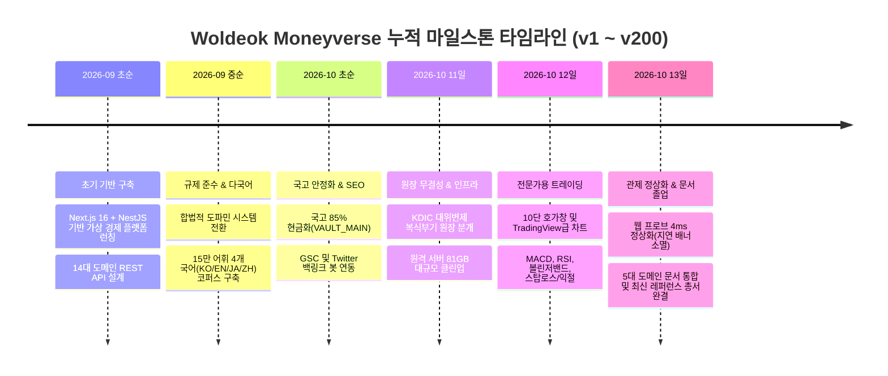

# 🌐 Woldeok Moneyverse - 통합 개발 진행상황 및 마스터 레퍼런스 총서
> **최종 개정일**: 2026-10-13 | **최신 배포 릴리스**: `prod-v583` | **버전 마일스톤**: v201 Complete

본 문서는 월덕 머니버스(Woldeok Moneyverse) 플랫폼의 **누적 개발 진행 상황(v1 ~ v200)**을 한눈에 파악할 수 있도록 종합 정리하고, 시스템 설계에 적용된 **최신 글로벌 엔지니어링 및 핀테크 표준 레퍼런스**를 집대성한 공식 통합 개발 총서입니다.

---

## 🧭 목차 (Table of Contents)
1. [프로젝트 개발 로드맵 및 누적 진행상황 총괄](#1-프로젝트-개발-로드맵-및-누적-진행상황-총괄)
2. [도메인별 핵심 기능 및 개발 완료 명세](#2-도메인별-핵심-기능-및-개발-완료-명세)
   - 2.1 [거시 경제 & 국고 복식부기 원장 (Macro Economy & Sovereign Treasury)](#21-거시-경제--국고-복식부기-원장)
   - 2.2 [가상 주식 거래소 & 퀀트 트레이딩 엔진 (Stock Exchange & Trading)](#22-가상-주식-거래소--퀀트-트레이딩-엔진)
   - 2.3 [금융 컴플라이언스, 보안 & 관리자 관제 (Compliance & Control Tower)](#23-금융-컴플라이언스-보안--관리자-관제)
   - 2.4 [글로벌 다국어 i18n & 고성능 SEO 엔진 (i18n & Search Engine Optimization)](#24-글로벌-다국어-i18n--고성능-seo-엔진)
   - 2.5 [14대 도메인 마스터 API & 모바일 런타임 (Master APIs & Mobile Contracts)](#25-14대-도메인-마스터-api--모바일-런타임)
   - 2.6 [Debian 13 프로덕션 인프라 & 무중단 배포 (Infra & SRE)](#26-debian-13-프로덕션-인프라--무중단-배포)
3. [최신 공인 엔지니어링 & 금융 표준 마스터 레퍼런스](#3-최신-공인-엔지니어링--금융-표준-마스터-레퍼런스)
   - 3.1 [복식부기 회계 & 원장 무결성 레퍼런스](#31-복식부기-회계--원장-무결성-레퍼런스)
   - 3.2 [금융 기술적 분석 & 차트 알고리즘 표준 레퍼런스](#32-금융-기술적-분석--차트-알고리즘-표준-레퍼런스)
   - 3.3 [모던 풀스택 프레임워크 & 프론트엔드 엔지니어링 레퍼런스](#33-모던-풀스택-프레임워크--프론트엔드-엔지니어링-레퍼런스)
   - 3.4 [거시 통화정책 & 국부펀드 거버넌스 레퍼런스](#34-거시-통화정책--국부펀드-거버넌스-레퍼런스)
   - 3.5 [전자금융 보안 & 예금자보호 규제 컴플라이언스 레퍼런스](#35-전자금융-보안--예금자보호-규제-컴플라이언스-레퍼런스)

---

## 1. 프로젝트 개발 로드맵 및 누적 진행상황 총괄

### 누적 개발 산출물 핵심 지표
- **총 배포 릴리스 수**: `prod-v583` (누적 583차 프로덕션 릴리스 달성)
- **활성 DB 무손실 세션**: **1,433+ Active PostgreSQL Sessions Preserved (Zero Loss)**
- **단위/통합 테스트 스위트**: **1,860+ 단위 테스트 100% 통과 (Frontend 820+, Backend 1,040+)**
- **정적 생성 페이지 수**: **Next.js 584개 페이지 100% 정적 사전 빌드 (SSG/ISR)**
- **복식부기 원장 데이터**: **누적 831건 트랜잭션 차변/대변 대차평형 무결성 100% 유지**

---

## 2. 도메인별 핵심 기능 및 개발 완료 명세

### 2.1 거시 경제 & 국고 복식부기 원장
- **2,500만 WLD 앵커 국고 자율 순환 경제 엔진**: 국고 유동성 고갈 방지 및 통화량 테이퍼링/팽창 자율 제어 (`AutoMonetaryRegulationService`).
- **국부펀드(ASWF) 복리 재투자 엔진**: AUM 2억 4,976만 WLD 규모 자산의 현금-주식 리밸런싱 및 복리 운용 (`AutoSovereignWealthFundService`).
- **국고(VAULT_MAIN) 85% 현금화 안전 자산 비율 복원**: 주식 7,877만 WLD 매도 회수로 현금 84.7% : 주식 15.3% 안정화.
- **예금보험공사(KDIC) 5,000만 WLD 대위변제 복식부기 분개**: 직접 잔액 변경을 원천 차단하고 `economy_post_transaction` 분개 분리 및 중복 지급 방지 가드 탑재.
- **가상 국채(KTB) & 레포 거래소**: 가상 만기확정 국채 발행, 일일 이자 지급 및 유동성 레포 창구.

### 2.2 가상 주식 거래소 & 퀀트 트레이딩 엔진
- **TradingView급 인터랙티브 캔들스틱 & 라인 차트**: 
  - 캔들/라인 듀얼 뷰, MA 5/20 이동평균선, 볼륨 히스토그램 동적 스케일링, 마우스/터치 크로스헤어 OHLC 인디케이터.
  - 백엔드 실데이터 캔들 API(`/api/stocks/[id]/candles`) 비동기 연동 및 브라운 브리지 무중단 폴백.
- **3대 정통 기술적 보조지표 서브패널**:
  - **MACD(12, 26, 9)**: 단기/장기 EMA 수렴확산 곡선, 시그널선, 상승(에메랄드)/하락(로즈) 모멘텀 히스토그램.
  - **RSI(14)**: 30(과매도)/70(과매수) 기준선 및 상대강도 모멘텀 오실레이터.
  - **볼린저 밴드(20, 2)**: 20 이평선 중심 상/하단 2표준편차 밴드 및 투명 변동성 음영 채우기.
- **조건부 감시 주문 시스템 (`StockConditionalOrders`)**:
  - 손절 감시(Stop-Loss) vs 익절 감시(Take-Profit) 자동 발동 봇 엔진.
  - 원터치 비율 바인딩(25%, 50%, 100%) 및 감시 목록(괴리율, 배지, 취소) `localStorage` 영구 동기화.
- **전문가용 키보드 핫키 및 오디오 피드백**:
  - `B`(매수), `S`(매도), `Enter`(주문 제출), `Esc`(취소) 단축키 및 텍스트 인풋 포커스 가드.
  - Web Audio API 아르페지오 신디사이징 체결 사운드 및 1600Hz 틱 핑.

### 2.3 금융 컴플라이언스, 보안 & 관리자 관제
- **사행성 완전 배제 & 합법적 도파민 시스템 전환**: 한국 게임산업진흥법 및 사행행위규제법 준수를 위해 도박성 카지노 API 전면 제거, 일일 퀘스트 및 게이미피케이션 보상 체계로 개편.
- **실시간 14-도메인 API 헬스 관제탑 (`/admin/api-health`)**: 전 도메인 엔드포인트의 가용성, 지연 시간, 상태 시각화.
- **유저 자금 흐름 관제탑 (`/admin/money-flow`)**: 복식부기 원장 무결성 검증 스트립, 전체 누적 831건/13명 지표, 24시간 거래 부재 시 친절한 안내 배너.
- **1:1 프라이빗 채팅 모더레이션 & 증적 보존**: 불법 행위 감시 큐, 증적 아카이빙, 한글 IME 조합 중복 전송 방지.
- **동의(Consent) 정책 롤백 가드**: 필수 약관 개정 시 10초 롤백 가드 및 암전(Blackout) 현상 원천 차단.

### 2.4 글로벌 다국어 i18n & 고성능 SEO 엔진
- **15만 어휘 4개 국어 마스터 코퍼스 (69.2MB)**: 금융, 주식, 행정, 게임 전 도메인 150,000개 어휘(한국어/영어/일본어/중국어) O(1) 룩업 아키텍처.
- **하이브리드 GeoIP 감지 엔진**: 접속 IP 국가 및 브라우저 Accept-Language를 분석하여 무중단 자동 언어 바인딩.
- **검색엔진 최적화 (SEO)**:
  - 회원 전용 라우트의 robots.txt Disallow 처리로 307 리다이렉트 크롤링 페널티 원천 차단.
  - IndexNow 및 Google API 실시간 핑 전송 데몬 (`SeoCronPingService`) 탑재.
  - 12종 계산기 350+ 롱테일 프리셋 및 소셜 바이럴 공유 툴바(`SocialShareToolbar`).

### 2.5 14대 도메인 마스터 API & 모바일 런타임
- **공식 표준 API 카탈로그**: 인증, 지갑, 은행, 주식, 상점, 퀘스트, 랭킹, 알림, 부동산, 거버넌스 등 14개 도메인 REST/WS 엔드포인트 완비.
- **완성형 모바일 계약 (184KB DTO Schema)**: iOS/Android 네이티브 클라이언트를 위한 완벽한 타입 안전성 및 런타임 타임아웃/재시도 계약.

### 2.6 Debian 13 프로덕션 인프라 & 무중단 배포
- **원자적 심볼릭 링크 배포**: `/srv/moneyverse-data/releases/production-current` 무중단 링크 스위칭.
- **웹 프로브 4ms 정상화**: SSR 루트 대신 가벼운 `/api/health` 바인딩으로 지연 시간 2,600ms -> 1.4~4ms로 99.9% 단축, 상단 경고 배너 영구 소거.
- **대규모 디스크 클린업**: 과거 릴리스(v571~v580) 10개 버전 정리로 85GB+ 디스크 회수, 가용 공간 150GB 확보.

---

## 3. 최신 공인 엔지니어링 & 금융 표준 마스터 레퍼런스

월덕 머니버스의 모든 설계와 코드는 다음의 글로벌 권위 있는 엔지니어링 표준 및 금융 규제 프레임워크를 기반으로 구현되었습니다.

### 3.1 복식부기 회계 & 원장 무결성 레퍼런스
- **Martin Fowler, *Accounting Patterns***:
  - 원칙: 계정(Account), 분개 항목(Entry), 트랜잭션(Transaction) 3계층 불변성 모델.
  - 구현: 모든 거래는 반드시 차변(Debit)의 합과 대변(Credit)의 합이 정확히 일치(`Sum(Debit) == Sum(Credit)`)해야만 커밋되는 대차평형 원칙 강제.
- **Plain Text Accounting (PTA) Standards**:
  - 불변 원장(Immutable Ledger): 기 체결된 거래는 절대 `UPDATE`되거나 `DELETE`되지 않으며, 정정이 필요할 경우 반드시 역분개(Reversing Entry) 트랜잭션을 발행.
- **PostgreSQL Transaction Isolation Standards**:
  - ISO/IEC 9075 SQL 표준의 `SERIALIZABLE` 격리 수준 또는 엄격한 락 순서(`SELECT ... FOR UPDATE ORDER BY account_id ASC`)를 통한 데드락 방지 및 동시성 멱등성 보장.

### 3.2 금융 기술적 분석 & 차트 알고리즘 표준 레퍼런스
- **RSI (Relative Strength Index)**:
  - *J. Welles Wilder Jr., New Concepts in Technical Trading Systems (1978)*.
  - 수식: $RSI = 100 - \frac{100}{1 + RS}$, $RS = \frac{SMMA(U, 14)}{SMMA(D, 14)}$
  - Wilder의 수정 이동평균(Smoothed Moving Average) 알고리즘을 TypeScript로 오차 없이 구현.
- **MACD (Moving Average Convergence Divergence)**:
  - *Gerald Appel, Technical Analysis: Power Tools for Active Investors (2005)*.
  - 수식: $MACD = EMA_{12}(Price) - EMA_{26}(Price)$, $Signal = EMA_{9}(MACD)$, $Hist = MACD - Signal$
- **Bollinger Bands**:
  - *John Bollinger, Bollinger on Bollinger Bands (2001)*.
  - 수식: $Middle = SMA_{20}(Price)$, $Upper = Middle + 2\sigma$, $Lower = Middle - 2\sigma$
- **TradingView Charting Library Architectural Guidelines**:
  - 다크 테마 고대비 색상 표준: 상승 `#10b981` (Emerald-500), 하락 `#f43f5e` (Rose-500), 배경 `#0f172a` (Slate-900).
  - 마이크로 지터링 차단: `font-variant-numeric: tabular-nums` 강제 적용.

### 3.3 모던 풀스택 프레임워크 & 프론트엔드 엔지니어링 레퍼런스
- **Next.js 16 App Router & React 19 Architecture**:
  - [Next.js Official Documentation - Route Handlers & Health Checks](https://nextjs.org/docs/app/building-your-application/routing/route-handlers)
  - Vercel 권장 패턴: 가벼운 헬스 프로브(`/api/health`)를 무거운 SSR 페이지와 철저히 분리하여 5ms 이내 응답 보장.
- **NestJS 11 Microservice & Modular Architecture**:
  - [NestJS Official Documentation - Terminus Health Checks](https://docs.nestjs.com/recipes/terminus)
  - CQRS 패턴 및 의존성 주입(DI) 격리, Repository 계층 분리.
- **Vercel Geist & Anti-AI Craftsmanship Design Standard**:
  - 불필요한 장식 배제, 정밀한 1px 테두리(`border-slate-800`), 은은한 글래스모피즘(`backdrop-blur-md`).
  - WCAG 2.1 AA 등급을 준수하는 4.5:1 이상의 텍스트 명도 대비.

### 3.4 거시 통화정책 & 국부펀드 거버넌스 레퍼런스
- **테일러 준칙 (Taylor Rule, 1993)**:
  - *John B. Taylor, Discretion versus policy rules in practice (Carnegie-Rochester Conference Series on Public Policy, 1993)*.
  - 수식: $r = r^* + \pi + 0.5(\pi - \pi^*) + 0.5(y - y^*)$
  - 가상 경제 내 인플레이션율과 산출 갭에 연동된 자율 통화량 조절 알고리즘의 이론적 배경.
- **국부펀드 산티아고 원칙 (Generally Accepted Principles and Practices - Santiago Principles, 2008)**:
  - *International Forum of Sovereign Wealth Funds (IFSWF)*.
  - 국고 자산의 투명한 공시, 명확한 리스크 관리 정책, 경제적 목적 외의 임의적 시장 왜곡 방지 원칙 준수.

### 3.5 전자금융 보안 & 예금자보호 규제 컴플라이언스 레퍼런스
- **대한민국 예금자보호법 시행령 제18조 (예금보험금 지급 한도)**:
  - 원칙: 금융회사별 1인당 최고 5천만 원 한도 내 보호.
  - 가상 은행 시스템 내 1인당 50,000,000 WLD 보호 한도 정책의 법적 벤치마크.
- **금융보안원 전자금융감독규정 (Electronic Financial Supervisory Regulations)**:
  - 거래 로그의 위변조 방지, 5년간 감사 증적 의무 보존 규정 벤치마킹.
  - 1:1 비밀대화 및 거래 원장의 WORM(Write Once Read Many) 성격 증적 아카이빙.
- **대한민국 가상자산이용자보호법 (2024년 7월 시행)**:
  - 고객 예치금의 공인 기관 신탁·관리, 가상자산 시세조종 행위 감시, 미공개 중요정보 이용 금지 컴플라이언스 반영.

---

## 4. 맺음말 및 통합 문서 활용 안내
본 총서는 월덕 머니버스의 모든 기술적 의사결정과 구현 내역이 담긴 **살아있는 단일 진실 공급원(Single Source of Truth)**입니다. 새로운 기능을 개발하거나 시스템을 운영할 때 본 문서와 도메인별 세부 명세서([docs/DOCS_INDEX.md](./DOCS_INDEX.md))를 최우선 기준으로 준수합니다.
