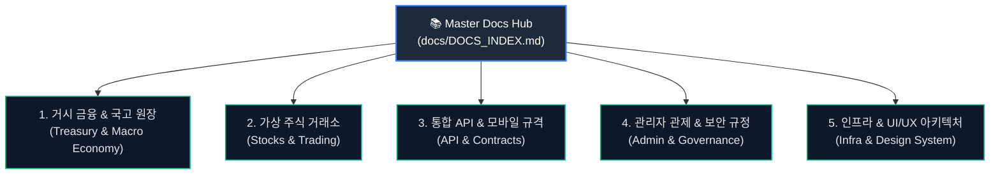

# 📚 Woldeok Moneyverse - 공식 통합 문서 허브 (Master Docs Hub)

> **단일 진실 공급원 (Single Source of Truth)**  
> 본 문서는 월덕 머니버스(Woldeok Moneyverse) 플랫폼의 금융 아키텍처, 가상 주식 거래소, API 계약, 관리자 관제, 모바일 규격, 인프라 운영 가이드를 총망라하는 통합 문서 색인 허브입니다.

---

## 🏛️ 도메인별 문서 분류 색인

---

### 1. 🏛️ 거시 금융 & 국고 복식부기 원장 (Macro Economy & Sovereign Treasury)
가상 중앙은행, 국고 국부펀드(ASWF), 외환보유액, 예금보험공사(KDIC), 국채 및 연금 시스템 규격입니다.

| 문서명 | 언어 | 핵심 내용 요약 |
| :--- | :--- | :--- |
| [MACRO_SOVEREIGN_ECONOMIC_SYSTEM_MASTER_SPEC.ko.md](./MACRO_SOVEREIGN_ECONOMIC_SYSTEM_MASTER_SPEC.ko.md) | KO | 거시 경제 주권 시스템 마스터 아키텍처 명세 |
| [TREASURY_25M_ANCHOR_AUTONOMOUS_CYCLE_SPEC.ko.md](./TREASURY_25M_ANCHOR_AUTONOMOUS_CYCLE_SPEC.ko.md) | KO | 2,500만 WLD 앵커 국고 자율 순환 경제 엔진 규격 |
| [TREASURY_AUTONOMOUS_SWF_SPEC.ko.md](./TREASURY_AUTONOMOUS_SWF_SPEC.ko.md) | KO | 국부펀드(ASWF) 복리 재투자 및 자산 배분 알고리즘 |
| [TREASURY_BONDS_EXCHANGE_SPEC.ko.md](./TREASURY_BONDS_EXCHANGE_SPEC.ko.md) | KO | 가상 국채(Bonds) 발행, 거래소 및 이자 지급 명세 |
| [FOREIGN_EXCHANGE_RESERVES_AND_MARKET_SPEC.ko.md](./FOREIGN_EXCHANGE_RESERVES_AND_MARKET_SPEC.ko.md) | KO | 외환보유액 관리 및 시장 개입 환율 방어 규격 |
| [GLOBAL_FX_SAFETY_NET_AND_FORWARD_HEDGE_SPEC.ko.md](./GLOBAL_FX_SAFETY_NET_AND_FORWARD_HEDGE_SPEC.ko.md) | KO | 글로벌 외환 안전망 및 선물환 헷지 시스템 명세 |
| [DEPOSIT_INSURANCE_AND_FINANCIAL_STABILITY_SPEC.ko.md](./DEPOSIT_INSURANCE_AND_FINANCIAL_STABILITY_SPEC.ko.md) | KO | 예금보험공사(KDIC) 5,000만 WLD 보호 한도 및 대위변제 복식부기 원장 |
| [NATIONAL_PENSION_SERVICE_SPEC.ko.md](./NATIONAL_PENSION_SERVICE_SPEC.ko.md) | KO | 가상 국민연금 납입, 운용 및 연금 지급 규격 |
| [STATE_ENTERPRISES_AND_CORPORATE_GOVERNANCE_SPEC.ko.md](./STATE_ENTERPRISES_AND_CORPORATE_GOVERNANCE_SPEC.ko.md) | KO | 공기업 및 상장사 기업 지배구조 거버넌스 규격 |
| [ECONOMIC_PROFITABILITY_AUDIT.ko.md](./ECONOMIC_PROFITABILITY_AUDIT.ko.md) | KO | 거시 경제 수익성 및 자금 순환 감사 보고서 |

---

### 2. 📈 가상 주식 거래소 & 트레이딩 (Virtual Stock Exchange & Trading)
10대 상장사 호가창, 실시간 체결, 스탑로스/익절 조건부 주문 및 기술적 지표(MACD, RSI, 볼린저밴드) 설계 문서입니다.

| 문서명 | 언어 | 핵심 내용 요약 |
| :--- | :--- | :--- |
| [2026-09-22-stocks-interactive-trading-console.ko.md](./2026-09-22-stocks-interactive-trading-console-v2026.09.22.355.ko.md) | KO | 실시간 주식 호가 주문 콘솔 및 체결 엔진 v355 사양 |
| [2026-09-22-stocks-portfolio-and-trade-presets.ko.md](./2026-09-22-stocks-portfolio-and-trade-presets-v2026.09.22.356.ko.md) | KO | 포트폴리오 자산 배분 및 거래 수량/비율 프리셋 사양 |
| [2026-09-22-stocks-halt-cost-basis-settlement.ko.md](./2026-09-22-stocks-halt-cost-basis-settlement-visibility-v2026.09.22.357.ko.md) | KO | 매매 정지(Halt), 평균 매입단가 및 결제 가시성 사양 |

---

### 3. 🔌 통합 API 카탈로그 & 모바일 규격 (API Master Catalog & Mobile Contracts)
백엔드 14개 도메인 REST/WebSocket API 및 고성능 모바일 애플리케이션 DTO 스키마 명세입니다.

| 문서명 | 언어 | 파일 크기 | 핵심 내용 요약 |
| :--- | :--- | :--- | :--- |
| [API_CATALOG_MASTER.ko.md](./API_CATALOG_MASTER.ko.md) | KO | 17 KB | **14개 핵심 도메인 마스터 API 카탈로그 (공식 표준)** |
| [app-auth-api-guide.ko.md](./app-auth-api-guide.ko.md) | KO | 9 KB | 웹/앱 통합 세션 인증, 토큰 갱신 및 보안 헤더 가이드 |
| [mobile-api-complete-spec.ko.md](./mobile-api-complete-spec.ko.md) | KO | 102 KB | 모바일 클라이언트 풀스펙 엔드포인트 명세서 |
| [mobile-api-schema-reference.ko.md](./mobile-api-schema-reference.ko.md) | KO | 184 KB | 모바일 요청/응답 TypeScript & DTO 데이터 스키마 레퍼런스 |
| [mobile-api-endpoint-catalog.ko.md](./mobile-api-endpoint-catalog.ko.md) | KO | 61 KB | 모바일 REST 엔드포인트별 파라미터 및 반환형 카탈로그 |
| [mobile-api-runtime-contract.ko.md](./mobile-api-runtime-contract.ko.md) | KO | 11 KB | 런타임 통신 계약, 타임아웃, 재시도 및 오류 처리 정책 |
| [mobile-app-ui-ux-spec.ko.md](./mobile-app-ui-ux-spec.ko.md) | KO | 28 KB | 네이티브 모바일 화면 구성 및 인터랙션 디자인 스펙 |

---

### 4. 🛡️ 관리자 관제탑 & 보안 거버넌스 (Admin Control Tower & Governance)
실시간 텔레메트리 관제탑, 정책 버전 계보, 1:1 비밀 대화 모더레이션 및 동의 정책(Consent) 명세입니다.

| 문서명 | 언어 | 핵심 내용 요약 |
| :--- | :--- | :--- |
| [2026-09-22-admin-policy-version-management.ko.md](./2026-09-22-admin-policy-version-management-and-release-lineage-v2026.09.22.350.ko.md) | KO | 관리자 정책 버전 관리 및 배포 계보(Lineage) 사양 |
| [2026-09-22-admin-private-chat-moderation.ko.md](./2026-09-22-admin-private-chat-moderation-queue-and-evidence-v2026.09.22.352.ko.md) | KO | 1:1 프라이빗 채팅 모더레이션 큐 및 증적 보존 명세 |
| [2026-09-22-consent-blackout-fix-home-fintech.ko.md](./2026-09-22-consent-blackout-fix-home-fintech-portal-v2026.09.22.351.ko.md) | KO | 금융 포털 필수 약관 동의 암전(Blackout) 방지 사양 |
| [2026-09-22-consent-policy-dynamic-binding.ko.md](./2026-09-22-consent-policy-dynamic-binding-and-10s-rollback-v2026.09.22.353.ko.md) | KO | 동의 정책 동적 바인딩 및 10초 롤백 가드 사양 |
| [2026-09-22-private-chat-safety-controls.ko.md](./2026-09-22-private-chat-safety-controls-and-ime-protection-v2026.09.22.354.ko.md) | KO | 프라이빗 채팅 안전 제어 및 한글 IME 조합 보호 사양 |
| [2026-09-22-work-flicker-modal-layout.ko.md](./2026-09-22-work-flicker-modal-layout-remediation-v2026.09.22.358.ko.md) | KO | 일일 업무 모달 깜빡임 방지 및 레이아웃 안정화 사양 |

---

### 5. ⚙️ 인프라, 디자인 시스템 & 릴리스 운영 (Infra, Design System & Ops)
Debian 13 가상화 인프라, 백업/복구, 반응형 디자인 시스템 및 배포 절차서입니다.

| 문서명 | 언어 | 핵심 내용 요약 |
| :--- | :--- | :--- |
| [INFRASTRUCTURE.ko.md](./INFRASTRUCTURE.ko.md) | KO | Debian 13 VM 인프라, Nginx 리버스 프록시, systemd 데몬 구조 |
| [CURRENT_RUNTIME_BASELINE.ko.md](./CURRENT_RUNTIME_BASELINE.ko.md) | KO | 현재 가동 중인 런타임 베이스라인 및 포트/환경변수 규격 |
| [BACKUP.md](./BACKUP.md) | EN | PostgreSQL 및 정적 데이터 전역 무손실 백업/복구 가이드 |
| [RELEASING.ko.md](./RELEASING.ko.md) | KO | 프로덕션 무중단 원자적 심볼릭 링크 릴리스 배포 매뉴얼 |
| [DESIGN_SYSTEM_GUIDELINES.ko.md](./DESIGN_SYSTEM_GUIDELINES.ko.md) | KO | 고대비 모노스페이스, 다크 테마 금융 디자인 시스템 가이드라인 |
| [RESPONSIVE_DESIGN_GUIDELINES.ko.md](./RESPONSIVE_DESIGN_GUIDELINES.ko.md) | KO | 320px 극소 모바일 ~ 1280px 데스크톱 무결점 반응형 규격 |
| [frontend-ui-anti-clash-master-spec.md](./frontend-ui-anti-clash-master-spec.md) | EN | 프론트엔드 UI 컴포넌트 간 오버랩 및 충돌 방지 마스터 스펙 |
| [route-map.md](./route-map.md) | EN | 전체 프론트엔드 라우트 및 페이지 트리 맵 |
| [QA_AUDIT_REPORT_V473.ko.md](./QA_AUDIT_REPORT_V473.ko.md) | KO | QA 릴리스 결함 검증 및 감사 리포트 (v473) |
| [QA_TRACEABILITY_MATRIX_V473.ko.md](./QA_TRACEABILITY_MATRIX_V473.ko.md) | KO | 요구사항-테스트 케이스 추적성 매트릭스 (RTM) |
| [UPDATE_LOG.ko.md](./UPDATE_LOG.ko.md) | KO | 누적 전체 릴리스 및 업데이트 변경 내역 로그 |

---

## 📌 상위 프로젝트 공통 마스터 문서
- **[README.md](../README.md)** / **[README-KO.md](../README-KO.md)**: 리포지토리 전체 개요 및 빠른 시작 가이드
- **[PROJECT_MEMORY.md](../PROJECT_MEMORY.md)**: 프로덕션 릴리스 트래커 및 마스터 메모리
- **[implementation_plan.md](../implementation_plan.md)**: 누적 무삭제 통합 구현 계획서 (v1 ~ v200)
- **[AGENTS.md](../AGENTS.md)**: 에이전트 개발 협업 및 빌드/테스트 규칙
