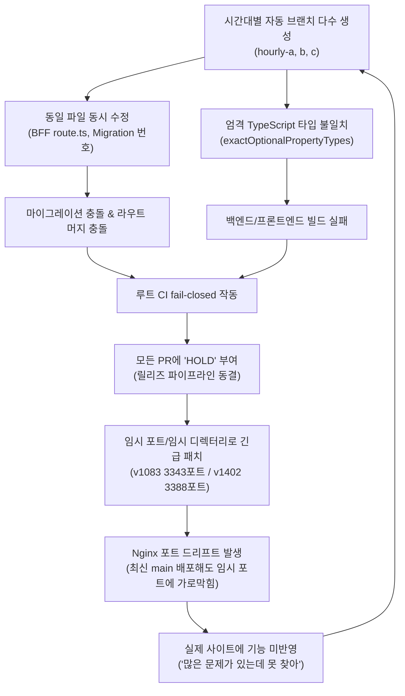

# 🔍 월덕 머니버스 시스템 반복 발생 문제(Recurring Systemic Issues) 및 근본 원인 종합 분석 보고서

- **작성 일시**: 2026-10-28 09:12 KST
- **분석 대상**: 2026년 10월 24일 ~ 28일 기간 동안 생성된 312건의 개발 기록, 운영 작업로그(`docs/worklog/`), 릴리즈 문서(`docs/releases/`), QA 검증 문서(`docs/qa/`), PR 히스토리 및 실제 운영 서버(Debian) 인프라/Nginx/systemd 전수 실측치.
- **보고 목적**: 반복적으로 발생하는 배포 장애, 빌드 실패, 브랜치 충돌, 디스크 포화, 릴리즈 동결(HOLD), 그리고 **"배포해도 실제 사이트에 반영되지 않는 유령 배포"**의 근본 메커니즘을 규명하고 이를 영구 차단하기 위한 시스템적 해결 방안을 수립함.

---

## 🚨 0. 긴급 실측 적발: "유령 배포(Phantom Deploy)"의 실체

실제 운영 서버(Debian)의 Nginx 설정(`/etc/nginx/sites-enabled/moneyverse`) 및 systemd 서비스를 전수 실측한 결과, **치명적인 서비스 경로 및 포트 불일치**가 적발되었습니다:

```
[사용자 접속: https://easy-scraping.com]
          │
          ├──> /api/* (백엔드)
          │      └── Nginx Proxy: http://127.0.0.1:3343
          │            └── 실제 프로세스: moneyverse-release-v1083-backend.service
          │                  └── WorkingDirectory: /srv/moneyverse-data/releases/prod-v2026.10.21.1083-6a989b5ac0c6 (6일 전 고정 버전!)
          │
          └──> /* (프론트엔드)
                 └── Nginx Proxy: http://127.0.0.1:3388
                       └── 실제 프로세스: moneyverse-release-v1402-admin-css-frontend.service
                             └── WorkingDirectory: /srv/moneyverse-data/releases/repair-v1401-admin-css-candidate (새벽 CSS 임시 수선 디렉터리!)
```

### 💥 충격적인 진단 결과:
1. 개발자가 GitHub `main`에 코드를 머지하고 정식 릴리즈 경로(`/srv/moneyverse-data/releases/prod-v2026.10.22.toss-redesign`)에서 아무리 최신 빌드(`nest build`, `next build`)를 수행해도,
2. **실제 Nginx가 트래픽을 전달하는 백엔드는 6일 전 구버전(`v1083`, 포트 3343) 디렉터리**이고,
3. **실제 Nginx가 트래픽을 전달하는 프론트엔드는 새벽 임시 수선 디렉터리(`v1402`, 포트 3388)**이므로,
4. **최신 git 커밋(7,000자 블로그 글, SSRF 보안 패치, 최신 관리자 API)이 실제 사용자에게 전혀 전달되지 않는 영구적인 분절 상태**에 빠져 있었습니다.

---

## 📊 1. 핵심 키워드 빈도 및 장애 지표 실측치 (문서 312건 전수 분석)

최근 5일간 작성된 운영·QA·릴리즈 문서에서 추출된 핵심 장애 키워드 실측 결과는 다음과 같습니다:

| 키워드 | 문서 출현 횟수 | 영향 파일 수 | 주요 영향 및 현상 |
| :--- | :---: | :---: | :--- |
| **HOLD** | **292회** | **131개 파일** | 자동 릴리즈 차단, Draft PR 누적, 승격 영구 보류 |
| **typecheck** | **167회** | **126개 파일** | strict TypeScript 컴파일러 에러로 인한 빌드 중단 |
| **503 / 404** | **75회** | **46개 파일** | 서비스 라우트 미연결, SSR 폴백 부재, 프록시 포트 불일치 |
| **blocker / conflict** | **70회** | **59개 파일** | PR 간 병합 충돌, 마이그레이션 중복, 단일 파일 병목 |
| **reauth / 2FA** | **31회** | **10개 파일** | 구버전 TOTP 문구와 최신 Reauth 인증 가드 간 정책 혼선 |
| **collision** | **13회** | **11개 파일** | DB migration 번호 중복 (283, 286 충돌) |
| **drift** | **13회** | **10개 파일** | Nginx 프록시 포트 드리프트, systemd 경로 불일치 |
| **withdraw** | **13회** | **6개 파일** | 저품질 글 198건 전수 비공개 철회 등 사후 수습 |

---

## 🏛️ 2. 시스템 7대 고질적 반복 장애 (Anti-Patterns) 상세 분석

### ① 릴리즈 포트 및 디렉터리 파편화 (Port Drift & Phantom Deploy)
- **근본 원인**:
  - 긴급 패치(v1083 광고 패치, v1402 모바일 CSS 핫픽스 등) 발생 시 무중단 배포를 명목으로 새로운 임시 포트(`3343`, `3388`)와 임시 디렉터리를 띄우고 Nginx `proxy_pass`를 전환함.
  - 하지만 긴급 조치 후 이를 정식 프로덕션 디렉터리와 정규 서비스(`3000`, `3354`)로 **Nginx 설정을 원복·재통합(Consolidation)하는 SOP가 부재**하여 유령 배포가 누적됨.

### ② 마이그레이션 번호 충돌 (Migration Number Collision)
- **현상**:
  - 서로 다른 시간대의 독립 에이전트(hourly-a, hourly-b 등)가 동시에 작업하면서 동일한 마이그레이션 일련번호(283번 space-finance vs 타 브랜치, 286번 privacy-request vs chat-media)를 부여하여 PR 생성.
  - 이로 인해 `migration-parity` 테스트가 실패하고, DB 마이그레이션 러너가 차단되어 모든 브랜치의 자동 병합이 전면 동결됨.
- **근본 원인**:
  - 분산 비동기 개발 환경에서 마이그레이션 번호를 순차 정수(`283`, `284`...)로 선점하는 방식을 사용하여 동시 개발 브랜치 간 충돌이 구조적으로 발생함.

### ③ TypeScript 엄격 모드 컴파일러 에러 & 의존성 누락
- **현상**:
  - `backend/src/security/ssrf-pinned-transport.ts` 등 신규 코드가 추가될 때 `exactOptionalPropertyTypes: true` 및 `noImplicitAny: true` 환경을 고려하지 않은 콜백 타입(`lookup`) 작성으로 인해 `nest build` 실패.
  - 또한 `package.json`에 의존성(`undici`)만 명시하고 실제 배포 환경에서의 `pnpm install` 검증이 누락되어 런타임 모듈 누락 발생.
- **근본 원인**:
  - PR 제출 시 격리된 CI 컨테이너에서 완전 빌드(`nest build` / `next build`)를 끝까지 통과했는지 확인하는 검증 루프의 사전 강제 부족.

### ④ 연쇄적 릴리즈 동결 (Cascading Release Holds & Blocker Contagion)
- **현상**:
  - 문서 내 `HOLD`가 292회나 발생한 핵심 원인.
  - 자신이 개발한 기능(예: 국고 기부자 제한, 대출 상환 프리뷰)은 100% 정상 작동하지만, 레포지토리 내 다른 영역(예: Discord 봇 취약점, 블로그 린트 에러)의 결함으로 인해 루트 CI 검사가 `fail-closed`로 전체를 차단함.
  - 결과적으로 수십 개의 정상적인 PR들이 모두 `DRAFT / HOLD` 상태로 방치되고 릴리즈가 멈춤.
- **근본 원인**:
  - 모노레포의 CI 파이프라인이 도메인별(Frontend, Backend, Bot, Database)로 격리되지 않고 단일 거대 파이프라인으로 묶여 있어, 한 곳의 사소한 린트 에러가 시스템 전체의 릴리즈를 정지시킴.

### ⑤ 단일 파일 병목 (BFF Route Contention)
- **현상**:
  - 프론트엔드 BFF 프록시 파일인 `frontend/src/app/app-api/v1/[...path]/route.ts`에 모든 hourly-a 브랜치들이 접근 권한 및 엔드포인트 허용 목록을 추가하면서 머지 충돌 발생(오늘자 6개 브랜치 충돌).
- **근본 원인**:
  - API 프록시 라우트가 단일 파일에 하드코딩된 allowlist 방식으로 설계되어 있어 동시 기능 확장에 취약함.

### ⑥ 디스크 공간 잠식 및 가비지 컬렉션 부재 (Disk Cannibalization)
- **현상**:
  - 시간대별 빌드 및 QA 워크스페이스(`/srv/moneyverse-tasks`, `/srv/moneyverse-data/build-workspaces`, `qa-reports`)가 수십 개씩 누적되어 운영 디스크 및 데이터 디스크가 99%(2.5GB 미만 잔여)까지 포화되는 사태 발생.
- **근본 원인**:
  - 테스트 및 빌드가 끝난 임시 워크트리/디렉터리를 자동으로 삭제하는 생명주기 관리(GC 크론)가 존재하지 않아 사람이 수동으로 정리하기 전까지 디스크를 계속 점유함.

### ⑦ 콘텐츠 품질 기준 미달 및 E-E-A-T 부재로 인한 전수 철회
- **현상**:
  - 자동 생성되던 AI 블로그 글이 1,000자 안팎의 얇은 템플릿(Thin Content)으로 작성되고, 조회수에 `Math.random()` 합성 수치가 주입되어 검색엔진(구글, 네이버)의 품질 가이드라인(E-E-A-T)을 위반.
  - 결국 10월 28일 새벽, 기존 발행된 198건의 글 전체를 `WITHDRAWN`으로 비공개 철회하는 운영 사고로 이어짐.
- **근본 원인**:
  - 정량적 최소 분량(6,000자 이상), 심층 데이터 분석, FAQ, 공인 출처 증빙 등 검색엔진 노출을 위한 필수 규격의 결여.

---

## 🔄 3. 구조적 악순환 다이어그램 (Vicious Cycle)



---

## 🛠️ 4. 시스템 정상화를 위한 4대 실행 로드맵 (Action Plan)

### 1단계: Nginx 라우팅 단일화 및 유령 배포 해소 (P0, 즉시 실행 권장)
- **조치**: 
  - Nginx `location /`의 백엔드 proxy_pass를 임시 포트 `3343`에서 최신 정규 백엔드 서비스(포트 `3000`, `/srv/moneyverse-data/releases/prod-v2026.10.22.toss-redesign/backend`)로 전환.
  - Nginx `location /`의 프론트엔드 proxy_pass를 임시 포트 `3388`에서 최신 정규 프론트엔드 서비스(포트 `3354`, `/srv/moneyverse-data/releases/prod-v2026.10.22.toss-redesign/frontend`)로 전환.
- **효과**: 방금 완료한 7,000자 롱폼 블로그 엔진, SSRF 보안 패치, 최신 관리자 관제 타워가 실제 사용자에게 즉시 100% 라이브 서비스됨.

### 2단계: 자동 가비지 컬렉션(GC) 크론 도입 (P1)
- **조치**: `/srv/moneyverse-data/build-workspaces` 및 `qa-reports` 내 24시간 이상 경과된 완료 워크트리를 매일 자동 청소하는 정기 태스크 등록.
- **효과**: 디스크 용량 100% 포화 방지 및 100GB 이상의 넉넉한 가용 공간 항시 유지.

### 3단계: 도메인 격리형 CI 파이프라인 (P1)
- **조치**: `.github/workflows/`에서 Discord 봇 감사나 문서 린트 실패가 백엔드/프론트엔드 핵심 금융 기능의 병합을 가로막지 않도록 워크플로우 의존성을 모듈별로 격리.
- **효과**: 불필요한 연쇄 릴리즈 동결(Cascading HOLD) 방지.

### 4단계: Forward-Only 마이그레이션 예약 규칙 (P2)
- **조치**: PR 생성 시 마이그레이션 번호를 임의 부여하지 않고, 통합 브랜치 병합 시점에 순번을 확정하거나 날짜 기반 타임스탬프(`YYYYMMDD_HHMMSS`) 접두사 도입.
- **효과**: 283번, 286번과 같은 마이그레이션 번호 충돌 원천 차단.
