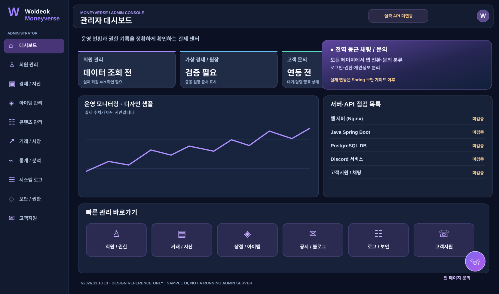
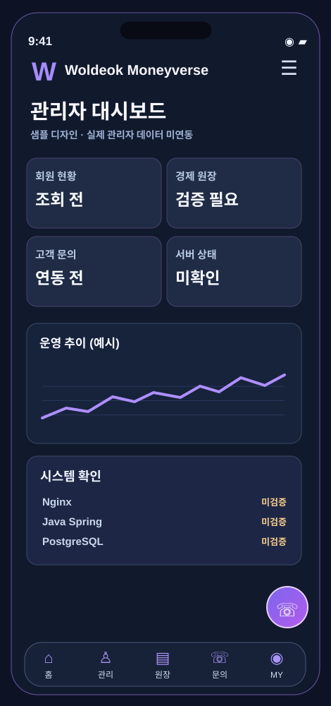

# Admin Console + Global Floating Chat — Visuals and Interactive Preview

Version: `v2026.11.18.13` | Status: ISOLATED DEMO ONLY | User locale: Korean design review; planned app defaults: English and Korean.

The existing frontend was **not edited**. Do not deploy the preview as a production admin route. It contains **no real member data**, network API calls, credentials, persistent chat records, or working message submission.

> **Recovered implementation handoff (v2026.11.19.31):** [English](../UI_IMAGE_IMPLEMENTATION_HANDOFF_v2026.11.19.31.md) · [한국어](../UI_IMAGE_IMPLEMENTATION_HANDOFF_v2026.11.19.31.ko.md). Originally unmerged PR #3270; no Spring admin/chat integration is implied.

## Administrator reference concepts

- [Desktop administrator console and global chat concept](references/admin-console-desktop.svg)

- [Mobile administrator console and global round chat launcher concept](references/admin-console-mobile.svg)

- [English specification](../../planning/ADMIN_GLOBAL_CHAT_DESIGN_v2026.11.18.13.md) / [한국어 기획](../../planning/ADMIN_GLOBAL_CHAT_DESIGN_v2026.11.18.13.ko.md)

## Interactive preview

- [Open the prototype HTML](preview/index.html) with an ordinary static HTTP server (direct `file://` may block ES modules).
- On the mini-PC worktree: `python3 -m http.server 18943 --bind 127.0.0.1 --directory docs/design/admin-chat-v2026.11.18.13/preview` (test preview only, do not publish).
- Open `http://127.0.0.1:18943/`. Click the floating circular 문의 icon and switch the customer-support / 1:1 chat tabs; navigate between Administrator, Wallet, Quests, Board and Support. In-progress drafts persist **in memory** between those simulated page switches.
- Click `로그인 상태: 시뮬레이션` in the preview sidebar to test guest state; this is **not an actual login**. No user content is written to browser storage or sent to any server.
- Use `node --test docs/design/admin-chat-v2026.11.18.13/preview/*.test.mjs` for deterministic behavior and safe-preview checks.

## Implementation and QA boundary

Existing deployed `FloatingSupportChatWidget` already supports ticket and DM flows but is suppressed for /admin routes. Do not simply remove that guard. The Java Spring support/chat endpoints currently accept spoofable user identity headers and some failure paths return `success:true`. Production integration is blocked pending security fixes, authenticated negative tests and explicit release review.

**Design screenshot ≠ live system state.** Test/Production frontend, database and Spring services were not changed.
