# G1 "길드 원장" 게임풍 리디자인 — 후보안 (180개 경로)

**상태: 소유자 승인 대기 후보안. 현재 공식 디자인 기준이 아닙니다.** 승인 전까지는 [CURRENT_UI_DESIGN.md](../CURRENT_UI_DESIGN.md)(v10)가 그대로 유효합니다. 승인되면 기준 문서·manifest·갤러리를 함께 갱신하고, 그때부터 프론트엔드 구현을 시작합니다.

버전 v2026.11.24.G1 · manifest의 경로마다 1장씩 총 180장, 각 이미지에 PC 화면과 모바일 화면을 함께 담았습니다. [English](README.md)

## 방향
- 콘셉트: 밤의 월덕 야시장을 MMO 길드 홀로. 가장 눈에 띄는 요소는 하나 — 항상 떠 있는 **플레이어 HUD**(실제 파비콘 위 레벨 링 메달, XP 바, 금빛 WLD 카운터). 나머지는 모서리를 깎은 아이템 프레임 패널로 차분하게.
- 색(토큰): 밤 `#120E26`, 자두 `#1C1638`, 로열 바이올렛 `#8B6CFF`(행동), 코인 골드 `#F2B84B`(재화·희귀도), 민트 `#4BE3A4`(상승), 엠버 `#FF5D73`(하락·위험·GM). 희귀도 색(일반/희귀/영웅/전설)은 아이템 등급과 종목 위험도에만 사용.
- 서체: Black Han Sans(제목), Noto Sans KR(본문), Orbitron(수치).
- 모바일: 로고 + 축소 HUD, 장면 히어로, 가운데 퀘스트 버튼이 솟은 5탭 도크.
- 화면 원형 15종(계산기·용어 46, GM 콘솔 40, 거래소 14, 광장 12, 문서 12, 캐릭터 시트 9, 퀘스트·시즌 8, 은행 금고 8, 글 상세 7, 지갑·인벤토리 7, 길드 문(인증) 6, 문의 채팅 5, 상점 4, 길드 홀 1, 서버 상태 1). 경로마다 제목·장면·패널 구성이 다릅니다.

## 제작 방법(사용한 스킬)
- `ui-ux-pro-max`: 디자인 시스템·게임 스타일 검색(골드+바이올렛 팔레트, HUD 수치용 Orbitron).
- `frontend-design`: 2단계 계획과 자기 검토 — 첫 안(네온 시안 사이버펑크)은 흔한 기본값이라 폐기하고 야시장 방향으로 교체.
- `hallmark`: 바닥 규칙을 `sloplint`로 검사 — **180개 전 페이지 FAIL 0 / REFLEX 0 / WARN 0**(토큰 색만 사용, 4px 간격, eyebrow·가운뎃점 메타 없음, 장식 점 없음, 카드 안 카드 없음, 포커스 표시, 대비).
- 생성기: [`scripts/design/game-ui-g1/`](../../../scripts/design/game-ui-g1/)

## 정직성 경계
이미지 속 수치는 예시이며 모든 이미지에 예시 데이터임을 표기했습니다. 이미지는 실제 기능 동작의 증거가 아니며, 구현 시 실제 Spring API 값과 기존 인증·원장·관리자 보호를 그대로 따릅니다.

## 대표 화면
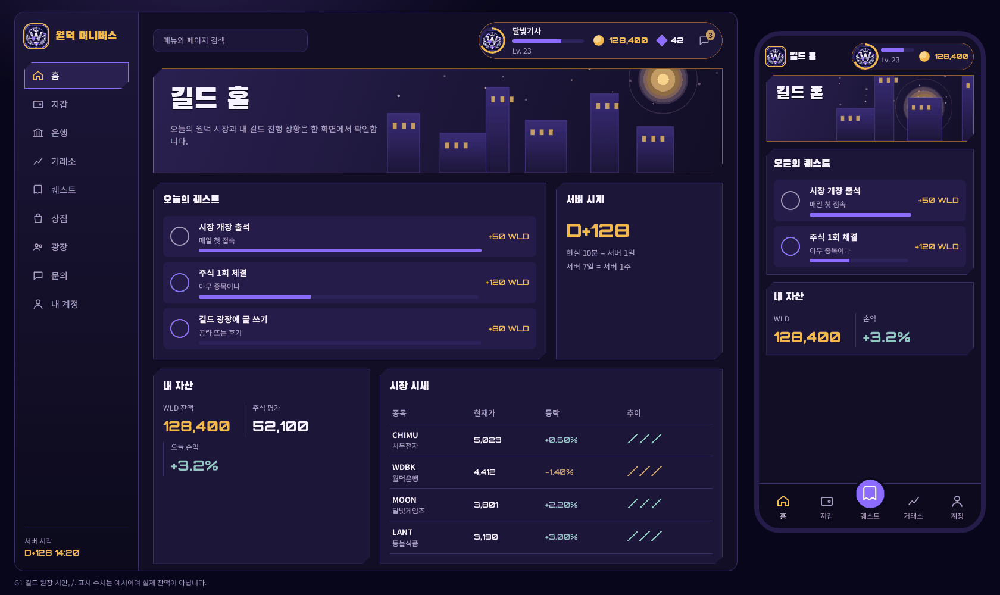
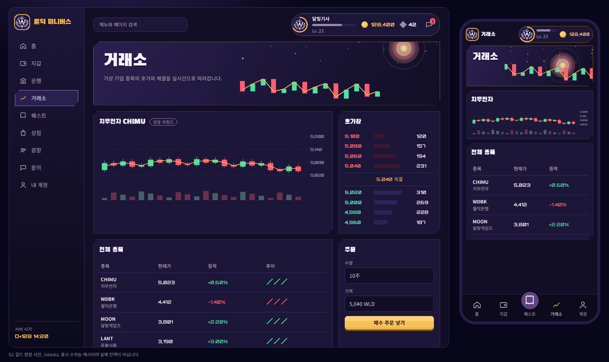
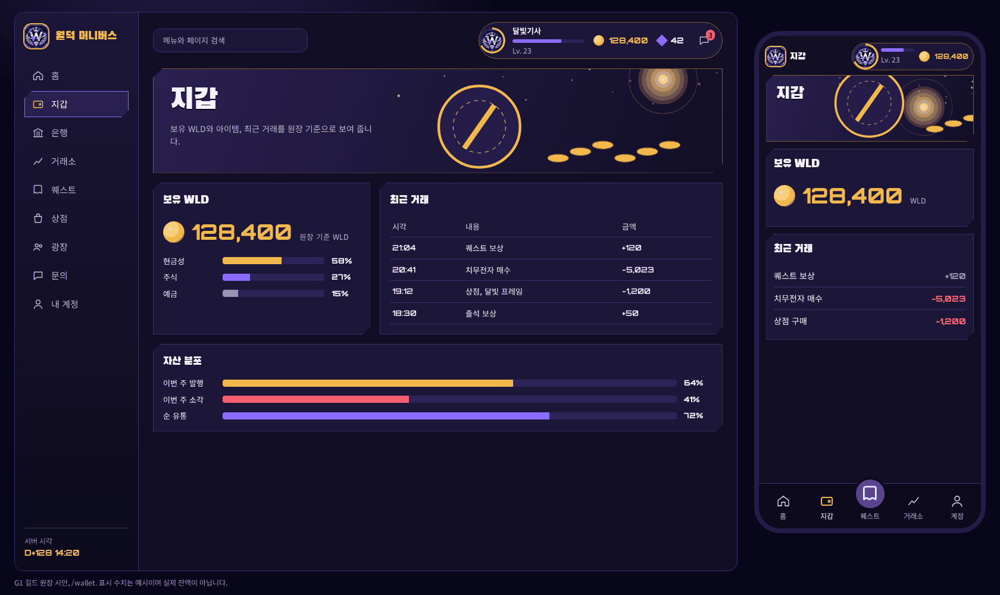
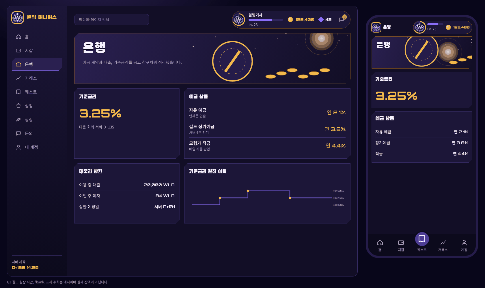
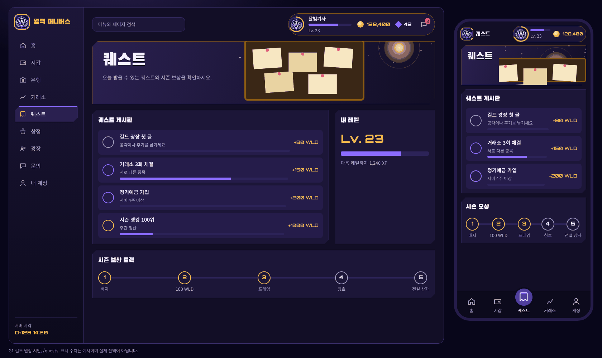
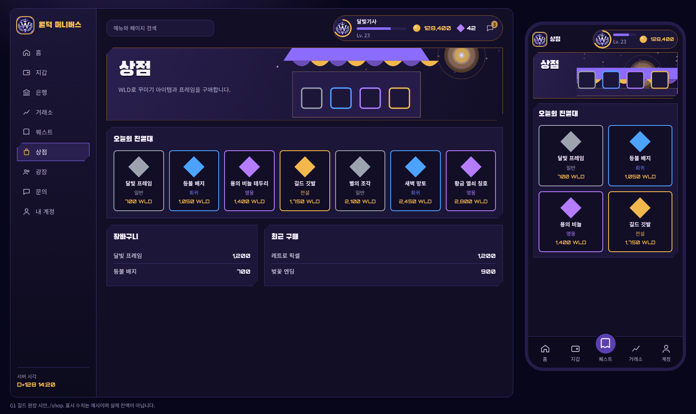
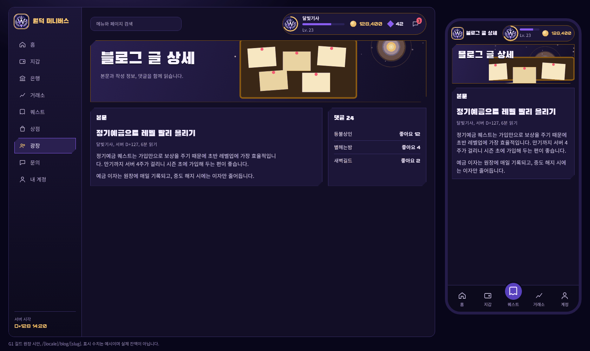
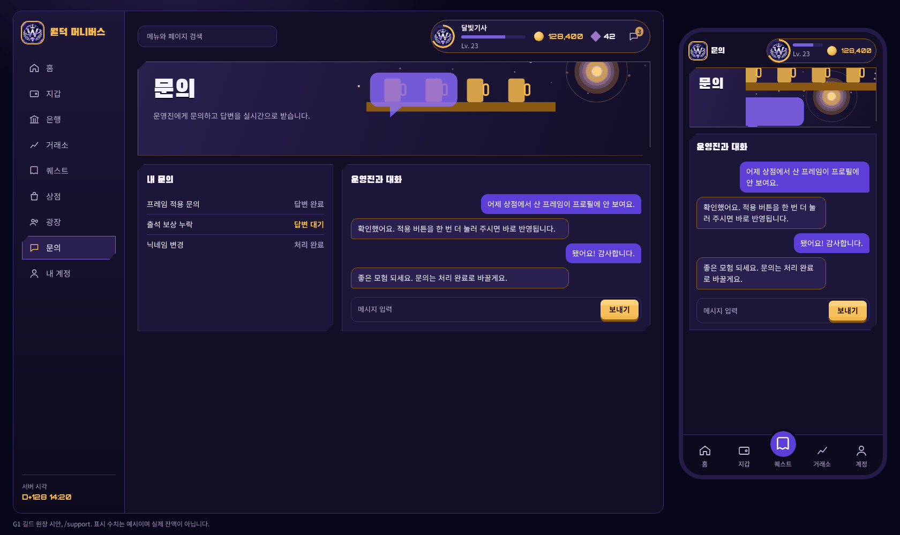
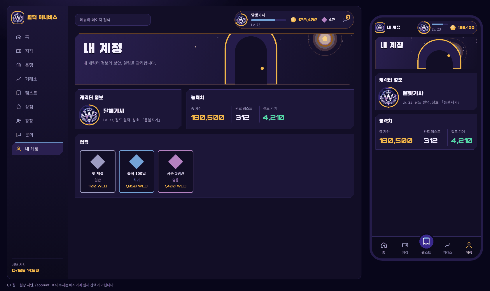
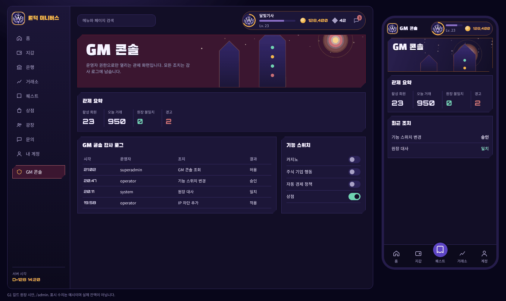
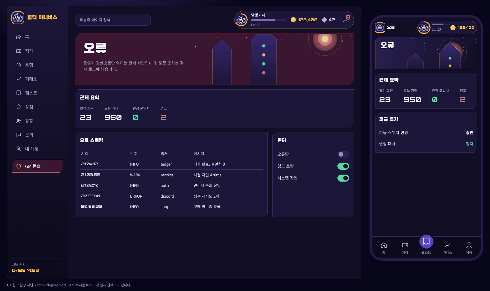
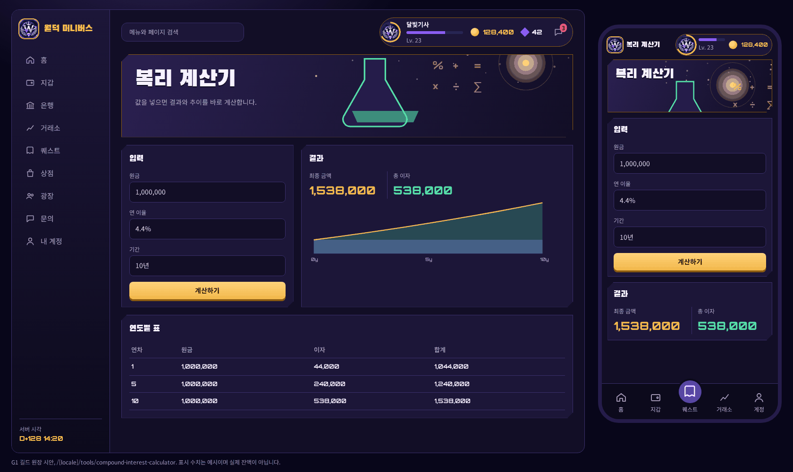
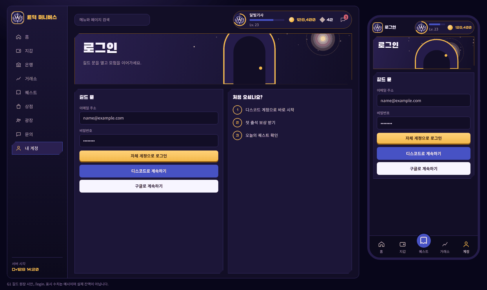

## 전체 180개 경로
| 경로 | 화면 원형 | 이미지 |
| --- | --- | --- |
| `/` | 길드 홀 | [길드 홀](previews/home.png) |
| `/[locale]/blog` | 광장 | [블로그](previews/-locale--blog.png) |
| `/[locale]/blog/[slug]` | 글 상세 | [블로그 글 상세](previews/-locale--blog--slug-.png) |
| `/[locale]/guide/glossary` | 계산기·용어 | [용어 사전](previews/-locale--guide-glossary.png) |
| `/[locale]/guide/glossary/[term]` | 계산기·용어 | [용어 사전 용어 상세](previews/-locale--guide-glossary--term-.png) |
| `/[locale]/tools/compound-interest-calculator` | 계산기·용어 | [복리 계산기](previews/-locale--tools-compound-interest-calculator.png) |
| `/[locale]/tools/compound-interest-calculator/[preset]` | 계산기·용어 | [복리 계산기 프리셋](previews/-locale--tools-compound-interest-calculator--preset-.png) |
| `/account` | 캐릭터 시트 | [내 계정](previews/account.png) |
| `/account-deletion` | 캐릭터 시트 | [계정 삭제](previews/account-deletion.png) |
| `/account/notifications` | 캐릭터 시트 | [알림](previews/account-notifications.png) |
| `/account/privacy` | 캐릭터 시트 | [개인정보](previews/account-privacy.png) |
| `/account/security` | 캐릭터 시트 | [보안](previews/account-security.png) |
| `/admin` | GM 콘솔 | [GM 콘솔](previews/admin.png) |
| `/admin/analytics` | GM 콘솔 | [분석](previews/admin-analytics.png) |
| `/admin/api-health` | GM 콘솔 | [API 상태](previews/admin-api-health.png) |
| `/admin/bank` | GM 콘솔 | [은행](previews/admin-bank.png) |
| `/admin/blog` | GM 콘솔 | [블로그](previews/admin-blog.png) |
| `/admin/bonds` | GM 콘솔 | [국채](previews/admin-bonds.png) |
| `/admin/catalog` | GM 콘솔 | [카탈로그](previews/admin-catalog.png) |
| `/admin/central-bank` | GM 콘솔 | [중앙은행](previews/admin-central-bank.png) |
| `/admin/content` | GM 콘솔 | [콘텐츠](previews/admin-content.png) |
| `/admin/controls` | GM 콘솔 | [기능 스위치](previews/admin-controls.png) |
| `/admin/discord` | GM 콘솔 | [디스코드](previews/admin-discord.png) |
| `/admin/economy` | GM 콘솔 | [경제](previews/admin-economy.png) |
| `/admin/economy/scenario-lab` | GM 콘솔 | [시나리오 실험실](previews/admin-economy-scenario-lab.png) |
| `/admin/enterprises` | GM 콘솔 | [공기업](previews/admin-enterprises.png) |
| `/admin/fx` | GM 콘솔 | [외환시장](previews/admin-fx.png) |
| `/admin/help` | GM 콘솔 | [도움말](previews/admin-help.png) |
| `/admin/kdic` | GM 콘솔 | [예금보험](previews/admin-kdic.png) |
| `/admin/logs` | GM 콘솔 | [로그](previews/admin-logs.png) |
| `/admin/logs/activity` | GM 콘솔 | [활동](previews/admin-logs-activity.png) |
| `/admin/logs/delivery` | GM 콘솔 | [전송](previews/admin-logs-delivery.png) |
| `/admin/logs/errors` | GM 콘솔 | [오류](previews/admin-logs-errors.png) |
| `/admin/logs/integrity` | GM 콘솔 | [무결성](previews/admin-logs-integrity.png) |
| `/admin/logs/system` | GM 콘솔 | [시스템](previews/admin-logs-system.png) |
| `/admin/market` | GM 콘솔 | [시장](previews/admin-market.png) |
| `/admin/market/ai-news` | GM 콘솔 | [AI 뉴스](previews/admin-market-ai-news.png) |
| `/admin/mint` | GM 콘솔 | [조폐국](previews/admin-mint.png) |
| `/admin/money-flow` | GM 콘솔 | [자금 흐름](previews/admin-money-flow.png) |
| `/admin/operations/storage` | GM 콘솔 | [저장소](previews/admin-operations-storage.png) |
| `/admin/pension` | GM 콘솔 | [국민연금](previews/admin-pension.png) |
| `/admin/safety` | GM 콘솔 | [안전](previews/admin-safety.png) |
| `/admin/security` | GM 콘솔 | [보안](previews/admin-security.png) |
| `/admin/seo` | GM 콘솔 | [검색 노출](previews/admin-seo.png) |
| `/admin/seo-audit` | GM 콘솔 | [검색 감사](previews/admin-seo-audit.png) |
| `/admin/shop` | GM 콘솔 | [상점](previews/admin-shop.png) |
| `/admin/support` | GM 콘솔 | [문의](previews/admin-support.png) |
| `/admin/treasury` | GM 콘솔 | [국고](previews/admin-treasury.png) |
| `/admin/treasury/grants` | GM 콘솔 | [grants](previews/admin-treasury-grants.png) |
| `/admin/users` | GM 콘솔 | [회원](previews/admin-users.png) |
| `/admin/users/[id]` | GM 콘솔 | [회원 상세](previews/admin-users--id-.png) |
| `/admin/work` | GM 콘솔 | [직업](previews/admin-work.png) |
| `/advisor` | 문의 채팅 | [덕이 상담소](previews/advisor.png) |
| `/announcements` | 광장 | [공지](previews/announcements.png) |
| `/announcements/[announcementId]` | 글 상세 | [공지 상세](previews/announcements--announcementId-.png) |
| `/arcade` | 퀘스트·시즌 | [아케이드](previews/arcade.png) |
| `/bank` | 은행 금고 | [은행](previews/bank.png) |
| `/bank/savings-pot` | 은행 금고 | [적금 pot](previews/bank-savings-pot.png) |
| `/blog` | 광장 | [블로그](previews/blog.png) |
| `/blog/[slug]` | 글 상세 | [블로그 글 상세](previews/blog--slug-.png) |
| `/board` | 광장 | [광장](previews/board.png) |
| `/board/[postId]` | 글 상세 | [광장 상세](previews/board--postId-.png) |
| `/bonds` | 은행 금고 | [국채](previews/bonds.png) |
| `/businesses` | 거래소 | [사업](previews/businesses.png) |
| `/businesses/ventures` | 거래소 | [ventures](previews/businesses-ventures.png) |
| `/calculators` | 계산기·용어 | [계산기 모음](previews/calculators.png) |
| `/calendar` | 퀘스트·시즌 | [달력](previews/calendar.png) |
| `/casino` | 퀘스트·시즌 | [카지노](previews/casino.png) |
| `/central-bank` | 은행 금고 | [중앙은행](previews/central-bank.png) |
| `/chat` | 문의 채팅 | [채팅](previews/chat.png) |
| `/clubs` | 광장 | [클럽](previews/clubs.png) |
| `/clubs/[clubId]` | 글 상세 | [클럽 상세](previews/clubs--clubId-.png) |
| `/clubs/[clubId]/members` | 글 상세 | [members](previews/clubs--clubId--members.png) |
| `/clubs/new` | 광장 | [새로 만들기](previews/clubs-new.png) |
| `/clubs/warfare` | 광장 | [warfare](previews/clubs-warfare.png) |
| `/collections` | 지갑·인벤토리 | [도감](previews/collections.png) |
| `/dashboard` | 지갑·인벤토리 | [대시보드](previews/dashboard.png) |
| `/data-deletion` | 캐릭터 시트 | [데이터 삭제](previews/data-deletion.png) |
| `/design-preview` | 문서 | [디자인 미리보기](previews/design-preview.png) |
| `/developer` | 문서 | [개발자](previews/developer.png) |
| `/enterprises` | 거래소 | [공기업](previews/enterprises.png) |
| `/features` | 문서 | [기능 안내](previews/features.png) |
| `/forgot-password` | 길드 문(인증) | [비밀번호 찾기](previews/forgot-password.png) |
| `/fx` | 은행 금고 | [외환시장](previews/fx.png) |
| `/gallery` | 광장 | [갤러리](previews/gallery.png) |
| `/gallery/[photoId]` | 글 상세 | [갤러리 상세](previews/gallery--photoId-.png) |
| `/gallery/submit` | 광장 | [submit](previews/gallery-submit.png) |
| `/guide` | 계산기·용어 | [가이드](previews/guide.png) |
| `/guide/career-mastery` | 계산기·용어 | [career mastery](previews/guide-career-mastery.png) |
| `/guide/dopamine-system` | 계산기·용어 | [dopamine system](previews/guide-dopamine-system.png) |
| `/guide/glossary` | 계산기·용어 | [용어 사전](previews/guide-glossary.png) |
| `/guide/glossary/[term]` | 계산기·용어 | [용어 사전 용어 상세](previews/guide-glossary--term-.png) |
| `/guide/stock-trading` | 계산기·용어 | [주식 수익률 trading](previews/guide-stock-trading.png) |
| `/guide/virtual-banking` | 계산기·용어 | [virtual banking](previews/guide-virtual-banking.png) |
| `/help` | 문의 채팅 | [도움말](previews/help.png) |
| `/help/[slug]` | 문의 채팅 | [도움말 글 상세](previews/help--slug-.png) |
| `/inventory` | 지갑·인벤토리 | [인벤토리](previews/inventory.png) |
| `/invite/[code]` | 길드 문(인증) | [초대 상세](previews/invite--code-.png) |
| `/kdic` | 은행 금고 | [예금보험](previews/kdic.png) |
| `/lobby` | 퀘스트·시즌 | [로비](previews/lobby.png) |
| `/login` | 길드 문(인증) | [로그인](previews/login.png) |
| `/login/providers` | 길드 문(인증) | [로그인 방법](previews/login-providers.png) |
| `/marketplace` | 상점 | [장터](previews/marketplace.png) |
| `/marketplace/auction` | 상점 | [auction](previews/marketplace-auction.png) |
| `/mint` | 지갑·인벤토리 | [조폐국](previews/mint.png) |
| `/newspaper` | 광장 | [월덕 신문](previews/newspaper.png) |
| `/pension` | 은행 금고 | [국민연금](previews/pension.png) |
| `/prediction` | 거래소 | [예측 시장](previews/prediction.png) |
| `/privacy` | 문서 | [개인정보](previews/privacy.png) |
| `/profile` | 캐릭터 시트 | [프로필](previews/profile.png) |
| `/profile/[userId]` | 캐릭터 시트 | [프로필 상세](previews/profile--userId-.png) |
| `/profile/settings` | 캐릭터 시트 | [설정](previews/profile-settings.png) |
| `/progression` | 퀘스트·시즌 | [성장](previews/progression.png) |
| `/progression/prestige` | 퀘스트·시즌 | [prestige](previews/progression-prestige.png) |
| `/quests` | 퀘스트·시즌 | [퀘스트](previews/quests.png) |
| `/register` | 길드 문(인증) | [모험가 등록](previews/register.png) |
| `/reset-password` | 길드 문(인증) | [비밀번호 재설정](previews/reset-password.png) |
| `/roadmap` | 문서 | [로드맵](previews/roadmap.png) |
| `/safety` | 문서 | [안전](previews/safety.png) |
| `/safety/takedown` | 문서 | [takedown](previews/safety-takedown.png) |
| `/search` | 문서 | [검색](previews/search.png) |
| `/seasons` | 퀘스트·시즌 | [시즌](previews/seasons.png) |
| `/shop` | 상점 | [상점](previews/shop.png) |
| `/shop/catalog` | 상점 | [카탈로그](previews/shop-catalog.png) |
| `/spaces` | 광장 | [공간](previews/spaces.png) |
| `/spaces/real-estate` | 광장 | [real estate](previews/spaces-real-estate.png) |
| `/status` | 서버 상태 | [서버 상태](previews/status.png) |
| `/stocks` | 거래소 | [거래소](previews/stocks.png) |
| `/stocks/[symbol]` | 거래소 | [거래소 종목 상세](previews/stocks--symbol-.png) |
| `/stocks/alerts` | 거래소 | [조건부 알림](previews/stocks-alerts.png) |
| `/stocks/community` | 거래소 | [community](previews/stocks-community.png) |
| `/stocks/compare` | 거래소 | [종목 비교](previews/stocks-compare.png) |
| `/stocks/derivatives` | 거래소 | [derivatives](previews/stocks-derivatives.png) |
| `/stocks/history` | 거래소 | [거래 내역](previews/stocks-history.png) |
| `/stocks/league` | 거래소 | [league](previews/stocks-league.png) |
| `/stocks/portfolio` | 거래소 | [포트폴리오](previews/stocks-portfolio.png) |
| `/stocks/watchlist` | 거래소 | [관심 종목](previews/stocks-watchlist.png) |
| `/support` | 문의 채팅 | [문의](previews/support.png) |
| `/terms` | 문서 | [이용약관](previews/terms.png) |
| `/tools` | 계산기·용어 | [계산기](previews/tools.png) |
| `/tools/capital-gains-tax-calculator` | 계산기·용어 | [양도세 차익 세금 계산기](previews/tools-capital-gains-tax-calculator.png) |
| `/tools/capital-gains-tax-calculator/[preset]` | 계산기·용어 | [양도세 차익 세금 계산기 프리셋](previews/tools-capital-gains-tax-calculator--preset-.png) |
| `/tools/compound-calculator` | 계산기·용어 | [복리 계산기](previews/tools-compound-calculator.png) |
| `/tools/compound-calculator/[preset]` | 계산기·용어 | [복리 계산기 프리셋](previews/tools-compound-calculator--preset-.png) |
| `/tools/crypto-apy-calculator` | 계산기·용어 | [crypto apy 계산기](previews/tools-crypto-apy-calculator.png) |
| `/tools/dividend-tax-calculator` | 계산기·용어 | [배당 세금 계산기](previews/tools-dividend-tax-calculator.png) |
| `/tools/dividend-tax-calculator/[ticker]` | 계산기·용어 | [배당 세금 계산기 상세](previews/tools-dividend-tax-calculator--ticker-.png) |
| `/tools/farming-calculator` | 계산기·용어 | [farming 계산기](previews/tools-farming-calculator.png) |
| `/tools/farming-calculator/[preset]` | 계산기·용어 | [farming 계산기 프리셋](previews/tools-farming-calculator--preset-.png) |
| `/tools/fire-calculator` | 계산기·용어 | [fire 계산기](previews/tools-fire-calculator.png) |
| `/tools/gift-tax-calculator` | 계산기·용어 | [gift 세금 계산기](previews/tools-gift-tax-calculator.png) |
| `/tools/gift-tax-calculator/[preset]` | 계산기·용어 | [gift 세금 계산기 프리셋](previews/tools-gift-tax-calculator--preset-.png) |
| `/tools/goal-wealth-calculator` | 계산기·용어 | [goal wealth 계산기](previews/tools-goal-wealth-calculator.png) |
| `/tools/isa-calculator` | 계산기·용어 | [ISA 계산기](previews/tools-isa-calculator.png) |
| `/tools/isa-calculator/[slug]` | 계산기·용어 | [ISA 계산기 글 상세](previews/tools-isa-calculator--slug-.png) |
| `/tools/kimchi-premium-calculator` | 계산기·용어 | [kimchi premium 계산기](previews/tools-kimchi-premium-calculator.png) |
| `/tools/kimchi-premium-calculator/[preset]` | 계산기·용어 | [kimchi premium 계산기 프리셋](previews/tools-kimchi-premium-calculator--preset-.png) |
| `/tools/loan-interest-calculator` | 계산기·용어 | [대출 이자 계산기](previews/tools-loan-interest-calculator.png) |
| `/tools/loan-interest-calculator/[preset]` | 계산기·용어 | [대출 이자 계산기 프리셋](previews/tools-loan-interest-calculator--preset-.png) |
| `/tools/pension-tax-calculator` | 계산기·용어 | [연금 세금 계산기](previews/tools-pension-tax-calculator.png) |
| `/tools/pension-tax-calculator/[slug]` | 계산기·용어 | [연금 세금 계산기 글 상세](previews/tools-pension-tax-calculator--slug-.png) |
| `/tools/quant-studio` | 계산기·용어 | [quant studio](previews/tools-quant-studio.png) |
| `/tools/real-estate-calculator` | 계산기·용어 | [real estate 계산기](previews/tools-real-estate-calculator.png) |
| `/tools/real-estate-calculator/[preset]` | 계산기·용어 | [real estate 계산기 프리셋](previews/tools-real-estate-calculator--preset-.png) |
| `/tools/retirement-calculator` | 계산기·용어 | [노후 자금 계산기](previews/tools-retirement-calculator.png) |
| `/tools/retirement-calculator/[slug]` | 계산기·용어 | [노후 자금 계산기 글 상세](previews/tools-retirement-calculator--slug-.png) |
| `/tools/salary-calculator` | 계산기·용어 | [연봉 실수령 계산기](previews/tools-salary-calculator.png) |
| `/tools/salary-calculator/[preset]` | 계산기·용어 | [연봉 실수령 계산기 프리셋](previews/tools-salary-calculator--preset-.png) |
| `/tools/stock-calculator` | 계산기·용어 | [주식 수익률 계산기](previews/tools-stock-calculator.png) |
| `/tools/stock-calculator/[preset]` | 계산기·용어 | [주식 수익률 계산기 프리셋](previews/tools-stock-calculator--preset-.png) |
| `/tools/tax-calculator` | 계산기·용어 | [세금 계산기](previews/tools-tax-calculator.png) |
| `/tools/youth-leap-calculator` | 계산기·용어 | [youth leap 계산기](previews/tools-youth-leap-calculator.png) |
| `/tools/youth-leap-calculator/[preset]` | 계산기·용어 | [youth leap 계산기 프리셋](previews/tools-youth-leap-calculator--preset-.png) |
| `/treasury` | 은행 금고 | [국고](previews/treasury.png) |
| `/verify-email` | 문서 | [verify email](previews/verify-email.png) |
| `/verify-email-change` | 문서 | [verify email change](previews/verify-email-change.png) |
| `/wallet` | 지갑·인벤토리 | [지갑](previews/wallet.png) |
| `/wallet/activity` | 지갑·인벤토리 | [활동](previews/wallet-activity.png) |
| `/wallet/activity/transactions/[transactionId]` | 지갑·인벤토리 | [거래 기록 상세](previews/wallet-activity-transactions--transactionId-.png) |
| `/work` | 문서 | [직업](previews/work.png) |
