> **ARCHIVED / 역사 자료 ONLY — v2026.11.28.2027.1.** All visual content below is superseded; no implementation or acceptance use. [New frontend rebuild authority](../../planning/FRONTEND_REBUILD_MASTER_v2026.11.28.2027.1.ko.md).

# G2 "길드 원장 단말기" 정밀 디자인 — 현재 디자인 기준 (2026-11-24 소유자 승인)

경로별 시안 180장: [routes/README.md](routes/README.md)

**상태: 2026-11-24 소유자 승인, 현재 시각 기준.** 테스트 서버에 적용됨. 운영 반영 없음.

## 왜 G2인가
소유자 피드백("더 예쁘고 정밀하게")과 길드 홈 QA(v2026.11.24.1646, GH-01~08)를 반영해 G1을 다듬은 안입니다. GPT(Codex)는 사용 한도, Gemini는 인증 키 오류로 응답을 받지 못해 외부 모델 의견은 포함되지 않았습니다.

## 바뀌는 점 (G1 → G2)
| 항목 | G1 | G2 |
| --- | --- | --- |
| 핵심 요소 | 플레이어 HUD | **원장 상태 띠**(서버 시간·상승/하락·기준금리·내 WLD)를 모든 화면 상단에 |
| 패널 | 깎은 모서리 + 금색 테두리 | 1px 선 + 6px 모서리, 장식 없음 |
| 색 | 금색·보라 반복 | 행동은 바이올렛 하나, **금색은 내 잔액에만**, 상승 빨강·하락 파랑 |
| 숫자 | Orbitron 남용 | 표·목록은 고정폭(tabular) 본문 서체로 정렬, Orbitron 은 큰 잔액 하나 |
| 제목 | 큰 배너 + 장면 그림 | 페이지 제목(Black Han Sans 28px) + 한 줄 설명, 장면 그림 제거 |
| 정보 밀도 | 카드 위주 | 12칸 그리드, 표 행 44px, 숫자 오른쪽 정렬, 벤토 배치 |
| 메뉴 | 평면 목록 | 게임·경제·커뮤니티 그룹, GM 콘솔은 관리자에게만 |
| 모바일 | 큰 히어로 | 압축 상태 띠 + 본문 + 5탭 도크 |

## 품질 검사
- Hallmark sloplint: **13/13 화면 FAIL·REFLEX·WARN 0** (토큰 색만 사용, 4px 간격, eyebrow·가운뎃점·대시 없음, 대비 4.5:1, reduced-motion).
- 이미지 속 수치는 예시이며 모든 이미지에 표기. 구현 시 실제 API 값만 사용(없으면 "불러올 수 없음").
- 생성기: `scripts/design/game-ui-g2/` (`generate.py`, `style.css`), 렌더러는 G1 의 `render.mjs` 공용.

## 시안
### 길드 홀(비회원)
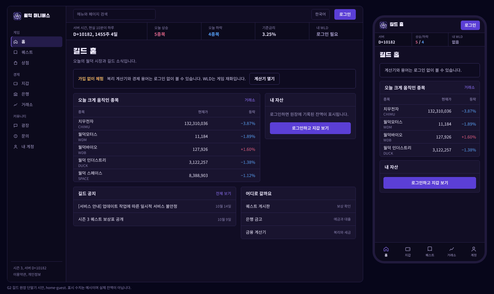

### 길드 홀(회원)
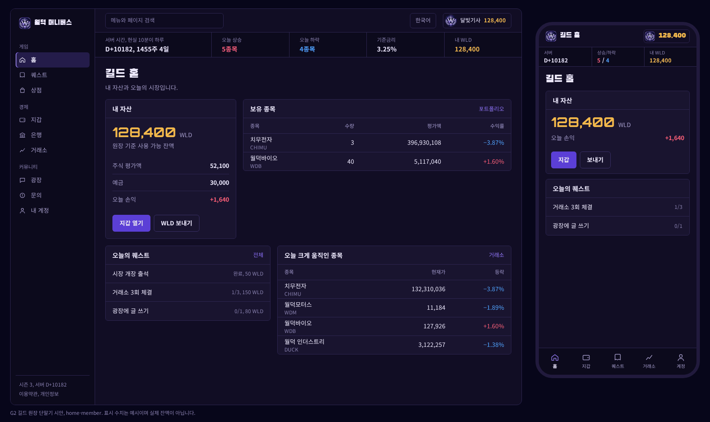

### 지갑
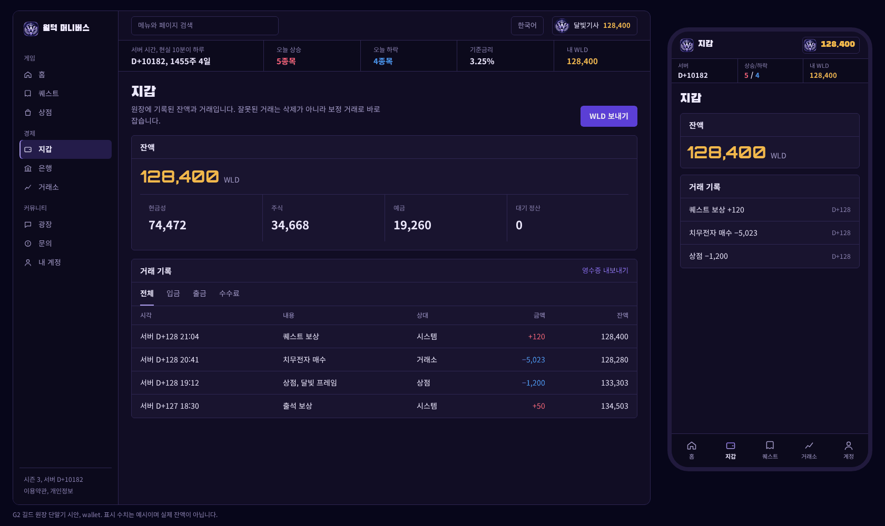

### 은행
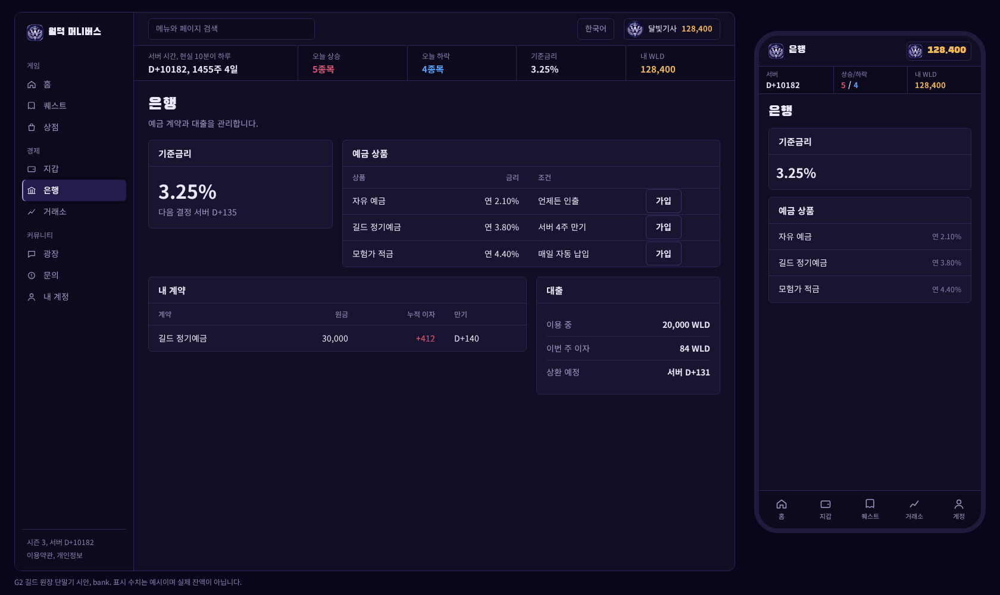

### 거래소
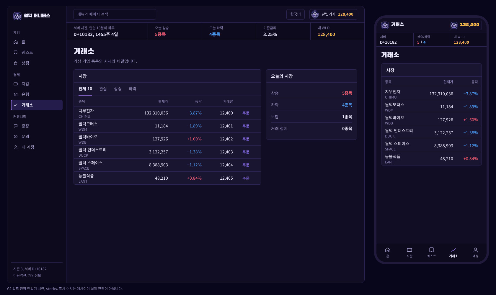

### 종목 상세·주문
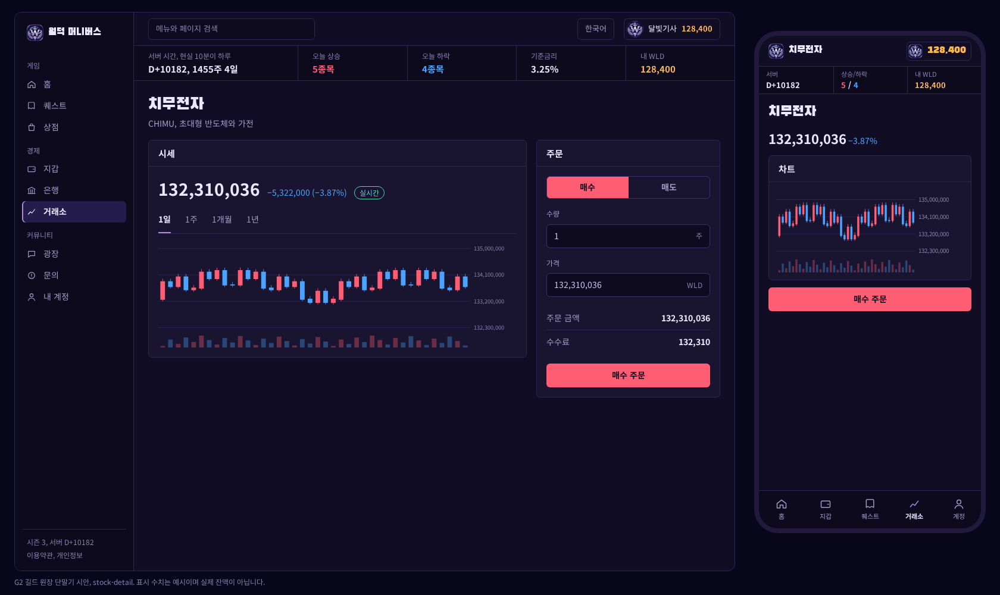

### 퀘스트
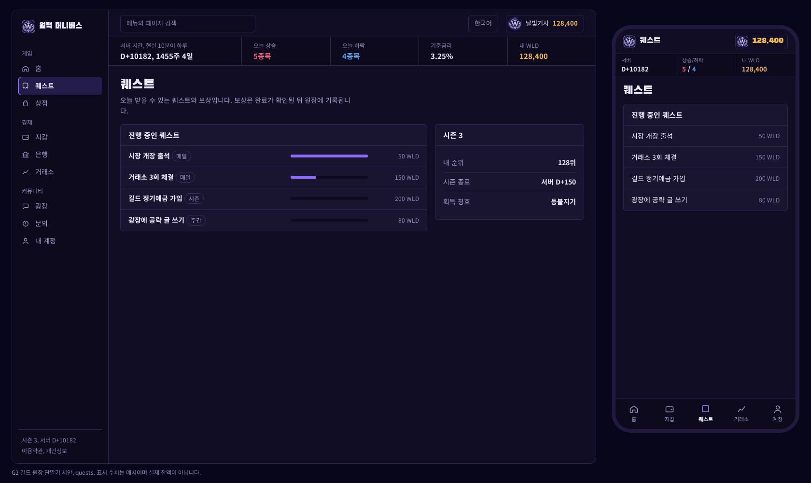

### 상점
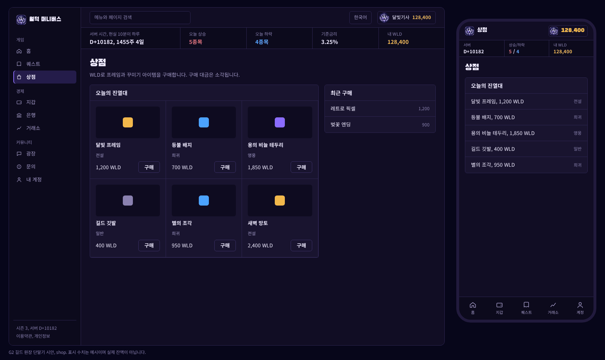

### 광장
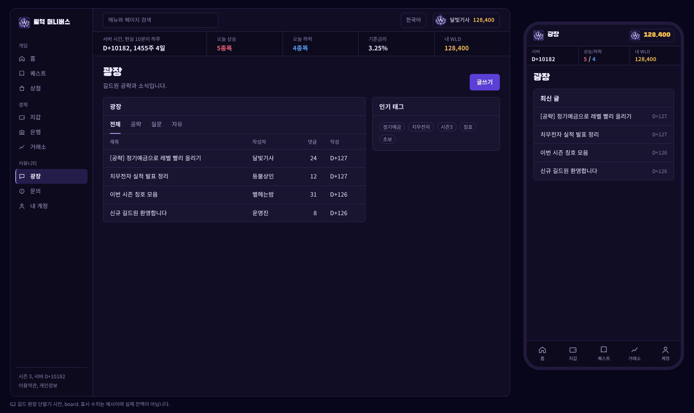

### 문의
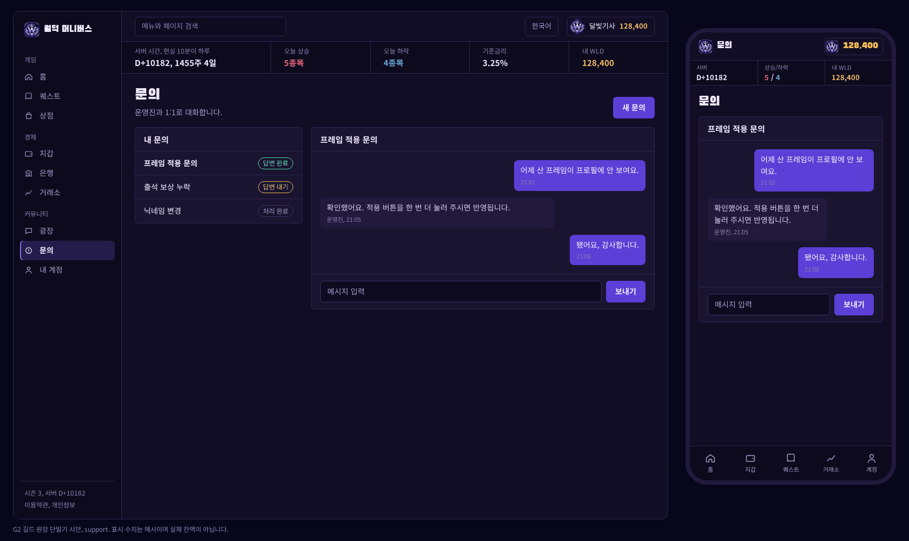

### GM 콘솔
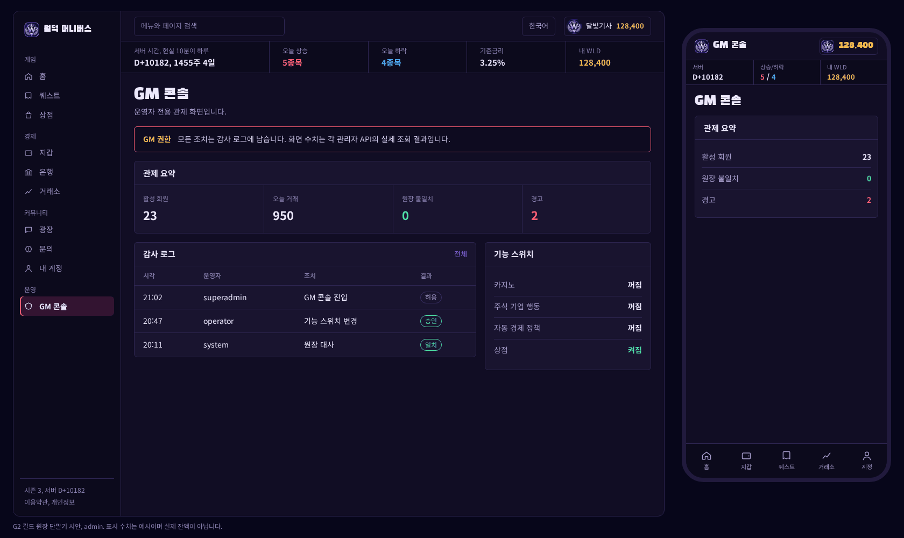

### 복리 계산기
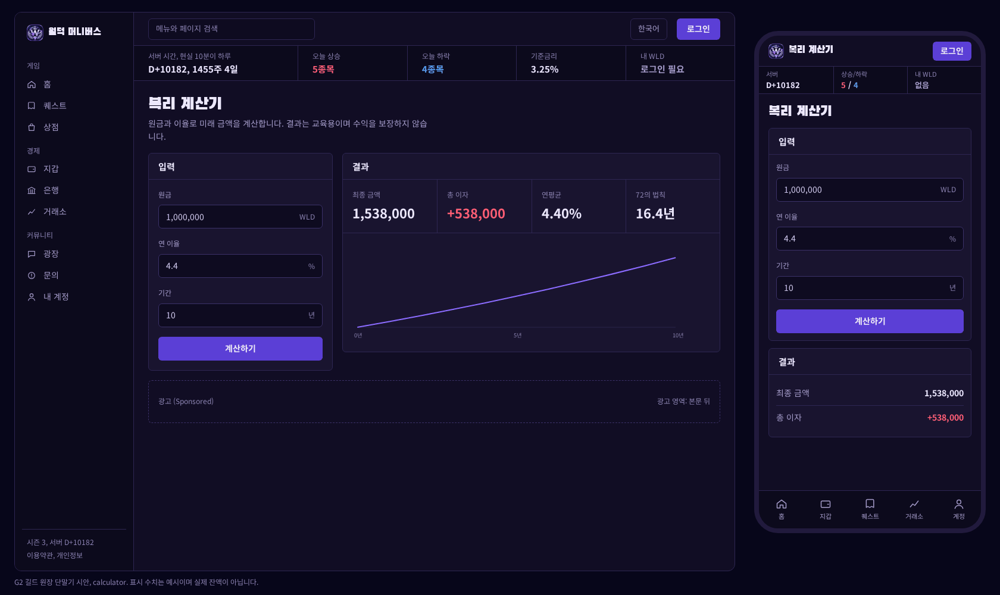

### 로그인
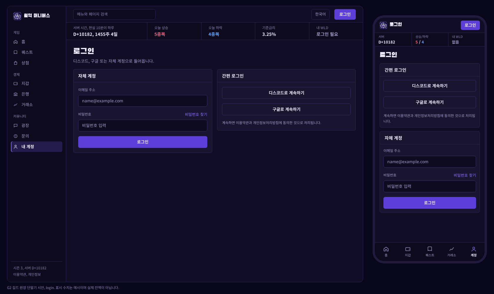
