# G2 "Guild Ledger Terminal" refined design — active design authority (owner-approved 2026-11-24)

**Status: owner-approved 2026-11-24, the active visual authority.** Implemented on Test. No Production change.

Refines G1 after owner feedback and guild-home QA v2026.11.24.1646: a ledger status strip on every page as the single signature; hairline 6px panels without chamfers; one violet action colour, gold only on the player's own balance, Korean market rise red / fall blue; tabular body figures in tables (Orbitron only for the main balance); 12-column grid, 44px table rows; grouped navigation with GM console for administrators only. Hallmark sloplint: 13/13 clean. Figures are illustrative and stamped. External models (Codex usage limit, Gemini invalid key) returned no response, so none is claimed. [한국어](README.ko.md)

### 길드 홀(비회원)
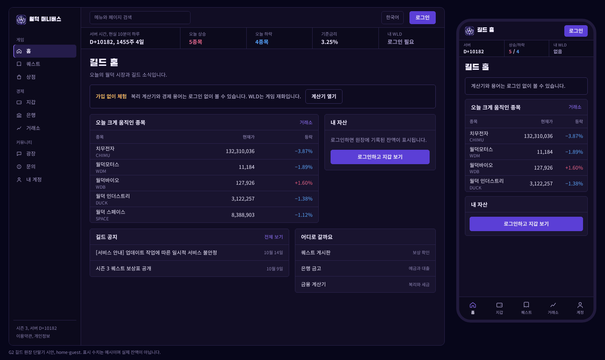

### 길드 홀(회원)
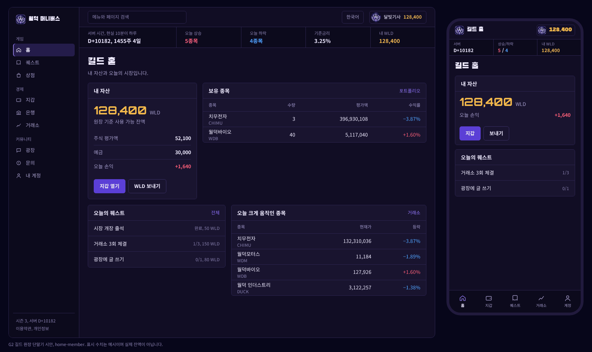

### 지갑
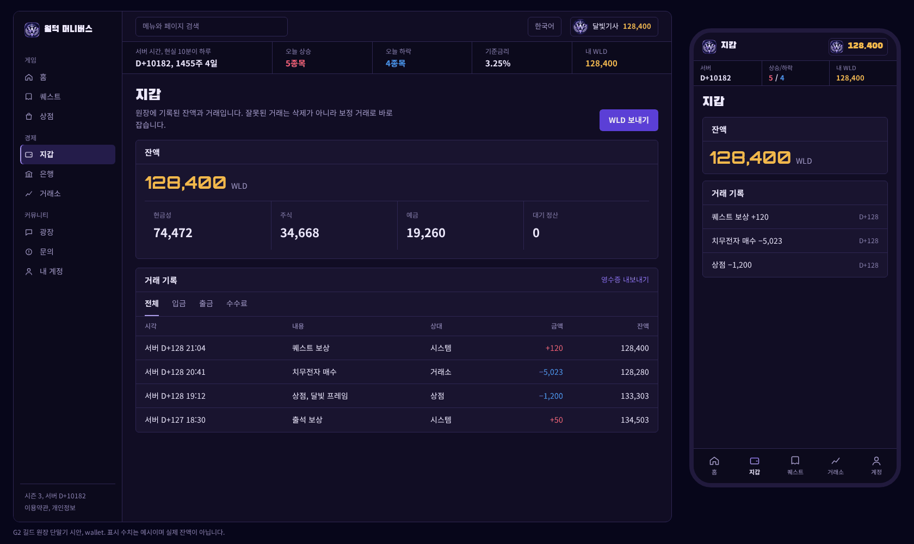

### 은행
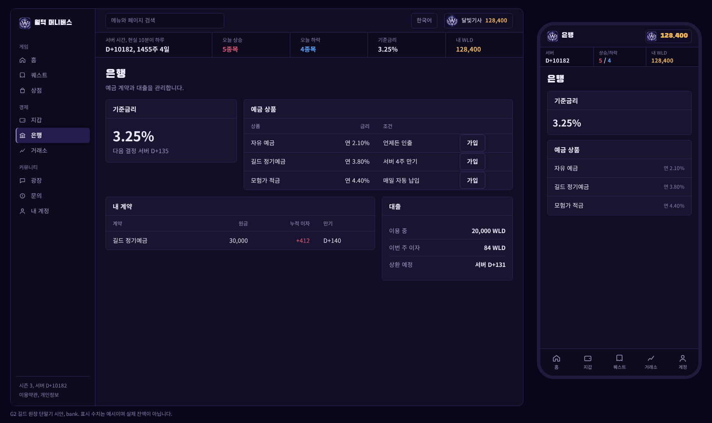

### 거래소
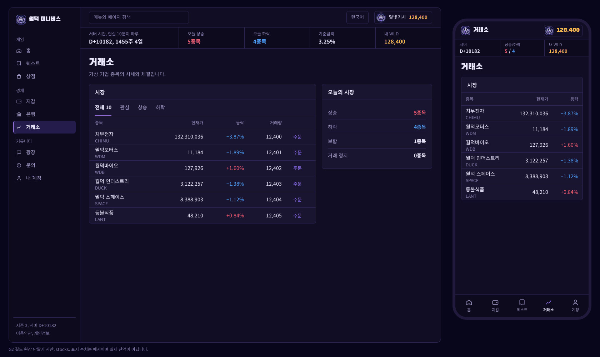

### 종목 상세·주문
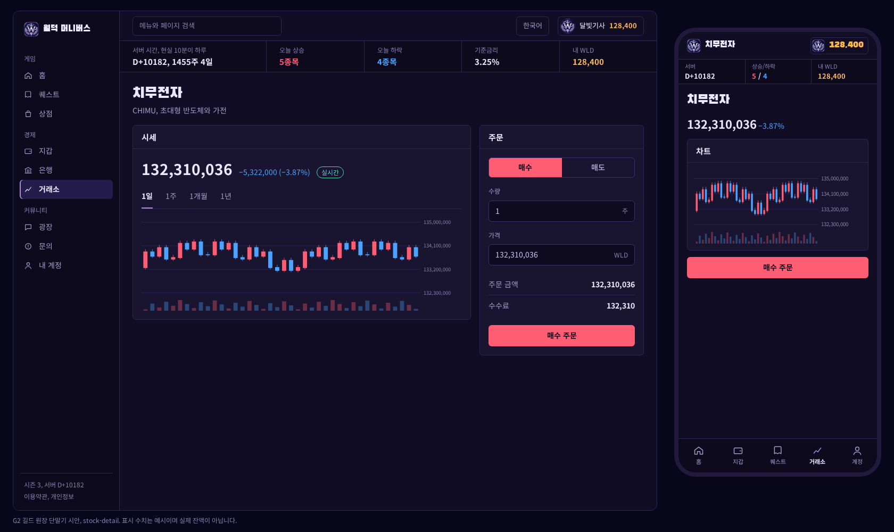

### 퀘스트
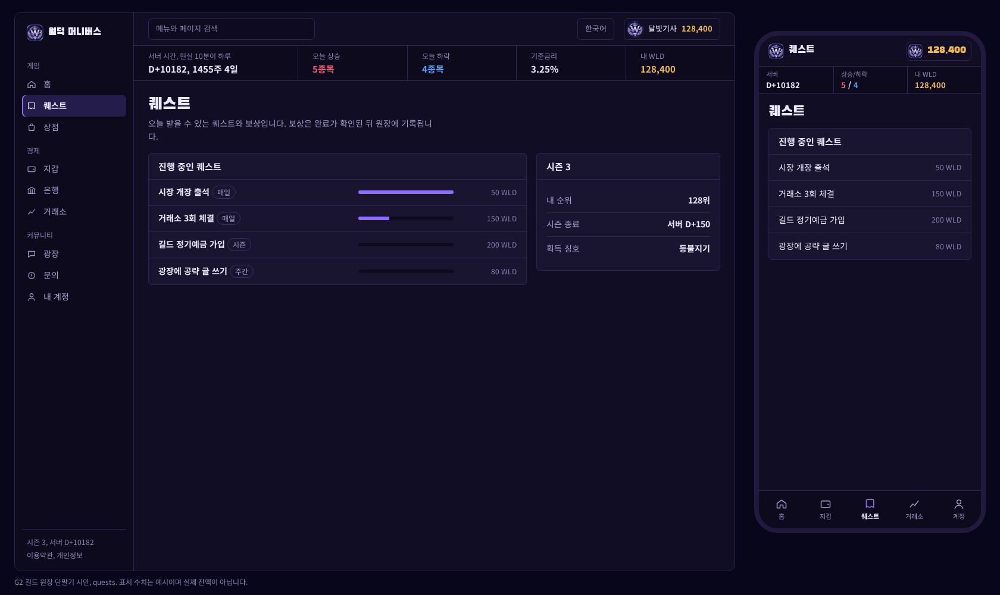

### 상점
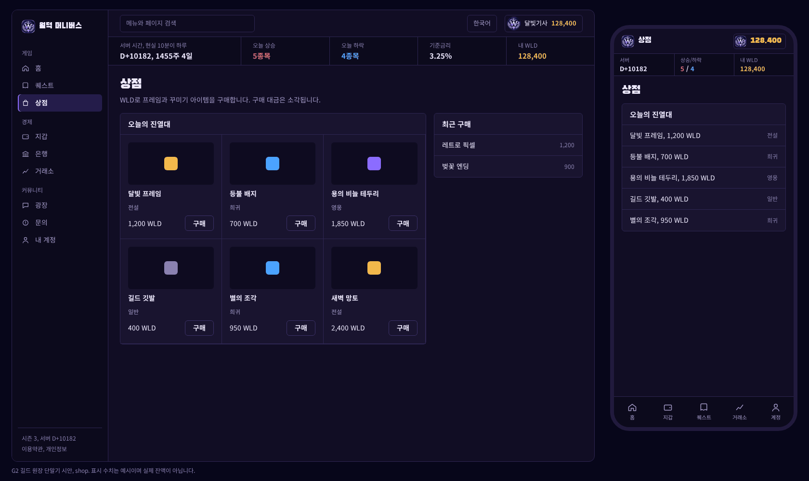

### 광장
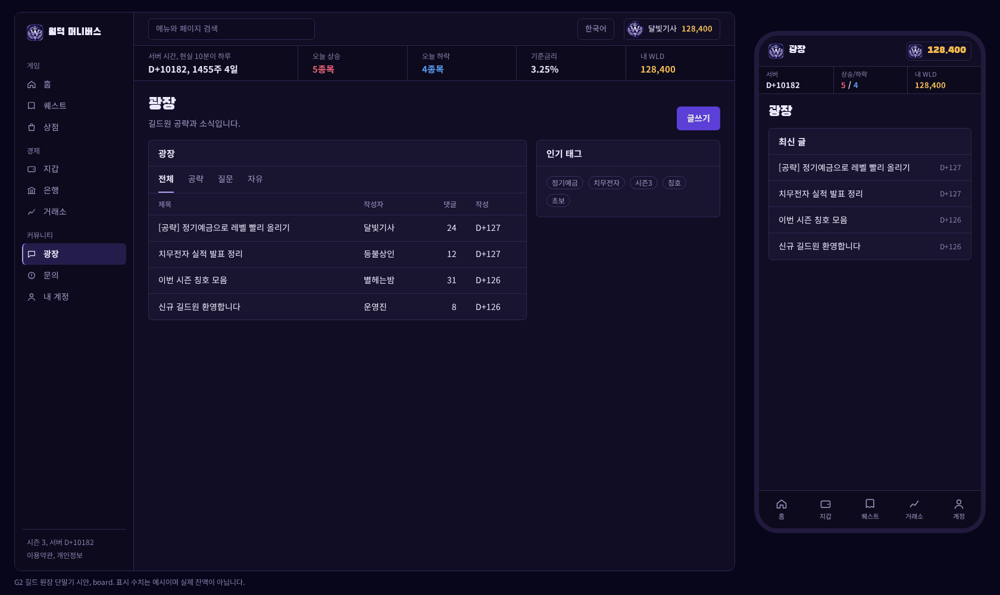

### 문의
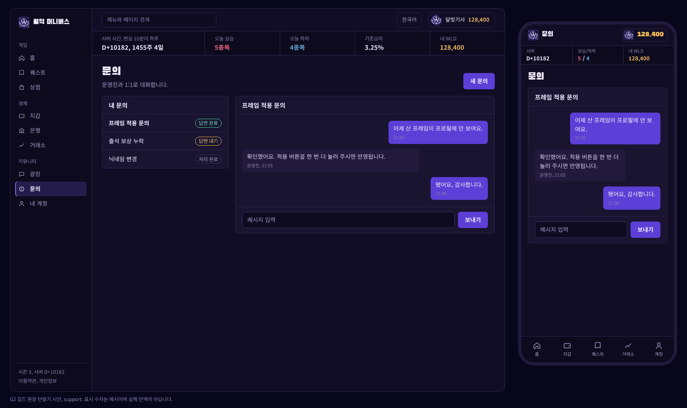

### GM 콘솔
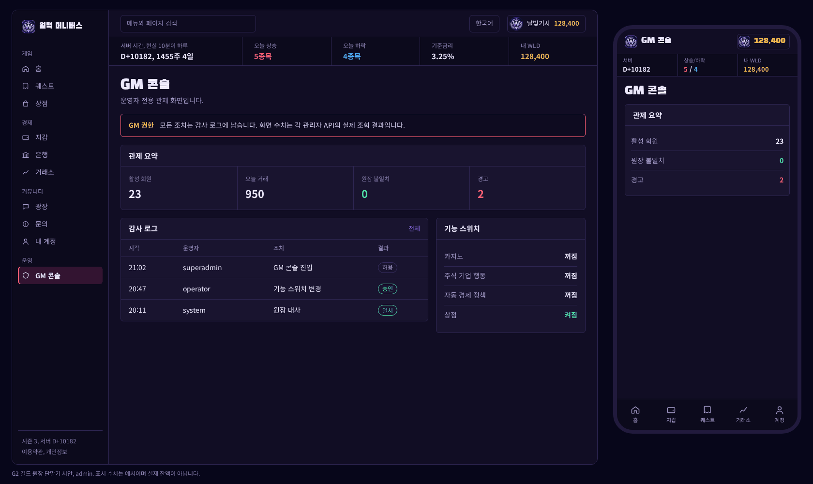

### 복리 계산기
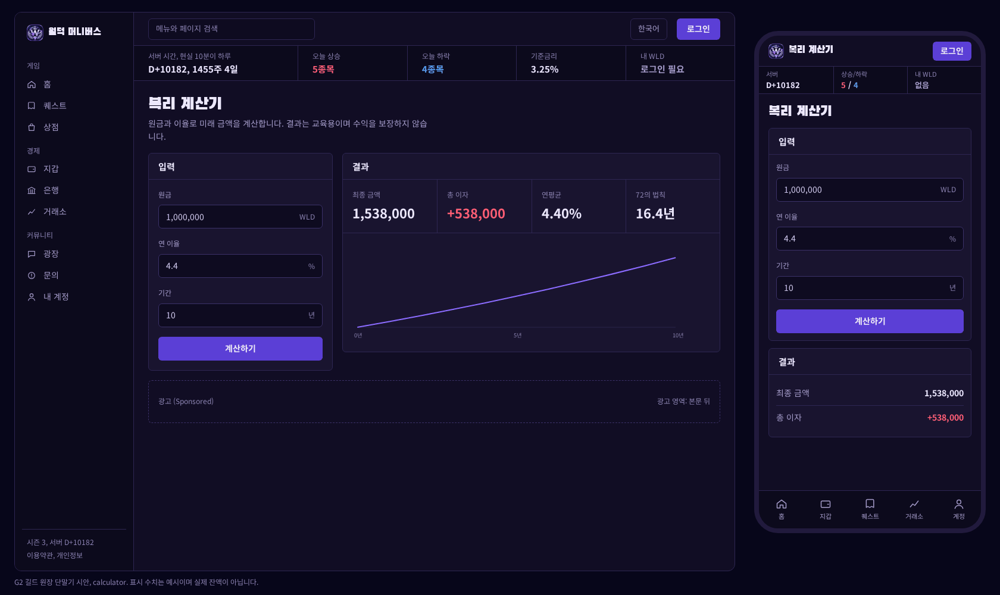

### 로그인
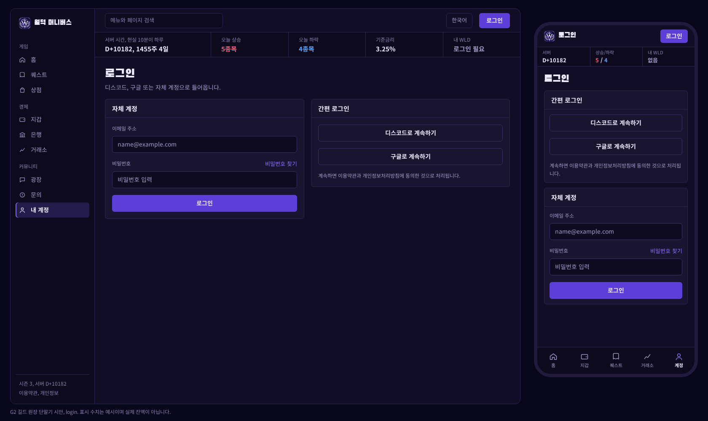
