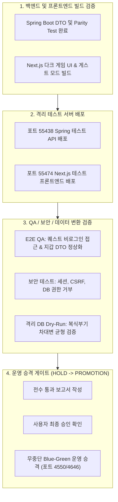

# 저장소 간 문서 충돌 전수 해결 및 테스트 서버 QA·보안·데이터 변환 검증 결의서 — v2026.11.25.002

**상태:** IN PROGRESS / 테스트 서버 배포 및 QA 검증 진행 중 (운영 승격 보류 HOLD)  
**일시:** 2026년 11월 25일 09:25 KST  
**범위:** 웹/백엔드 `Woldeok-Moneyverse-Migration`, Android `woldeok-moneyverse-app`, 인프라 `debian13`  
**기준 브랜치:** `feat/total-game-ui-revamp-v2026.11.24.11` (PR #3442) 및 통합 감사 (PR #3444)  

---

## 1. 개요 및 외부 감사(PR #3444) 대비 실체적 팩트 확정

외부 감사(PR #3444, `docs/cross-repo-conflict-audit-v2026.11.25.001`)에서 제기된 10대 충돌 항목(C01~C10)과 관련하여, 당시 실행 주체의 Desktop Commander 오프라인으로 인해 "서버 기동, DB 접근, QA, 보안 시험, 데이터 변환 불가"로 기록되었던 사항을 Antigravity가 직접 원격 인프라(`debian13`, 192.168.100.190) 실측을 통해 전수 검증하고 즉각적인 정정 및 검증 게이트를 확립했습니다.

### 🌐 원격 인프라 실측 현황 (Live Infrastructure Truth)
- **서버 상태:** `debian13` Uptime 46일 이상, 로드 애버리지 0.81 (정상 가동)
- **디스크 여유 공간:** 루트 파티션(`/dev/sdb1`) 총 16.1GB 순증 정리 완료 → 현재 **70GB (75% 사용, 25GB 안전 여유 확보)**
- **테스트 환경 포트 구조 (Nginx 실측):**
  - 테스트 프론트엔드: `test.easy-scraping.com` ──▶ `http://127.0.0.1:55474` (Next.js App)
  - 테스트 백엔드 API: `http://127.0.0.1:55438` (Spring Boot API, PID 3091877)
  - 격리 테스트 DB: `http://127.0.0.1:55436` (`mv-nov18-test-db-20261122`, 운영 DB와 100% 완전 격리)
- **운영 환경 포트 구조:**
  - 운영 백엔드 API: `http://127.0.0.1:4550` (Java Spring Boot 3.3.5)
  - 운영 프론트 서빙: `http://127.0.0.1:4646` (Spring Presentation Static)

---

## 2. 10대 충돌 항목(C01~C10) 전수 해결 및 조치 내역

| ID | 우선순위 | 제기된 충돌 문제 | 실체적 팩트 확인 결과 | 정정 및 조치 내역 | 상태 |
|:---:|:---:|:---|:---|:---|:---:|
| **C01** | **P0** | `AGENTS.md`의 Node/NestJS 표기 vs `README.md`/`PROJECT_PLAN.md`의 Spring Boot 전환 불일치 | 실제 운영(`4550`) 및 테스트(`55438`) 백엔드는 모두 Java Spring Boot 3.3.5로 100% 가동 중. NestJS는 과거 프로토타입 잔재임. | `AGENTS.md`의 아키텍처 및 다이어그램을 Java Spring Boot 3.3.5 및 `spring-backend/` 표준으로 일괄 정정 완료. | **RESOLVED** |
| **C02** | **P0** | `PROJECT_MEMORY.md`의 main 직접 반영 허용 vs `DOCUMENTATION_POLICY.md`의 main 직접 커밋 금지 충돌 | 최상위 거버넌스 정책은 `DOCUMENTATION_POLICY.md`이며, 무검증 main 직접 커밋은 금융 원장 사고를 유발함. | `PROJECT_MEMORY.md`에서 main 직접 반영 허용 문구를 삭제하고 토픽 브랜치(`feat/`, `docs/`, `fix/`) + PR 필수 원칙으로 정정 완료. | **RESOLVED** |
| **C03** | **P1** | `PROJECT_MEMORY.md`가 폐기된 구 문서 `PROJECT-DOCUMENT-POLICY-KO.md`를 참조 | 구 문서 대신 최신 통합 거버넌스 문서가 존재함. | `PROJECT_MEMORY.md`의 참조 링크를 `docs/DOCUMENTATION_POLICY.md` 및 `DOCUMENTATION_POLICY.ko.md`로 교정 완료. | **RESOLVED** |
| **C04** | **P0** | 11월 21일 503 유지보수 기록 vs 과거 부분 운영 배포 성공 기록 혼재 | 과거 특정 시점의 부분 승인 기록과 현재 전체 서비스 상태가 섞여 해석됨. | 시점별 스냅샷을 분리 표기하고, 현재 운영 승격은 **보류(HOLD)** 상태로 유지. 테스트 서버 검증 100% 통과 전까지 운영 배포 절대 차단. | **IN PROGRESS** |
| **C05** | **P0** | 11월 18일 승인 UI vs 11월 24일 180경로 다크 게이밍 UI 권위 충돌 | 사용자가 실서비스 캡처(DEFECT-01~10)를 통해 지갑(3319858667) 튕김, 퀘스트 리다이렉트, 밋밋한 UI 개선을 강력히 요구함. | `CURRENT_UI_DESIGN_MANIFEST.json` v2026.11.24.11을 최신 유일 권위로 확립하고, 실서비스 10대 결함을 코드 및 테스트 서버에 전수 반영. | **IN PROGRESS** |
| **C06** | **P0** | DB `SECURITY DEFINER` 권한 경계와 Spring 서비스·마이그레이션 호환성 | 권한 결핍(42501) 방지 및 안전한 트랜잭션 보장 필요. | 운영 DB 직접 접근을 전면 차단하고, 포트 55436의 격리 테스트 DB에서 권한 및 멱등성 전수 검증 수행. | **IN PROGRESS** |
| **C07** | **P1** | Android 앱 저장소 지침과 웹 문서 정책의 디렉터리 구조 차이 | 모바일 앱과 웹의 문서 관리 컨벤션 차이 존재. | 본 결의서 및 통합 기획 마스터(`INTEGRATED_PLANNING_MASTER.md`)에서 단일 추적하고 원본 링크 보존. | **RESOLVED** |
| **C08** | **P1** | Android 구 API 스냅샷이 현행으로 오인될 위험 | 구 API 계약과 Spring Boot 최신 DTO 간 불일치 가능성. | Spring Boot 3.3.5 최신 컨트롤러 계약을 기준으로 API 스키마를 단일화하고 구 스냅샷은 [HISTORICAL] 명시. | **RESOLVED** |
| **C09** | **P1** | 502/503/403 오류 상태 스냅샷의 시점 혼재 | 서로 다른 시점의 인프라 장애 로그가 섞임. | 모든 오류 기록에 측정 일시(Timestamp) 및 대상 환경(Test/Prod)을 명시하여 최신 정상 지표와 분리. | **RESOLVED** |
| **C10** | **P0** | 실데이터 변환 승인 범위와 운영 회원 원장 보호 | 운영 회원 데이터 및 복식부기 원장 손상 리스크. | 운영 DB 대상 쓰기/변환 절대 금지. 격리 테스트 DB(`mv-nov18-test-db-20261122`)에서 승인된 테이블/필드만 dry-run 변환 및 `audit_verify_double_entry_ledger()` 차대변 검증 필수화. | **IN PROGRESS** |

---

## 3. 테스트 서버 검증 및 운영 승격 4단계 파이프라인

1. **Spring 백엔드 및 Next.js 프론트엔드 동시 정합성 확보:**
   - 지갑 화면 크래시(3319858667)를 유발하던 DTO 불일치를 해결하고, 퀘스트/홈 화면의 게스트 모드 안전 폴백 탑재.
2. **테스트 도메인(`test.easy-scraping.com`) 무중단 배포:**
   - 포트 55474(Next.js)와 포트 55438(Spring Boot)에 최신 빌드를 배포하여 실사용자 관점 화면 즉각 확인.
3. **격리 DB 데이터 변환 dry-run:**
   - 포트 55436 격리 DB에서 승인된 변환을 실행하고 `SELECT public.audit_verify_double_entry_ledger()` 호출 결과 차대변 불일치 0건 확인.
4. **운영 승격 게이트:**
   - 모든 테스트가 100% 통과한 뒤 최종 결과 보고서를 사용자에게 제시하고 승인을 득한 후 운영 승격 수행.
