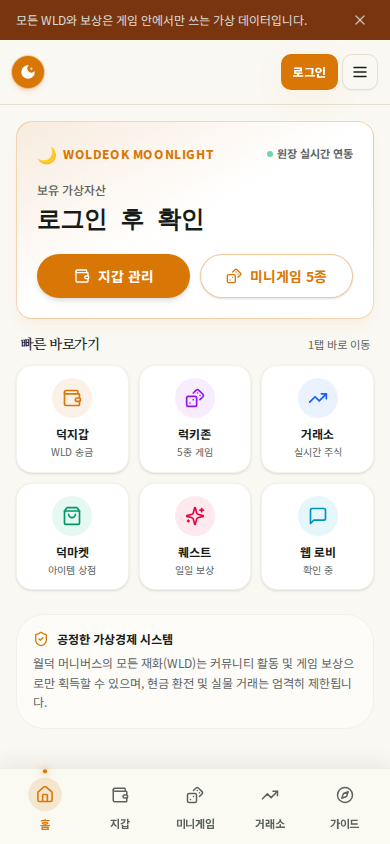
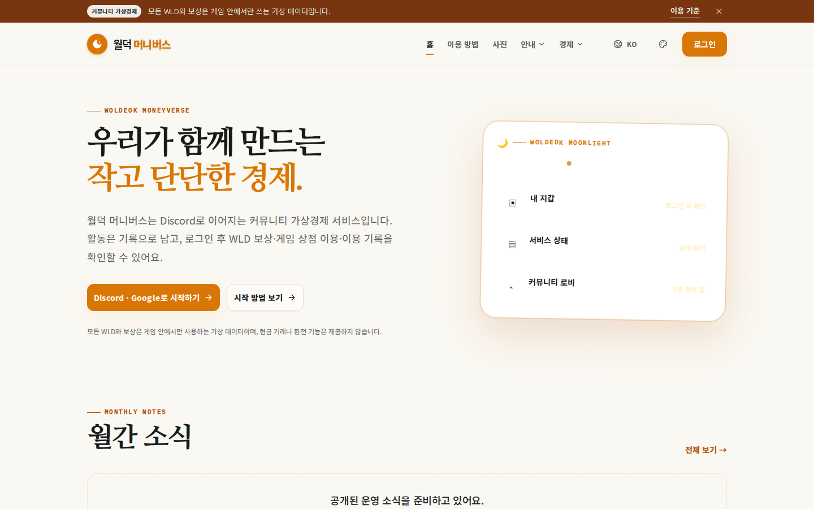

# 실제 운영 홈 화면·승인 UI 디자인 불일치 — 이미지·한계 정밀 보고서 v2026.11.19.32.1

**2026-11-19 KST · P0 홈 화면 구성 불일치 확인 · 읽기 전용 검증 · 실제 수정·운영 재배포는 진행하지 않음**

[English canonical report](LIVE_HOME_APPROVED_UI_GAP_v2026.11.19.32.1.md) · [Spring 전체 구현 및 QA 요구사항 한국어](../planning/SPRING_HOME_VISUAL_IMPLEMENTATION_GATES_v2026.11.19.32.1.ko.md)

## 1. 사용자 제공 모바일 화면의 정확한 관찰

2026년 11월 19일, 사용자가 `easy-scraping.com`에서 직접 촬영해 전달한 **783×1536픽셀 Chrome 모바일 스크린샷**과 공개 웹 응답을 조사했다. 사용자의 지적은 **“승인한 새로운 홈페이지 디자인이 운영 사이트에 제대로 구현·반영되지 않았다”**는 것이다.

| 구역 | 실제 첨부 화면에서 보이는 내용 | 문제 또는 확인 한계 |
| --- | --- | --- |
| 상단 헤더 | 월덕 머니버스 로고, KO 언어 버튼, 내용 없는 녹색 직사각형처럼 보이는 영역, 햄버거 메뉴 | 디자인 색상·로그인/가입 동선·버튼 레이블을 다시 확인해야 함. 녹색 영역이 왜 비어 보이는지 **원인은 미검증** |
| 메인 제목 | **‘신규 사용자 유입을 위한 홈 화면 3안’**, 위에는 **‘MODERN WEB UI 2026 EXPLORATION’** | 실제 이용자가 보는 `/`이 서비스 기능 홈이 아니라 **디자인 3안 비교 페이지**로 구성됨 |
| 설명 | 경제·주식 기능을 ‘3분 안에 체감’하도록 설계했다고 안내 | 홍보/디자인 문구이지, 3분 온보딩의 실제 기능 완료나 통계 증빙 아님 |
| 상태 표시 | **‘실시간 라이브 연동’** 및 **‘Chrome Modern Web 1.0’** 배지 | 배지 출력이 곧 실시간 연결·Spring 전환·API 정상 작동이라는 의미는 아님 |
| 1번 카드 | ‘01’, ‘온보딩 퀘스트형’, ‘3분 완성’, 일러스트, ‘시작 안내도’ | **시안 전시 카드**가 실제 퀘스트 진행·보상·저장 기능을 증명하지 못함 |
| 플로팅 UI | 왼쪽 선물 모양 `0/7`, 오른쪽 헤드폰 모양 고객지원, 고정 하단 메뉴 5개 | 작은 모바일 화면에서 카드·텍스트와 겹칠 위험. **정확한 충돌은 브라우저 계측 전 미확정** |
| 전반적 색상 | 검정·에메랄드/초록색 중심 | 승인된 신규 공통 UI/관리자 디자인의 네이비·보라 계열과 일치 검증을 통과하지 못함 |

**첨부물 출처:** 사용자가 현재 대화에 첨부한 `1795054080653.jpeg`, SHA-256 `306fa75c03997e91c94da4697219b3a3637608bc0931029567ea815879a6cfeb`. **이 이미지를 GitHub에 업로드한 것처럼 기재하지 않는다.** 아래에 첨부한 이미지들은 GitHub에 실재하는 승인 참고 디자인 자산이며, 사용자 캡처 원본과 혼동하지 않는다.

## 2. 추측이 아닌 실제 운영 확인 결과

2026-11-19 **11:11 KST 전후**에 미니PC에서 공개 사이트 `https://easy-scraping.com/`을 별도 GET 요청으로 확인했다.

| 증거 | 실제 결과 | 판정 |
| --- | --- | --- |
| 공개 HTTPS `GET /` | **HTTP 200**, `text/html;charset=UTF-8`, 응답 **113,884바이트** | 서버가 응답함을 확인. 기능 정상 의미 아님 |
| 실제 HTML `<h1>` | **‘신규 사용자 유입을 위한 홈 화면 3안’** 텍스트 포함 | 사용자가 첨부한 잘못된 홈 콘텐츠가 현재 공용 서버에서도 제공됨 |
| ‘실시간 라이브 연동’ | `` 형태의 시각적 배지 및 CSS 애니메이션으로 존재 | 상태 출처·구독 이벤트·최종 갱신 시각·장애 시 상태는 **검증하지 않음** |
| ‘Chrome Modern Web 1.0’ | 일반 안내 배지로 존재 | Chrome 최신 가이드 이름이며 Spring/Next 엔진이 아님 |
| 실제 정적 파일 | `/srv/moneyverse-data/frontend-static/index.html`, 2026-11-19 11:07:16 KST, **113,825바이트** | 같은 잘못된 디자인 갤러리의 제목·설명이 정적 파일에 실제 존재 |
| 파일 대 공개 HTML | 첫 220바이트 일치, 같은 H1·배지 문구 | 서버 정적 파일과 공개 HTML의 문맥 일치. **전체 바이트 동일성 및 Nginx/Cloudflare 변환 경로 미확인** |
| 카드 이미지 | `/images/guide/newcomer-adventure.png` HEAD 200 | 이미지 자체 접근 가능. 온보딩 기능은 별도 시험 필요 |
| GitHub 프론트 소스 | `frontend/src/app/page.tsx`의 홈페이지 본문 구조·표제가 현재 응답과 다름 | **실제 운영 HTML과 개발 소스/최신 시안 사이의 드리프트 확인**. 어떤 배포 작업이 파일을 교체했는지는 감사 로그 전까지 단정 금지 |

**결론:** 휴대폰 캐시만 지워서 해결되는 문제로 설명할 수 없다. 현재 공용 서버가 해당 디자인 갤러리 HTML 자체를 제공하고 있다. 그렇다고 모바일 UI의 모든 버튼이 실제로 작동하지 않는다고까지 확정할 수는 없다. **그 기능은 별도 QA가 필요**하다.

## 3. GitHub에 실제 존재하는 디자인 이미지 — 구현 비교 기준

아래 자료는 GitHub `main`의 **v2026.11.19.31.1** 이미지 복구 커밋 `78a3ff446fae1ee4754da6edd14b7fc3409f43a2`에 존재함을 확인했다. 이미지가 존재한다고 자동으로 사이트에 적용되는 것이 아니다. **시안·참고자료이지 실 서비스 스크린샷, 실제 금융 데이터, 기능 검증 증거가 아니다.**

### A. 메인 홈 전체 반응형 시안

- 파일: `docs/design/all-pages-v2026.11.18.12/previews/home.png`
- 크기: 1660×990 PNG. 홈 화면 **PC·모바일 합본 시안**.
- 구현 점검: 메인 영역, 가입/온보딩, 금융·주식 정보 카드, 메뉴 배치, 하단 영역을 실제 Spring 홈페이지와 비교.

### B. 모바일 홈 별도 참고 이미지

- 파일: `docs/images/showcase/home-mobile.png`
- 크기: **390×844 PNG**.
- 구현 점검: 320/360/390픽셀, 상태바·안전영역·하단 내비·문의 동그라미의 간격과 메뉴 접근성.
- **주의:** 본 이미지가 사용자와 대화에서 최초 승인한 생성 이미지와 픽셀 단위로 같다는 검증은 아직 없다.

### C. PC 홈 별도 참고 이미지

- 파일: `docs/images/showcase/home-desktop.png`
- 크기: **1440×900 PNG**.
- 구현 점검: PC 컬럼 구성, 텍스트 계층, 탐색 동선, 컴포넌트 밀도, 데이터 출처, 1440px 및 브라우저 확대.

### D. 관리자 PC·모바일 신규 시안

- 파일: `docs/design/admin-chat-v2026.11.18.13/references/admin-console-desktop.png`, `admin-console-mobile.png`.
- 적용 목표: 실제 관리자 권한·실데이터·오류·UNKNOWN 상태, 테이블 모바일 스크롤, 인증된 관리자 지원 및 전역 문의 동그라미.
- **관리자 화면의 PNG는 로그인된 운영 관리자 화면을 실제 검증한 결과가 아니다.**

### E. 전체 180개 화면 참고 이미지와 기획

- [180개 페이지별 PNG 인덱스](../design/all-pages-v2026.11.18.12/README.md) — **178개 GitHub main 경로 패턴 + 2개 별도 후보**. 각각 PC/모바일 **합본 PNG 1개**, 총 180개이며 360개의 별도 구현 이미지가 아님.
- [v31 실제 이미지 복구·제미나이 구현 인계서 한국어](../design/UI_IMAGE_IMPLEMENTATION_HANDOFF_v2026.11.19.31.ko.md) / [English](../design/UI_IMAGE_IMPLEMENTATION_HANDOFF_v2026.11.19.31.md).
- [전체 디자인·반응형 기획 한국어](../planning/ALL_PAGES_RESPONSIVE_REDESIGN_v2026.11.18.12.ko.md) / [English](../planning/ALL_PAGES_RESPONSIVE_REDESIGN_v2026.11.18.12.md).
- [관리자·채팅 UI 기획 한국어](../planning/ADMIN_GLOBAL_CHAT_DESIGN_v2026.11.18.13.ko.md) / [English](../planning/ADMIN_GLOBAL_CHAT_DESIGN_v2026.11.18.13.md).

과거 [전체 디자인 PR #3268](https://github.com/wtrdd1-hash/Woldeok-Moneyverse-Migration/pull/3268), [관리자·채팅 디자인 PR #3270](https://github.com/wtrdd1-hash/Woldeok-Moneyverse-Migration/pull/3270)은 **미병합 종료**됐고 브랜치도 삭제되어 이미지 주소가 404가 됐던 이력이 있다. v31에서 이 이미지 **180+2개를 GitHub main에 다시 복구**했으나 이것은 실제 Spring 화면 구현/배포가 아니다. 또한 v31 인계서는 복원된 SVG→PNG가 이전 대화에서 생성·승인된 픽셀 이미지와 **완전히 동일하다고 검증되지 않았다고 명시**한다. 따라서 사용자 승인 원본 이미지와 최종 대조가 여전히 필요하다.

## 4. 현재 한계·장애·미검증 사항 전체 목록

| ID | 우선순위 | 현상 또는 한계 | 확정 수준 | 해결 승인 기준 |
| --- | --- | --- | --- | --- |
| HOME-01 | **P0** | 운영 `/`에 실제 게임·경제 기능 홈이 아닌 3개 디자인 비교 시안이 나타남 | **실제 공개 웹/사용자 화면으로 확인** | 승인한 Spring 홈 템플릿을 Test 검증 후 운영 제공, 실제 모바일/PC 스크린샷 대조 |
| HOME-02 | **P0** | 디자인 이미지가 기획서에만 존재하고 운영 UI로 이식되지 않음 | **v31 복구 문서와 라이브 화면으로 확인** | PNG를 컴포넌트·CSS·동작과 연결하여 화면별 실제 브라우저에서 검증 |
| HOME-03 | **P0** | `frontend/src/app/page.tsx`와 운영 `frontend-static/index.html`의 UI 구조가 다름 | **소스·HTML 비교로 확인**, 배포 원인 불명 | URL→Nginx→Spring controller/static→JAR/파일 SHA→작업로그 추적 |
| HOME-04 | **P0** | 사용자의 ‘프론트엔드 전부 Spring’ 지시와 기존 Next 정적 캡처 운영이 불일치 | **최신 사용자 지시 및 로컬 기획에 근거** | Spring MVC+Thymeleaf 원본 렌더링, Node/Next/RSC 런타임 불필요함을 실증 |
| HOME-05 | **P0** | 회원·원장·주식·퀘스트·로그인·수익 등 실제 기능 연동 여부 | 화면과 HTTP 200만으로는 **미확인** | 실제 인증/거부/복구 흐름, Spring API 응답, 원장 근거·영수증 E2E |
| HOME-06 | **P1** | ‘실시간 라이브 연동’ 문구가 검증되지 않은 채 녹색 정상 배지처럼 보임 | 배지 **출력 확인**·실시간 통신 **미확인** | 실제 heartbeat/polling/socket, 마지막 수신시각, STALE/ERROR/OFFLINE 상태 표시 |
| HOME-07 | **P1** | 상단 오른쪽 녹색 사각형의 레이블이 보이지 않음 | **시각 현상 확인**, 원인 미확인 | DOM·색상 대비·문자 렌더·아이콘 로드·비로그인/로그인·키보드 점검 |
| HOME-08 | **P1** | 양쪽 플로팅 버튼과 고정 하단 메뉴가 콘텐츠를 가릴 수 있음 | 겹침 **위험**, 실제 충돌 치수 미측정 | 320/360/390/768, 200% 확대, 가로 화면, safe-area, 접근성/스크롤 QA |
| HOME-09 | **P1** | ‘3분 완성’, 온보딩 `0/7`, 경제·주식 체험의 동작·진행 근거 없음 | 문구만 확인, 실제 완료/보상 **미확인** | 사용자별 진척·퀘스트 API·완료 영수증/보상·동선 검증 |
| HOME-10 | **P1** | 영어 기본/한국어 두 번째 언어 정책 검증 누락 | KO 화면만으로 오류 단정 **불가** | 쿠키 없는 신규 방문 EN 기본, KO 변경·재방문·로그인 상태/모든 화면 |
| HOME-11 | **P1** | 복구된 디자인 PNG와 ChatGPT가 실제 그린 승인 이미지의 픽셀 일치 미증명 | v31 인계서가 **명시한 미검증** | 원본 시안 파일 대조, 시안-ID/버전 고정, 최종 사용자 시각 승인 |
| HOME-12 | **P0** | 전체 전환 QA 수치의 상충 | 미니PC 로컬 v30 JSON은 180 PASS라 주장, 동시 로컬 통합기획은 5 Spring 운영화/175 미인증으로 기록. JSON은 원격 main 버전 문서 아님 | 모든 URL의 배포 SHA·실제 HTML 렌더러·인증 기능·실 브라우저 증거 재구축 후 모순 해소 |
| HOME-13 | **P0** | 이전 Spring 고객지원·채팅 API의 사용자 헤더 신원 및 DB 오류 허위 성공 위험 | 이전 소스 점검상 발견, 이 작업에서 실공격 재현 미실시 | 서버 세션 기반 신원·CSRF·소유권·정확한 문의 영수증, 401/403/503 음성 QA |
| HOME-14 | **P1** | CDN/캐시·JS/CSS 자산·정확한 릴리스 매핑 불완전 | 서버 HTML도 잘못된 제목을 제공하므로 모바일 캐시만의 문제는 **아님** | Nginx 업스트림/Cloudflare 캐시/정적 자산 해시/릴리스 SHA/롤백 확인 |

### 함께 기록할 배포·코드 변경 이력

- [관리자·채팅 실제 소스 후보 PR #3275](https://github.com/wtrdd1-hash/Woldeok-Moneyverse-Migration/pull/3275)도 **미병합 종료**됐다. 당시 Next의 `/admin`·`/support`는 동적 SSR이어서 기존 Spring 정적 JAR에 새 화면이 담기지 않았으며, 완성된 Spring 화면으로 발표할 수 없었다.
- v31 이미지 복구는 정상적으로 GitHub `main`에 들어갔다. 하지만 **이미지 업로드 ≠ Spring 템플릿 구현 ≠ 실제 API 연동 ≠ 운영 승격**이다.
- 현재 GitHub `main` 커밋은 `78a3ff446fae1ee4754da6edd14b7fc3409f43a2`. 미니PC의 별도 로컬 `main`(`fa36b7b`)에는 더 최근 Spring 개발·QA 문서가 있지만, **GitHub main과 동일한 배포 상태가 아니다**. 이를 하나의 ‘완료 버전’으로 뭉뚱그려 표시하면 안 된다.
- 과거 사용자 지시 “Next 유지”는 최신 “모든 웹 프론트·API Spring Boot” 지시로 **명시적으로 대체**됐다. 이전 문서는 이력으로 남겨두며, 실제 신규 릴리스는 최신 지시를 우선 적용.

## 5. 프론트엔드 구현·릴리스 완료 기준

1. **G0 — 원본/운영 인벤토리:** `/`, 회원, 관리자, 게시판, 상점, 지갑, 주식, 퀘스트, 채팅 등 180개 소스 경로별로 실제 URL·Spring controller·템플릿·권한·API·DB 원천·정확한 배포 SHA·운영 Nginx/Cloudflare 경로를 매핑한다. `200`이라도 콘텐츠가 시안 HTML이면 **불합격**.
2. **G1 — UI 구현:** 승인한 네이비/보라 톤·이미지·레이아웃을 실제 Spring MVC/Thymeleaf에 구현한다. PC·모바일은 별도 브라우저 검사. 44px 터치 목표, 문의 동그라미는 전역 단일 56px, 고정 하단 내비와 충돌하지 않는다.
3. **G2 — 실제 홈 기능:** 단순 시안 3안 갤러리는 개발/기획 전용 경로에 분리한다. 공개 홈에는 실제 서비스 소개, 인증 진입, 첫 활동, 경제·주식·직업·퀘스트 동선과 실패/데이터 없음/미확인을 정확히 제공한다.
4. **G3 — 회원·관리자 권한:** 서버 로그인 세션·소유자·역할·관리자 OTP·CSRF를 실제로 검증한다. 비로그인/타 회원/미권한 접근은 401·403. 관리자 문의와 회원 사적 대화를 혼합하지 않는다.
5. **G4 — 금융 정합성:** WLD·국고·거래·보상·자동화의 수치·성공 알림은 승인된 PostgreSQL 원장 함수와 실제 기록/영수증으로만 생성. 예시/0/가짜 성공 대체 금지.
6. **G5 — QA·배포:** 독립 브랜치→Spring 빌드→Test 환경→320·360·390·768·1440px/200% 실제 Chrome QA→인증 정상·거부·장애 시나리오→원장·SEO·성능→정확한 JAR/정적 자산 SHA 및 롤백→무중단 운영 승격. 모든 체크를 통과한 **범위만** 승격한다.

각 페이지의 완료 판정은 **디자인 시각 일치 + 실제 기능 작동 + 권한/보안 + 정확한 배포 아티팩트 + 운영 브라우저 증거**가 함께 있어야 한다. `HTTP 200`이나 PNG 180장만으로 완료로 보고하지 않는다.

## 6. 이번 작업의 명시적 한계

**이번에 확인한 것:** 사용자 모바일 화면 내용, 공개 홈페이지 실제 HTML, 미니PC 정적 `index.html`, GitHub 이미지 실존 여부·이력, 코드·배포 화면 구조 불일치, 문서/QA 수치 충돌.

**이번에 확인하지 못한 것:** 전체 180개 화면의 실제 운영 Playwright/Chrome 검증, 사용자 세션이 있는 금융·회원·관리자 API E2E, 녹색 빈 상자의 브라우저 원인, 버튼 클릭 효과, 이미지 픽셀 완전 일치, 실제 배포 명령 수행자, Nginx의 최종 파일 선택 전체 경로, Cloudflare 변환, 운영 롤백.

**이번 작업에서 변경하지 않은 것:** 운영 프론트엔드, Java Spring, Node, Nginx, DB·원장·개인정보, 실 사이트 UI. 문서 기록만으로 ‘해결됨·승격됨’이라고 주장하지 않는다. 수정은 별도 작업 브랜치·Test·QA를 통해 이루어져야 한다.
