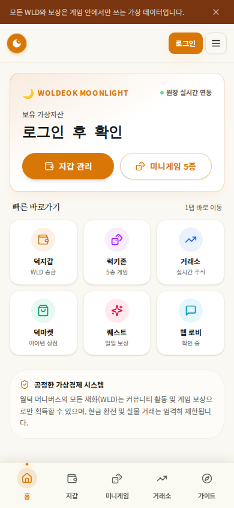
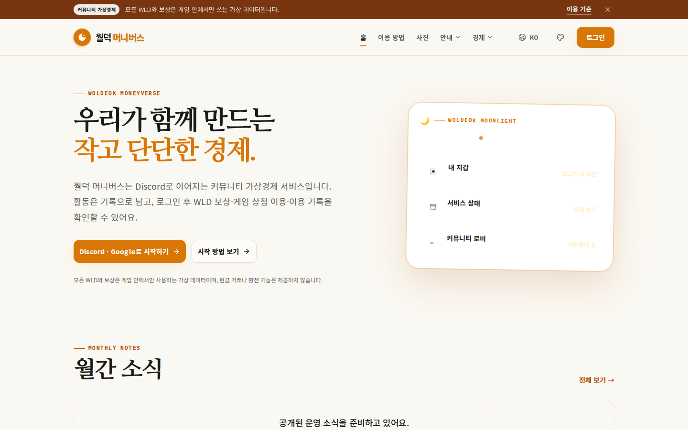

# Production Home vs Approved UI — Visual Evidence and Implementation Gap (v2026.11.19.32.1)

**2026-11-19 KST · P0 HOME PRESENTATION MISMATCH · READ-ONLY VERIFIED EVIDENCE · PRODUCTION FIX NOT DONE**

[한국어 상세 보고서](LIVE_HOME_APPROVED_UI_GAP_v2026.11.19.32.1.ko.md) · [Authoritative implementation plan](../planning/SPRING_HOME_VISUAL_IMPLEMENTATION_GATES_v2026.11.19.32.1.md) / [한국어](../planning/SPRING_HOME_VISUAL_IMPLEMENTATION_GATES_v2026.11.19.32.1.ko.md)

## 1. What the user actually observed

The user attached a **783×1536 mobile Chrome screenshot** of `easy-scraping.com` on 2026-11-19, reporting that the approved frontend redesign has **not been applied correctly**.

Visible screenshot evidence, not claims of internal behavior:

| Area | Screenshot observation | Why the evidence matters |
| --- | --- | --- |
| Header | Woldeok Moneyverse logo, KO locale control, an apparently unlabelled solid green rectangle, menu button | Check contrast/identity, login affordance and touch targets in real browsers; root cause of green rectangle remains unproven |
| Hero title | **“신규 사용자 유입을 위한 홈 화면 3안”** under **“MODERN WEB UI 2026 EXPLORATION”** | A three-concept design exploration is being shown at the **live root**, not the approved functioning game/economy home |
| Description | Promises a 3-minute orientation to the economy and stocks | This is an unverified marketing promise, not 3-minute functional onboarding evidence |
| Pills | **“실시간 라이브 연동”**, **“Chrome Modern Web 1.0”** | Labels do not establish any actual websocket subscription, fresh data, verified integrations or completed Spring migration |
| First content | “01”, **“온보딩 퀘스트형”**, a `3분 완성` concept card, and an illustration labeled “시작 안내도” | This is a concept-comparison card. A design illustration must not be counted as a working player onboarding flow |
| Fixed controls | Gift progress `0/7` left, headphone support bubble right, five-item bottom navigation | Multiple fixed surfaces may occlude card content on compact mobile devices; requires measured 320/390/200% collision and focus tests |
| Palette | Predominantly black/emerald-green instead of the approved navy/violet admin/new-UI direction | Visual parity has not been established; compare source-of-truth design per page, not just badge colors |

**Uploaded screenshot provenance:** `1795054080653.jpeg`, SHA-256 `306fa75c03997e91c94da4697219b3a3637608bc0931029567ea815879a6cfeb`. Original is attached in the owner's chat; **not** falsely represented as a GitHub image. This report links stable GitHub design references separately.

## 2. Independent public read-only reproduction

On **2026-11-19 at approximately 11:11 KST**, a fresh unauthenticated HTTPS GET `https://easy-scraping.com/` returned **HTTP 200**, `content-type: text/html;charset=UTF-8`, **113,884 response bytes**, with exact text **“신규 사용자 유입을 위한 홈 화면 3안”** twice and both badge labels in HTML. The screenshot's problematic title is therefore **served by the website itself**, not merely proof of one mobile browser keeping an old screenshot.

The mini-PC file **`/srv/moneyverse-data/frontend-static/index.html`** (modified 2026-11-19 11:07:16 KST, **113,825 bytes**) contains the same design-gallery H1 and labels, with the first 220 bytes matching the HTTPS document. **This is an active static artifact containing design-comparison markup**. The public HTML is not byte-identical to the local file (different lengths; the exact edge transformation was not traced). No Nginx config, JVM process, cache, service, PostgreSQL, GitHub main or production files were mutated in this investigation.

Additional source observations:
- The served `<h1>` is literally a **three-home-design comparison** with three concept articles, not an application dashboard H1.
- The first illustration is an `` inside the concept card and a click-to-enlarge action; HTTP HEAD for this image returned 200. This proves **image availability only**, not that onboarding tasks persist or economy APIs work.
- The “real-time integration” indicator is present as a styled `` with a CSS pulse class. There is **no server-derived status/last-update/receipt in that label**; realtime behavior was not positively tested.
- The repository's `frontend/src/app/page.tsx` has a distinct product homepage structure and heading, not this HTML design-gallery title. Which release job authored or copied the static `index.html` requires provenance/audit-log tracing. **Do not attribute blame without those logs.**
- The browser's missing-looking green header area and possible controls overlap are **visually observable**; CSS fault, hydration failure, actual click response and accessibility behavior are **NOT YET DIAGNOSED**.

A page returning HTTP 200, an image loading, a Spring jar building, or a successful Next.js build are **not** acceptance evidence that the approved UI or business features were delivered.

## 3. Verified design image references, now in GitHub main

The source-of-truth **planning resources** restored in GitHub `main` commit `78a3ff446fae1ee4754da6edd14b7fc3409f43a2` are linked below. Each is a design/reference image, **not** a screenshot of the current live Spring UI and **not** proof of implemented functionality.

### Homepage — desktop + mobile

- [180 page concepts with route-to-image mapping](../design/all-pages-v2026.11.18.12/README.md) — **180 combined PC/mobile PNGs**, **178 main route patterns + 2 branch-only design candidates**. These are not 180 completed Spring pages.
- [Image recovery and implementation handoff (English)](../design/UI_IMAGE_IMPLEMENTATION_HANDOFF_v2026.11.19.31.md) / [한국어](../design/UI_IMAGE_IMPLEMENTATION_HANDOFF_v2026.11.19.31.ko.md).
- The v31 recovery explicitly warns that recovered SVG-derived PNGs are **not verified pixel-identical** to the originally generated chat design images. A human approval/visual comparison is still necessary.

### Admin console and global help

These admin design images have not been verified as an authenticated operating admin console. The earlier UI-source implementation PR [#3275](https://github.com/wtrdd1-hash/Woldeok-Moneyverse-Migration/pull/3275) was **closed without merge**; its Next.js dynamic `/admin` and `/support` output was not present in the Spring static JAR tested in that work. The earlier design and preview PRs [#3268](https://github.com/wtrdd1-hash/Woldeok-Moneyverse-Migration/pull/3268) and [#3270](https://github.com/wtrdd1-hash/Woldeok-Moneyverse-Migration/pull/3270) were also closed/unmerged; v31 restored the image assets to current GitHub main.

## 4. Critical limitations, categorized by confidence

| ID / priority | Confirmed limitation or open risk | What can be claimed today | Required verification before closing |
| --- | --- | --- | --- |
| HOME-01 / P0 | Real `/` serves the design comparison, not the usable approved product homepage | **Confirmed** via user image + live GET + static artifact | Replace with exact-SHA approved Spring MVC/Thymeleaf functional page and real browser screenshot |
| HOME-02 / P0 | Design assets are documentation files; restoring them did **not** update live templates | **Confirmed** in v31 handoff and site response | Connect approved reference to actual Java/template/CSS assets, then audit rendered DOM |
| HOME-03 / P0 | Frontend runtime/source mismatch: Next `page.tsx` vs deployed static HTML | **Confirmed mismatch**; specific build/deployer cause not yet proven | Map route→Nginx upstream→Spring controller/static file→artifact SHA and deployment audit |
| HOME-04 / P0 | Owner requests **all frontend/API under Spring**, not a reintroduced Node/Next runtime | **Current owner directive** from mini-PC planning; historical public main has superseded older advice | Spring MVC/Thymeleaf native route with no RSC/Next/Node runtime dependency; prove with runtime process and request trace |
| HOME-05 / P0 | Buttons, auth/onboarding/quest, trading, wallet and money may appear without verified transport | **No positive functional evidence from screenshot/HTTP 200** | Real role-based browser E2E, Spring API status/body, DB receipt and error/UNKNOWN states (read-only prod checks) |
| HOME-06 / P1 | “실시간 라이브 연동” status is only a visual label in examined HTML | **No positive live proof**; do not equate badge with integration | Show actual event/heartbeat timestamp, read-only socket or polling lifecycle, disconnected/stale/error display |
| HOME-07 / P1 | Header green rectangle looks unlabeled or broken | **Observed visually**, root cause **unknown** | Reproduce guest/signed-in/mobile/zoom, inspect DOM text/color, network, click/keyboard |
| HOME-08 / P1 | Gift `0/7`, onboarding guide, support bubble and bottom nav crowd mobile viewport | **Visible potential occlusion**, not a measured geometry collision | 320/360/390/768px, safe-area, 200% zoom, landscape; scroll/focus/screenshot compare |
| HOME-09 / P1 | 3-minute onboarding and real stock/economy copy not verified | Promotional design text only | Capture tasks/permissions/progress/quest reward receipts and real route navigation; no fake successes |
| HOME-10 / P1 | English-default, Korean-second language requirement is not demonstrated by a Korean screenshot | Language preference might correctly select KO; **not proof of a bug** | Clear cookie/session, EN default and KO preference fallback, persisted auth session, accessibility |
| HOME-11 / P1 | Image-based reconstruction is not guaranteed to match originally approved generated image | v31 explicitly says pixel parity **not yet verified** | Side-by-side design sign-off, visual snapshots and shared tokens before implementation |
| HOME-12 / P0 | Overall route QA counts are inconsistent between local v30 docs | Unversioned local v30 board claimed 180 verified; local master reports 5 native/175 not certified; **neither can certify the current root** | Rebuild read-only route matrix with SHA/response identity, actual Spring-renderer proof, role/auth tests, screenshot evidence per route |
| HOME-13 / P0 | Spring support/chat actor identity and false-success risks from previous review | Previously source-observed; not freshly re-exploited here | Server-resolved identity, authZ/CSRF/ownership, fail-closed DB write receipt and negative tests |
| HOME-14 / P1 | CDN, device cache, runtime release ID and cache invalidation were not fully traced | Live server HTML matches screenshot title; **browser cache alone cannot explain the mismatch** | Nginx route, Cloudflare cache/ETag, client assets, release manifest, exact SHA and rollback history |

## 5. Implementation boundaries and QA contracts

**Do not implement “design” by putting the design-comparison gallery at the public root.** Design galleries belong to a restricted `/design-preview`/documentation route with `noindex`, clear simulated status and no public customer-facing “live” labels.

For each production route, preserve these invariants:
1. **G0:** capture canonical Java controller/template, public URL, exact Git/build/Spring artifact SHA, Nginx edge mapping, locale, auth role and canonical DB function. If any is unknown, record **UNKNOWN/BLOCKED**, not PASS.
2. **G1:** implement one shared Spring MVC/Thymeleaf design system consistent with approved navy/violet visuals, 320–1440 mobile/desktop layouts, EN default / KO second, accessible 44px targets and a single conflict-free 56px support dock.
3. **G2:** functional `/` must show genuine anonymous onboarding and authenticated state, honest stock/economy content, functional navigation and non-fabricated connection status. Images are visual assets, not functional replacements.
4. **G3:** member/admin routes require authoritative server session, correct CSRF/OTP and ownership; support cannot impersonate clients or return false success. Private values must never be embedded in static shared HTML.
5. **G4:** all money/trading/quest outcomes must come from authorized PostgreSQL canonical functions and actual receipts; no mock balances, no unverified payout.
6. **G5:** isolated Test from exact SHA, full-width/zoom/keyboard/Chrome browser QA, 401/403/404/503 and positive authenticated cases, SEO/noindex/CSP, asset load, failure recovery, no horizontal overflow or overlay collision; only then atomic/zero-downtime promotion with reversible rollback.

A route passes only if **function + design + authentication + exact production artifact + real browser evidence** agree. `HTTP 200` is transport evidence alone.

## 6. Boundary of this investigation and handoff

**Completed:** independent public HTML confirmation, mini-PC static-file comparison, image reference checks, root/source divergence findings and release-gate documentation.

**Not completed:** no browser CDP/Playwright session, no authenticated functionality check, no source-to-deployment audit log proving individual author, no reproduction of the green header element's cause, no verified fullscreen pixel parity against chat-generated originals, no Nginx/Cloudflare change and **no frontend production promotion**.

The user screenshot is available as the chat attachment and a separate local evidence package (if provided); no non-existent GitHub path is claimed for it. A new bugfix/design integration branch and official Test deployment are still necessary; **this documentation is not a fix or a release**.
