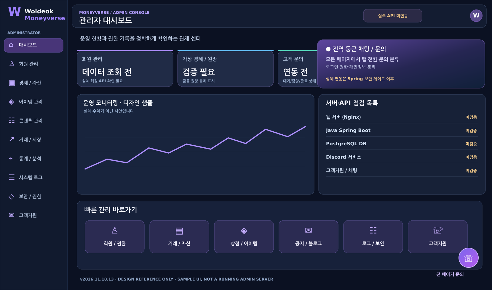
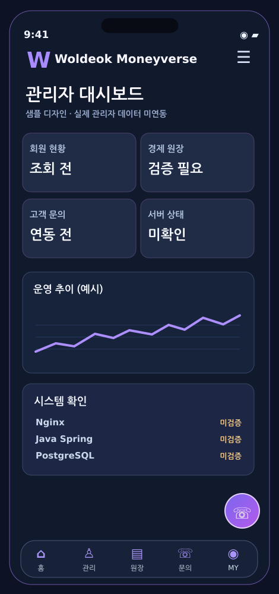

# 관리자 페이지 리디자인·전 페이지 둥근 채팅 문의 — v2026.11.18.13

상태: 독립 미리보기 개발 / 운영 API 연결 보안 게이트 미통과
상위 기획: [180개 화면 PC·모바일 리디자인](ALL_PAGES_RESPONSIVE_REDESIGN_v2026.11.18.12.ko.md).
영문 정본: [English](ADMIN_GLOBAL_CHAT_DESIGN_v2026.11.18.13.md).
기준 GitHub main: `0590fac4e8a82bc986ba1b8c64f014d18daca9e9` / 이전 디자인 브랜치: `cf928183b38f8b01b70ab66780d3e2ad7c750930`.

## 사용자 요구
현재 서비스 프론트엔드는 전혀 수정하지 않는다. 이전 승인한 보라·블루 기반 게임형 경제 디자인에 맞춰 **관리자 PC·모바일 이미지 시안**을 만들고 통합 기획에 첨부한다. 고객 문의와 회원 간 채팅을 어디서든 쉽게 펼칠 수 있는 **둥근 플로팅 버튼**을 별도 개발해 미리보기에서 검증한다.

## 기존 기능 확인 및 보안 차단 요건
- 기존 `FloatingSupportChatWidget`은 /app-api/v1/support 및 /app-api/v1/chat을 통한 문의/1:1 쪽지 기능이 이미 있다. 신규 중복 DB·API 생성하지 않는다.
- `RouteAwareFloatingUtilities`는 관리자 경로에 위젯을 렌더하지 않는다. 관리자 권한 분리·보안 검증 없이 단순히 이 제한을 삭제해서는 안 된다.
- Spring SupportController와 ChatController는 사용자 조작 가능한 X-User-Id / x-actor-user-id 헤더를 사용자 신원으로 취급하고 값이 없을 때 고정 UUID를 대입한다. SupportService는 DB 오류 후에도 성공한 것처럼 대체 응답을 보낼 수 있다. 실제 채팅 연동 전에 **서버 인증 세션 기반 신원·DB 소유권·실패 시 실패 응답** 보완 필수. 관련 Java 변경은 다른 보안 작업 브랜치와 충돌하지 않도록 이번 작업에서 제외한다.

## 관리자 PC·모바일 화면 구성
PC 관리자 화면: 왼쪽 메뉴(대시보드·회원·경제/원장·아이템·콘텐츠·모니터링·보안·고객지원), 시스템 출처 기반 상태, 운영 현황, 승인 대기 작업, 감사 이력, 서비스 로그. 실제 서비스에서는 API가 확인되지 않으면 0/정상 대신 **UNKNOWN/조회 실패**로 표기한다.

회원 관리: 권한 있는 검색·페이지네이션·작업 이력·재인증. 금융 관리: 원장 기준 금액/기준 시각/오류, 민감 조작 시 명시적 확인/감사. 고객지원: 미배정·대기·답변·종료 상태, 담당자 및 영수증. 로그: Nginx/Spring/Discord/API 출처 및 심각도. 모바일: 단일 컬럼, 사이드 메뉴 드로어, 정확한 단위, 둥근 문의 버튼과 하단 내비 충돌 방지.

시안의 숫자·그래프는 전부 **디자인 샘플**이며 운영 실측 데이터로 취급하지 않는다.

## 전역 플로팅 채팅 명세
- 화면 오른쪽 아래 **원형 56px** 문의/채팅 버튼. 모바일은 하단 내비(64px) 위에 최소 16px 거리 확보. 기존 덕이 도우미 및 다른 플로팅 요소와 겹치지 않는다.
- 열면 '고객 문의'와 '1:1 채팅' 탭, 문의 분류(계정·WLD 원장·거래소·아이템/퀘스트·버그·기타), 자주 묻는 질문, 새 문의·이력, 실시간 상태(대기·읽음·실패 등)를 명확히 구분.
- 열린 패널은 내부 페이지 이동 후에도 유지하고, 입력 중인 글은 SPA 메모리에서만 보관한다. localStorage 등 디스크에 실제 대화·계정·토큰 저장 금지; 로그아웃 및 계정 전환 시 초기화.
- '어떤 페이지에서 문의했는지'는 /admin·/wallet·/stocks·/shop 등 **상위 카테고리만** 안전하게 전달한다. 쿼리 문자열, 개인 ID, 결제번호 또는 URL 조각 자동 전송 금지.
- 입력 공백 금지, 최대 1000자, 연속 중복 제출 방지, 실제 서버 성공 영수증 수신 전 '접수 완료' 금지. 미리보기에서는 **'전송되지 않은 데모'**라고 항상 표시한다.
- 키보드 Escape 닫기, 열린 뒤 포커스 이동·닫힌 뒤 버튼 복귀, 44px 터치 영역, 읽기 쉬운 모바일 패널, 스크린리더 및 동작 줄이기.
- 고객지원/관리자 DM 권한은 분리한다. 관리자가 다른 회원의 대화를 임의 열람하게 만들지 않는다.

## 시안 이미지 첨부

## 별도 개발 범위
`docs/design/admin-chat-v2026.11.18.13/preview/`에 기존 프론트엔드 코드와 분리된 동작 가능한 독립 웹 미리보기를 구현한다. 화면 전환 시 문의 패널·작성 내용 상태 유지, 둥근 버튼·두 가지 탭·단축 분류, 미전송 경고를 구현한다. 실제 DB·회원 정보·채팅 API 호출 없음. 운영 화면 반영·배포와 동일시하지 않는다.

## 보안 해결 후의 실제 연동 순서
1. 다른 보안 담당 브랜치에서 Spring 로그인 세션 확인, 헤더 신원 위조 금지, 고정 UUID 제거, 응답 무결성 및 CSRF·소유권 검증.
2. DB 오류 시 성공 응답 대신 정확한 실패 결과, 처리 영수증, 교차 회원 조회 거부 검증.
3. 기존 고객지원 컴포넌트와 조합해 중복 위젯을 없애고 관리자 전용 권한 모드를 별도 설계한 뒤 신규 코드 브랜치에서 통합.
4. 320/360/390/768/1440px, 고대비, 키보드·스크린리더·금액/URL 개인정보, 동시 클릭, 권한·원장 회귀를 테스트 서버의 정확한 SHA로 검증.
5. 모든 릴리스 게이트와 롤백 검증이 통과하기 전 운영 전환 금지.

[Spring 채팅 보안·허위 성공 P0 기록](../findings/2026-11-18-spring-support-chat-auth-gate-v2026.11.18.13.ko.md) / [English](../findings/2026-11-18-spring-support-chat-auth-gate-v2026.11.18.13.md).

**현재 상태:** 이미지·계획·독립 기능 미리보기만 구현. 실제 운영 프론트엔드와 서버를 변경하지 않는다.
