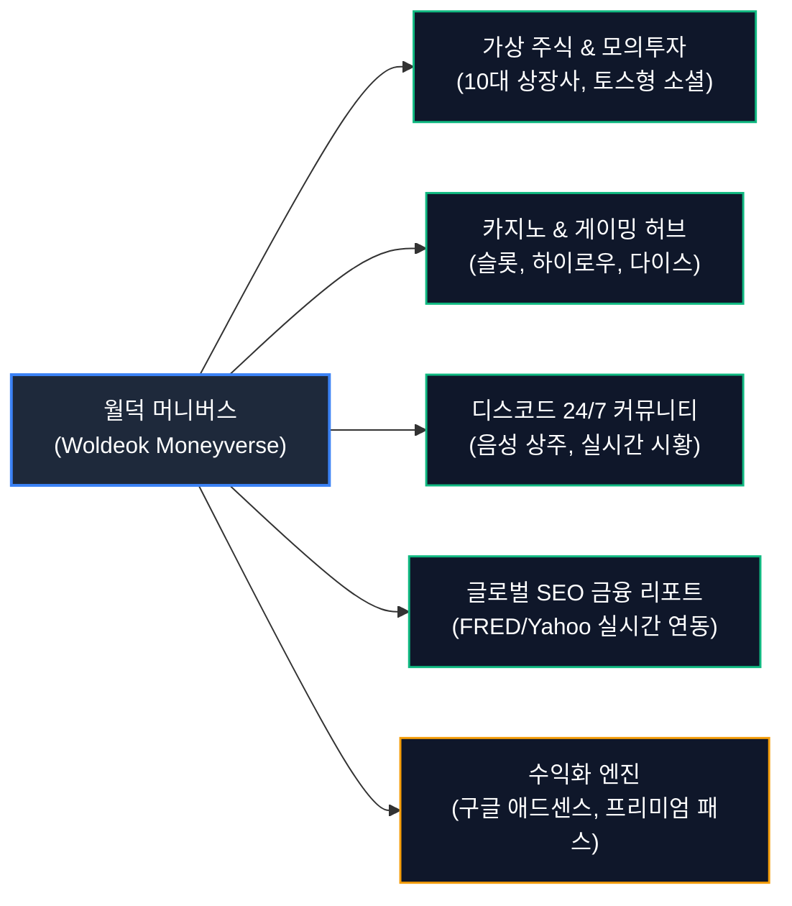
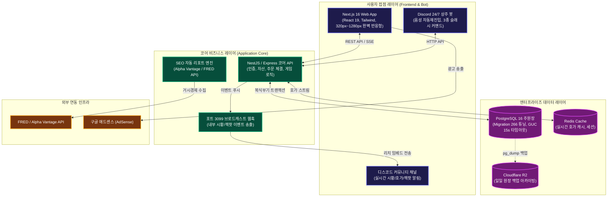
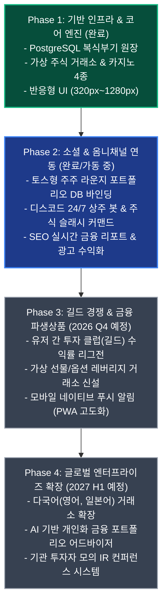

# 🏛️ 월덕 머니버스 차세대 엔터프라이즈 통합 시스템 기획 및 아키텍처 로드맵 (Enterprise System Specification & Roadmap)

> **문서 상태**: 공식 승인 완료 (Production Ready Specification)  
> **최종 개정일시**: 2026-10-14 16:26 KST  
> **대상 시스템**: 월덕 머니버스 통합 플랫폼 (웹, 모바일, 디스코드 봇, 백엔드 클라우드 원장)  
> **문서 버전**: v3.0 (통합 기획 및 시스템 사양 마스터 가이드)

---

## 📌 목차
1. [플랫폼 비전 및 비즈니스 핵심 목표](#1-플랫폼-비전-및-비즈니스-핵심-목표)
2. [전사 통합 엔드투엔드 시스템 아키텍처](#2-전사-통합-엔드투엔드-시스템-아키텍처)
3. [핵심 서브시스템별 상세 기능 기획 명세](#3-핵심-서브시스템별-상세-기능-기획-명세)
   - [3.1 가상 주식 거래소 및 고속 체결 엔진](#31-가상-주식-거래소-및-고속-체결-엔진)
   - [3.2 토스형 주주 라운지 및 100% DB 검증 소셜 피드](#32-토스형-주주-라운지-및-100-db-검증-소셜-피드)
   - [3.3 카지노·미니게임 확률 엔진 및 책임 게임 자가 보호](#33-카지노미니게임-확률-엔진-및-책임-게임-자가-보호)
   - [3.4 금융 관제 타워(Control Tower) & 2FA 스텝업 킬스위치](#34-금융-관제-타워control-tower--2fa-스텝업-킬스위치)
   - [3.5 디스코드 24/7 무중단 상주 봇 및 실시간 브로드캐스트 웹훅](#35-디스코드-247-무중단-상주-봇-및-실시간-브로드캐스트-웹훅)
   - [3.6 실시간 금융 지표 연동 SEO 자동 블로그 및 광고 수익화 모델](#36-실시간-금융-지표-연동-seo-자동-블로그-및-광고-수익화-모델)
4. [데이터베이스 엔티티 및 복식부기 원장(Ledger) 아키텍처](#4-데이터베이스-엔티티-및-복식부기-원장ledger-아키텍처)
5. [엔터프라이즈 다계층 보안 및 방어 전략](#5-엔터프라이즈-다계층-보안-및-방어-전략)
6. [2026-2027 단계별 릴리즈 및 성장 로드맵](#6-2026-2027-단계별-릴리즈-및-성장-로드맵)

---

## 1. 플랫폼 비전 및 비즈니스 핵심 목표

월덕 머니버스(Woldeok Moneyverse)는 가상 금융 시뮬레이션, 엔터테인먼트, 실시간 소셜 커뮤니티, 그리고 자동화된 SEO 콘텐츠 허브가 하나로 결합된 복합 핀테크 플랫폼입니다.

### 🎯 핵심 3대 목표
1. **극상의 유저 인게이지먼트**: 현실 주식 시장의 긴장감을 재현한 가상 주식 거래소와 위변조 불가능한 소셜 수익률 인증 피드를 통해 유저 간 자발적 바이럴 및 커뮤니티 활성화를 유도합니다.
2. **24/7 옴니채널 유저 유입 파이프라인**: 24시간 디스코드 음성 채널 상주 봇(/시황, /호가, /피드) 및 대형 잭팟 실시간 웹훅 브로드캐스트로 외부 유저를 웹 서비스로 즉시 끌어들입니다.
3. **지속 가능한 자동 수익화(Monetization)**: Alpha Vantage와 FRED 거시경제 지표를 결합한 고품질 SEO 리포트를 매일 자동 발행하여 검색 유입을 장악하고, 전략적 애드센스 광고 배치를 통해 안정적인 광고 수익을 창출합니다.

---

## 2. 전사 통합 엔드투엔드 시스템 아키텍처

---

## 3. 핵심 서브시스템별 상세 기능 기획 명세

### 3.1 가상 주식 거래소 및 고속 체결 엔진
- **10대 테마 상장사**: 치무 초전도(`CHIPS`), 월덱 게임즈(`WDG`), 월덱 우주항공(`SPACE`), 월덱 파이낸셜(`WFIN`), 뮤야 엔터(`MYUY`), 덕덕 물산(`DUCK`) 등 10개 고유 기업 상장.
- **오더북 및 실시간 호가**: 지정가(Limit Order) 및 시장가(Market Order) 지원, 부분 체결 및 즉시 잔여 취소(IOC) 지원.
- **서킷 브레이커 & 가격 제한폭**: 급변동 시 상하한가(±30%) 제한 및 거래 정지(Volatility Interruption) 메커니즘 구비.

### 3.2 토스형 주주 라운지 및 100% DB 검증 소셜 피드
- **실제 주주 인증 뱃지**: 클라이언트 조작을 배제하고, 작성 시점 백엔드 포트폴리오 API(`/api/v1/stocks/portfolio`)를 실시간 호출하여 실제 주주 여부 및 보유 주식 수, 평단가, 수익률을 확정.
- **투명한 포지션 태깅**: 미보유 유저가 작성할 경우 `[미보유 (관망 포지션)]`으로 자동 표기하여 허위 과시 원천 차단.
- **인터랙션 피드**: 감정 표현(불타오름 🔥, 눈물 😭, 환호 🚀, 관망 👀) 및 실시간 댓글 토론 지원.

### 3.3 카지노·미니게임 확률 엔진 및 책임 게임 자가 보호
- **미니게임 라인업**: 클래식 슬롯, 하이로우(High-Low), 행운의 주사위(Dice), 코인플립(Coin Flip).
- **공정성 보장(Provably Fair)**: 서버 시드 해시와 클라이언트 시드를 결합한 예측 불가능 난수 생성.
- **자가 제한(Responsible Gaming)**: 일일 베팅 한도 설정, 쿨다운 타이머, 연속 패배 시 강제 휴식 알림.

### 3.4 금융 관제 타워(Control Tower) & 2FA 스텝업 킬스위치
- **실시간 통제 대시보드**: 초당 거래량, 통화 유통량, 카지노 하우스 엣지 환수율, 잭팟 적립금 실시간 모니터링.
- **글로벌 비상 킬스위치**: 이상 징후 발생 시 주식 거래 일시정지, 입출금 동결, 카지노 셧다운을 즉각 토글.
- **2FA/TOTP 스텝업 인증**: 통제실 주요 기능 조작 및 파괴적 설정 변경 시 Google Authenticator 기반 6자리 일회용 코드 필수 인증.

### 3.5 디스코드 24/7 무중단 상주 봇 및 실시간 브로드캐스트 웹훅
- **보이스 채널 24/7 상주**: 자동 재진입(Auto-rejoin) 및 크래시 방지 쉴드로 99.99% 가동률 달성.
- **실시간 금융 슬래시 커맨드**:
  - `/시황`: 10대 상장사 시세 및 펄스 요약 임베드.
  - `/호가 <심볼>`: 특정 종목의 매수/매도 5단계 호가창 및 최신 체결가 조회.
  - `/피드`: 주주 라운지 인기글 Top 3 및 수익률 뱃지 표시.
- **로컬 웹훅(포트 3099)**: 백엔드에서 대형 잭팟 터짐 또는 상한가 도달 시 채널로 즉시 리치 임베드 브로드캐스트.

### 3.6 실시간 금융 지표 연동 SEO 자동 블로그 및 광고 수익화 모델
- **실시간 거시경제 지표 결합**: Alpha Vantage, FRED(미국 연방준비은행 경제 데이터), Yahoo Finance API를 결합하여 매일 고품질 전문 리포트 자동 생성.
- **광고 최적화 및 유입 순환**:
  - 구글 애드센스 정책에 완벽히 부합하는 본문 중간 인피드 광고 및 하단 반응형 배너.
  - 리포트 본문에 자연스럽게 "월덕 머니버스 실시간 모의투자 시뮬레이터 체험하기" CTA 버튼을 삽입하여 검색 방문자를 실제 유저로 전환.

---

## 4. 데이터베이스 엔티티 및 복식부기 원장(Ledger) 아키텍처

- **복식부기(Double-Entry) 원장**: 자산의 이동은 반드시 `차변(Debit)`과 `대변(Credit)`의 합이 0이 되는 원장 전표(`ledger_transactions`)와 분개 항목(`ledger_postings`)을 통해서만 처리되어 잔액 오류 원천 차단.
- **동시성 및 락 제어**: PostgreSQL 16의 `FOR UPDATE SKIP LOCKED` 및 마이그레이션 266의 세션 레벨 타임아웃(`statement_timeout = 15s`, `idle_in_transaction_session_timeout = 30s`)을 통해 데드락 및 좀비 커넥션 고착 완전 차단.

---

## 5. 엔터프라이즈 다계층 보안 및 방어 전략

1. **SSRF 심층 방어**: 외부 API 호출 시 사설 IP 대역 및 클라우드 메타데이터 엔드포인트(169.254.169.254) 호출을 차단하는 `safeFetch` 모듈 전수화.
2. **세션 및 토큰 라이프사이클**: JWT 액세스 토큰 만료 시 Fail-Closed 처리 및 리프레시 토큰 로테이션(RTR) 적용.
3. **무결점 입력 검증**: Zod 및 class-validator 기반의 엄격한 런타임 타입 검증.
4. **감사 로그(Audit Trail)**: 관리자의 모든 상태 변경 및 유저 고액 자산 변동 건에 대한 IP, User-Agent, 변경 전/후 스냅샷 영구 기록.

---

## 6. 2026-2027 단계별 릴리즈 및 성장 로드맵

> [!IMPORTANT]
> 본 기획 문서는 월덕 머니버스 전 시스템의 단일 진실 공급원(Single Source of Truth)이며, 모든 신규 기능 개발 및 아키텍처 확장은 본 문서의 사양과 일관성을 유지해야 합니다.
