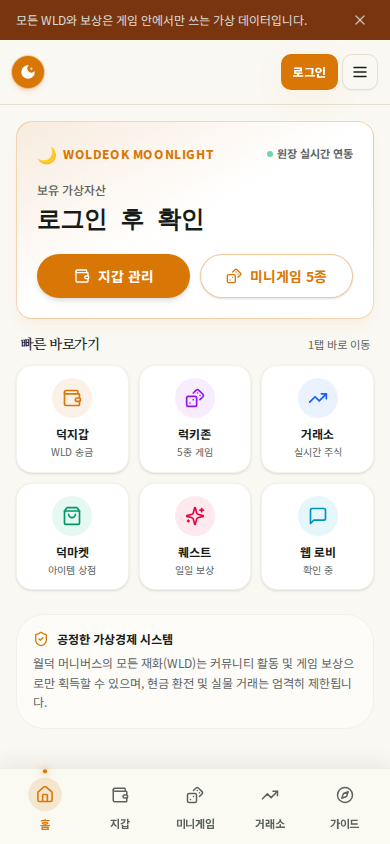

# 전체 Spring 프론트엔드 — 홈 디자인 구현·이미지 인계·QA 기준 v2026.11.19.32.1

**상태: 필수 상세 구현 계획 / 미구현·미배포 / P0 열림**
[운영 홈 불일치 이미지·검증 보고서 한국어](../findings/LIVE_HOME_APPROVED_UI_GAP_v2026.11.19.32.1.ko.md) · [English](../findings/LIVE_HOME_APPROVED_UI_GAP_v2026.11.19.32.1.md)

사용자 최신 지시는 **홈·회원·관리자·전체 API를 Java Spring Boot MVC+Thymeleaf로 구현·서빙**, 구현 후 Node/Next 런타임 의존성 제거, 기본 언어 영어·2차 한국어, 기존 기능 보존 및 실제 운영 검증이다. 과거 Next 유지 기획은 역사 기록으로 남기되 최신 지시와 충돌하면 본 계획을 우선한다.

## 실제 구현 기준으로 사용할 디자인 이미지

이미지는 GitHub `main` v31 복구본이며 **HTML·CSS·Spring 컨트롤러·인증·실제 API가 구현됐다는 증빙이 아니다**. 사용자 제공 모바일 화면의 ‘신규 사용자 유입을 위한 홈 화면 3안’은 공개 루트 `/`의 HTML에도 그대로 출력되고 있다. 디자인 비교 자료를 실제 서비스 홈으로 제공하면 기능 전환 완료로 판정할 수 없다.

## 페이지 세부 UI/기능 계약

| 화면 구역 | 시각/배치 요구 | 필수 기능·원천 | 오류/반응형 기준 |
| --- | --- | --- | --- |
| 공통 헤더 | 네이비·보라 브랜드, KO/EN 전환, 로그인/가입·메뉴 44px 이상 | Spring 서버 세션 및 실제 사용자 상태 | 비어 보이는 녹색 버튼 제거 또는 레이블·명암 개선, 320px/200% 확대 검증 |
| 홈 메인 히어로 | 서비스 정체성+한 개 주요 CTA, 실서비스 내용 | 익명·로그인 분기, Spring 홈페이지 템플릿 | 디자인 3안 제목을 공용 홈 H1으로 사용 금지 |
| 온보딩/첫 퀘스트 | 게임처럼 체감되는 단계·진척·보상 설명 | 사용자의 실제 단계/진척 API/완료 영수증 | 없는 보상이나 ‘3분 완성’ 측정 수치 임의 표기 금지 |
| WLD·지갑·경제 | 수치·단위·원장 근거·최종 검증시각 표시 | Spring→승인된 PostgreSQL 함수, 사용자 소유권 검증 | 401/403/503, 원천 장애는 UNKNOWN/STALE, 가짜 0/정상 금지 |
| 주식·거래·직업·상점 | 실제 페이지 이동 및 기능 카드 | 거래/직업/상점 Spring 라우트·권한·실 API | 이미지/빈 카드로 기능 대체 금지 |
| 게시판·커뮤니티 | 작성/조회/댓글 동선 | 세션·권한 및 실제 저장 결과 | 로그아웃/오류·재시도·콘텐츠 미확인 구분 |
| 문의·1:1 채팅 | **전역 단일 56px 원형 버튼**, 하단 내비와 분리 | 신원 헤더 위조 제거·CSRF·대화 소유권·전송 영수증 | 키보드 Esc/포커스 복귀, 320/390/768/1440, 연결 장애 |
| 실시간 상태 | 소스 기반 최신 상태만 초록색 승인 | heartbeat/수집 갱신시각·정확한 API 응답 | STALE/오류/연결 안 됨 명시, 장식 배지 ‘라이브’ 금지 |
| 디자인 시스템 | 전체 공통 토큰·여백·컴포넌트/스크린리더 | Spring MVC+Thymeleaf SSR, CSS/필수 JS만 사용 | 44px 터치, 200% 확대, 가로 넘침·모달 잘림 금지 |

## 디자인 토큰·반응형 구현 명세

- 배경 네이비 `#0B1223`, 카드 `#151F38`, 기본 글자 `#F3F6FF`, 보조 글자 `#B9C7E0`.
- 기본 강조 보라 `#9D7BFF`, 보조 파랑 `#63CCF7`; 에메랄드색은 **실제 검증된 정상 상태에만** 사용한다.
- 모바일 320·360·390px은 한 열, 최소 좌우 여백 16px, 테이블은 내부 스크롤, 데스크톱 1440px 12열 배치를 기준으로 한다.
- 문의 버튼 PC 우측24px, 모바일 우측14px/하단 안전 영역 위; 버튼56px, 패널은 뷰포트 내에 유지. 하단 메뉴·선물 0/7·가이드 툴팁과 화면을 가리지 않도록 실제 요소 높이 측정.
- 이미지에는 대체 설명(alt)·출처/버전·원본 승인 여부를 표시하고, 디자인 이미지의 예시 수치는 실 원장 값으로 사용하지 않는다.
- 로그인·설정·메뉴 버튼은 아이콘 로딩이 실패해도 읽을 수 있는 텍스트/aria-label을 제공한다.
- 영어 기본·한국어 보조는 쿠키가 없는 신규 방문과 사용자가 KO를 선택한 재방문을 각각 검증한다.

## 작업 단위와 증거 수집 기준

| ID | 우선 | 담당 영역 | 실제 작업·종료 조건 | 상태 |
| --- | --- | --- | --- | --- |
| F32-01 | P0 | 서버/배포 | 공개 루트→Nginx→Spring/정적 파일→아티팩트 SHA, 변경 시간·로그 작성자 확인 | 미완료 |
| F32-02 | P0 | 디자인·프론트 | v31 PNG 180+2종과 최초 승인 이미지 시각 대조·시안 버전/토큰 확정 | 미완료 |
| F32-03 | P0 | Spring UI | ‘3안 갤러리’가 아닌 실제 기능 홈페이지 Spring MVC/Thymeleaf 구현 | 미완료 |
| F32-04 | P0 | 인증/원장 | 서버 세션·사용자 소유권·CSRF·원장 함수·실제 거래 영수증 양성/음성 QA | 미완료 |
| F32-05 | P0 | 채팅/문의 | 조작 가능한 회원 ID 헤더/고정 UUID/허위 성공 차단, 단일 전역 채팅 버튼 | 미완료 |
| F32-06 | P1 | 모바일/접근성 | 320/360/390/768/1440/200% 화면 캡처 비교, 빈 녹색 CTA·겹침·키보드 | 미완료 |
| F32-07 | P0 | 전 경로 QA | 총 180개 소스 경로와 실제 URL·권한·렌더러·API·상태코드·정확한 SHA 증거 매핑 | 미완료 |
| F32-08 | P1 | 상태/실시간 | ‘라이브’ 표시를 실제 하트비트/갱신시각과 연결하고 장애/STALE 표시 | 미완료 |
| F32-09 | P0 | Test·릴리스 | 새 브랜치 Test Spring 배포·실 브라우저 QA·운영 롤백 검증 | 미완료 |
| F32-10 | P0 | 운영 | 모든 필수 보안·기능·UI·테스트를 통과한 범위에 한해 무중단 승격·외부 재검증 | **차단** |

## 완료 판정 규칙과 QA 수치 충돌

- `GET /` 200은 **접속 성공일 뿐**, 홈 UI 기능 동등성·인증·금융·전환 성공을 뜻하지 않는다.
- 운영 HTML이 세 가지 시안 소개 페이지이면, 비록 시안 이미지가 예뻐도 **HOME-01 불합격**.
- 미니PC 로컬 v30 기획은 네이티브 운영 Spring 화면 5개·나머지 175개 미인증이라고 기록하지만, 같은 환경의 로컬 QA JSON은 180개 인증으로 표기한 **상충 근거**가 존재한다. 특히 해당 JSON은 이번 작업의 GitHub main에 버전 관리된 문서가 아니다. 외부 실제 URL·SHA·권한·브라우저 증거 없이는 180/180 완료 주장 금지.
- 오류/실패/권한 거부를 가짜 성공·예시 수치·빈 목록으로 대체하면 불합격.
- 현재 사이트 UI를 직접 수정하거나 운영 승격하는 작업은 **이번 문서화 범위 밖**. 문서/이미지 존재를 작업 완료로 보고하지 않는다.
