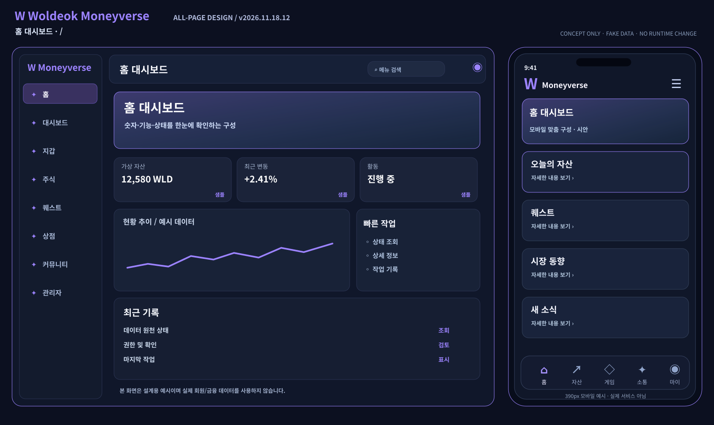
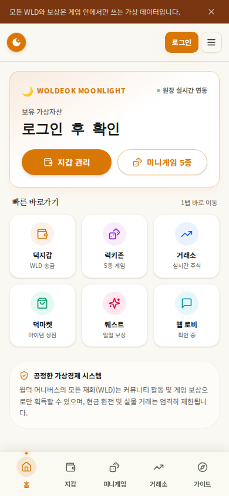

# Spring-only Home/UI Image Implementation & Evidence Gates v2026.11.19.32.1

**Adoption status: REQUIRED IMPLEMENTATION PLAN / NOT IMPLEMENTED / P0 OPEN**
**Primary evidence:** [Live homepage mismatch and images (EN)](../findings/LIVE_HOME_APPROVED_UI_GAP_v2026.11.19.32.1.md) · [한국어](../findings/LIVE_HOME_APPROVED_UI_GAP_v2026.11.19.32.1.ko.md)
**Owner priority:** all HTML and API runtime must ultimately run on Java Spring Boot MVC + Thymeleaf; English default and Korean secondary; no Node/Next runtime once genuinely migrated. Historical plans retaining Next runtime are superseded.

## Design images are specifications, not deployable UI

The GitHub main image-restore v31 provides 180 combined responsive route concepts + two admin references. These do not prove parity with original chat-generated imagery or any working Spring template. `https://easy-scraping.com/` currently displays a **three-home-concept showcase** at the root, verified by direct HTML GET and the Spring static-file snapshot. It must not be mistaken for the actual approved customer home.

## Section-by-section Spring home implementation contract

| Section / placement | Visual requirement | Server-side source and required behavior | Failure / mobile handling |
| --- | --- | --- | --- |
| Shared header | Navy/violet brand, language EN/KO, genuine sign-in and menu actions, 44px targets | Spring-rendered locale; valid server session; no unexplained empty green login rectangle | Guest/signed-in/logout, 320px and 200% zoom |
| Hero (root /) | Real service identity, one primary action, non-decorative information hierarchy | Authenticated user sees permission-safe summary; guest sees meaningful service introduction and actions | UNKNOWN/STALE without falsely green live badge |
| Onboarding | Game-like quest progress only when API-backed and identity-scoped | Authenticated Spring progress/receipt; guest preview explicitly marked as demo | No “3-minute complete” promise unless measured; no fake WLD rewards |
| Economy / wallet | Actual balance status, amount units and last calculated time | PostgreSQL canonical function via Spring session ownership | 401/403/503 and stale source; no invented 0/success |
| Stock & trading entry | Real symbol/quote and trading route | Authorized API/read provenance and separate action confirmation | No price/pnl invented by static snapshot |
| Work/jobs, shop, community | Dedicated CTA links and current feature states | Spring routes and valid permissions; proper unavailable/empty semantics | Preserve scrolling and bottom navigation without occlusion |
| Support/chat | ONE 56px global launcher at stable position and role-safe tabs | No client identity header; authenticated, ownership/CSRF/receipt verified before actual send | Mobile safe-area, Escape, focus restoration, offline errors |
| Desktop/mobile design system | Shared tokens and consistent 320/390/768/1440 layouts | Thymeleaf templates + scoped CSS/JS enhancement; no RSC/Flight/Next runtime | WCAG AA focus order, 44px minimum target, 200% zoom, RTL not assumed |
| Status badges | Do not display “real-time connected” without actual evidence | Real heartbeat/timestamp or request-verified status; fail closed | Show STALE/ERROR/DISCONNECTED explicitly |

## Design tokens (implementation direction, not existing runtime proof)

- Background and surfaces: navy `#0B1223`, slate `#151F38`, subdued gradient; foreground `#F3F6FF`, secondary text `#B9C7E0`.
- Accent violet `#9D7BFF`, secondary blue `#63CCF7`; emerald reserved for **verified** success/positive state rather than an ungrounded blanket “live” promise.
- Layout: max-width container, 16px gutters at 320–390, desktop 12-column composition; responsive single-column cards on mobile, no horizontal overflow.
- Dock: one 56px circular launcher, right 14px mobile / right 24px desktop; mobile bottom `calc(5.5rem + env(safe-area-inset-bottom))` or measured safe height above current bottom nav; dismissible panel within viewport, aria and 44px controls.
- Navigation labels must have visible and screen-reader-readable names even when icon or font assets fail. No blank green CTA.
- No copyrighted image copying from the browser screenshot. Use the separately approved/versioned images with explicit provenance and alternative text.

## Tasks and gates (not implementation claims)

| ID | Owner domain | Work and evidence | Status |
| --- | --- | --- | --- |
| F32-01 | Release/ops | Trace current root Nginx upstream, Spring static root, artifact SHA, asset timestamps and audit actor; preserve reversible previous build | **OPEN** |
| F32-02 | Design/frontend | Compare original chat-approved renderings with v31 recovered PNG (explicit pixel parity uncertainty), approve canonical PC/390 layout and tokens | **OPEN** |
| F32-03 | Spring frontend | Build functional Spring MVC+Thymeleaf home, not a concept gallery; preserve guest/onboarding/member wallet/stock/job routes | **OPEN** |
| F32-04 | Auth/finance | Prove role-bound sessions, authorization, exact amounts and receipts; cross-user/CSRF negative tests | **OPEN** |
| F32-05 | Chat/security | Remove forged actor-header/fallback identity, false success; confirm one global support dock and genuine send receipts | **OPEN** |
| F32-06 | UI/browser | Real Chrome screenshots 320, 360, 390, 768, 1440, 200% zoom, keyboard/screen reader; green CTA and overlapping bottom controls | **OPEN** |
| F32-07 | QA | Per-route positive/negative API evidence, actual Java rendered output, English default/Korean secondary and feature parity | **OPEN** |
| F32-08 | Analytics/status | Prove “live integration” badge derives from real status; clear stale and disconnected messages | **OPEN** |
| F32-09 | Test/release | Exact-SHA Test deployment with no member/financial writes; Nginx/Cloudflare routing and rollback runbook | **OPEN** |
| F32-10 | Production | Only after all release/security/QA gates pass, scoped zero-downtime promotion and independent external verification; preserve existing working features | **BLOCKED** |

## Discrepancy and provenance governance

The mini-PC local master records partial Spring deployment with **5 confirmed native UI routes and 175 unverified**, but a local v30 JSON route board separately claimed all 180 verified. The JSON is not on current GitHub main and its success is inconsistent with the observed root. **These counts must be reconciled by a new read-only route trace before any “180/180” announcement.** The canonical GitHub main at task start is `78a3ff446fae1ee4754da6edd14b7fc3409f43a2`; other local working `main` commits are not implicitly public production.

## Acceptance / stop decision

Release gate fails if any of these is true: a design comparison gallery still appears at `/`; a Next static snapshot or HTML 200 is treated as Spring function parity; images are missing or unapproved; a status badge is fabricated; member data/auth/ledger has no source; mobile controls occlude content; login CTA has no accessible name; test evidence lacks exact SHA and rollback.

**This version documents and prioritizes the mismatch; NO production frontend fix or promotion was performed here.**
