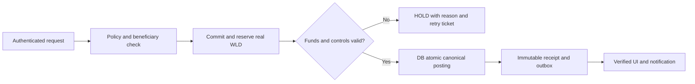

# Woldeok Moneyverse Sovereign Treasury — Current-State Forensic Inventory & Detailed Service Roadmap

> **Version**: v2026.11.08.1936 | **Status**: DRAFT / RESEARCH + PLANNING / NOT IMPLEMENTED | **2026-11-08 KST**
> **English canonical** | [한국어 전체 기획](TREASURY_SERVICE_CURRENT_STATE_AND_DETAILED_FEATURE_ROADMAP_v2026.11.08.1936.ko.md)
> **Parent authority**: [PROJECT_PLAN](PROJECT_PLAN.md) → [Integrated Master](INTEGRATED_PLANNING_MASTER.md) → [v523 institutional separation](CENTRAL_BANK_MINT_TREASURY_ECONOMY_CORE_SPEC.md) → [v1618.2 Treasury Core](../architecture/TREASURY_CORE.md) → [v1701 Finance Integrity Core](../architecture/FINANCE_INTEGRITY_CORE.md).
> **Prior draft**: [v1912 comprehensive proposal PR #2882](https://github.com/wtrdd1-hash/Woldeok-Moneyverse-Migration/pull/2882). **Deep source matrix:** [39 verified official references](../research/2026-11-08-sovereign-treasury-feature-reference-matrix-v1936.md). **Evidence diary:** [v1936 worklog](../worklog/2026-11-08-treasury-current-state-roadmap-v1936.md).
> **Change scope**: source/runtime/DB read-only inventory and implementation design only. No app, SQL migration, financial movement, deployment or policy adoption. Changes require a separate approved implementation milestone and exact Test/Production gate.

## 0. Decision and scope

Build one coherent **fictional WLD sovereign economy** in which Central Treasury, Central Bank, Mint, government bonds, SWF, state enterprises, pensions, health insurance, deposit insurance, public grants and commercial banks are **service domains on top of one canonical ledger**, not independent money printers. Prioritise protection against mismatched balances, fictitious funding, double payment, partial settlement and mislabelled warnings. Expand gameplay and fiscal transparency only after current payment primitives are fixed. Feature flags default OFF for new money-writing actions; verified legacy reads remain available.

**Never confuse:** code exists / route responds / runtime SHA matches / DB migration applied / owner-authorized action succeeds / canonical WLD settlement final / end-user sees a certified receipt. A feature is 'functional' only when each necessary layer is independently tested.

## 1. Evidence, date, confidence and authority drift

The observations below are from a 2026-11-08 KST read-only miniPC session. Source origin/main began at `b56fdc748dd817eb250b7d5d06019aaf5c299131`; the intermediate re-fetch changed to `4938d491d9eaaec161ead89c9317392380d6de92` (#2911 merged v291 disk/docs). Current isolated branch deliberately started from its earlier main base to avoid trampling other agents; a final refresh/rebase check is mandatory before PR handoff. The living Project Plan currently displays v1518 (2026-10-30) despite newer source and v1770 runtime; newer summary is **not superior product-policy authority**.

### 1.1 Observed infrastructure and finance

| Evidence | Observed data | Confidence / qualification |
|---|---|---|
| Production release pointer | `/srv/moneyverse-data/releases/prod-v2026.11.06.1770-17fde45484`; public `/api/version` ID starts `17fde45484` | Runtime pointer+public version, not authenticated transaction E2E |
| Official Test pointer | `/srv/moneyverse-data/releases/test-v2026.11.04.1742-dfb98c7c5c22` | Stale relative to main/Production; no fresh official Test E2E |
| Connected DB | `woldeok_moneyverse_dev`, `moneyverse_migrator`; host documents link 5433 to Production | **Do not infer isolation from _dev name.** Need verified connection provenance |
| Ledger counts | 895 transactions / 1854 postings / 42 balance rows | Snapshot; 0 unbalanced transaction sums in read-only aggregate, not all business workflows |
| Canonical Treasury cash | `accounts(TREASURY,treasury)` = 191,055,911 WLD | Current ledger projection, not historical provenance guarantee |
| Logical 5 vaults | `system_treasury_vaults` total = 191,055,911 WLD | Aggregate exactly matches canonical account at snapshot |
| Public Treasury BFF | `GET /api/treasury/overview` HTTP 200, `status:RECONCILED`, total 191055911, claimed available 190055911 and reserve 1000000 | Verified **current fiscal balance only**; payout history and pre-epoch balances are unknown |
| `treasury_core_receipts` | 0 rows | NPS funded-core path has no receipts; does NOT negate ordinary Treasury disbursements |
| Grants | 3 rows: 2 PENDING_REVIEW, 1 APPROVED for 500000 WLD; approved row has NULL `ledger_tx_id`, NULL `disbursed_at` | Approved ≠ paid, not intrinsically an error |
| Treasury disbursements | 1 row, one canonical `ledger_transaction_id` | Historical evidence of one disbursement, not universal payout pass |
| SWF | 4 portfolio rows, 276 events | Activity records, not asset custody/liquidity/audit confirmation |
| Mint | 1 certificate | Identity/provenance/issuer authorization still require joined audit |
| NPS | 1 account in ACCUMULATING; 0 contributed transaction rows; 0 payout logs | No observed retired recipient in that table; zero logs must not be advertised as payouts |
| Government bonds | 3 bonds; 0 owner holdings; 0 subscriptions/orders; 0 repo loans; 0 coupon logs | Issuance/config source exists, actual member trading E2E unproven |
| KDIC | 1 fund; 0 premium records; 0 payout records | Deposit insurance logic exists, prefunding and claim E2E unproven |
| Health insurance | 1 claim/record with canonical ledger link | At least one payout-path receipt; end-user insured-state E2E unproven |
| Central bank decisions | 0 decision history rows | Policy schema exists, executed policy decision lineage unproven |
| Migration source vs DB | source `340-soe-canonical-dividend-harvest-to-vault.sql` and `341-pension-canonical-settlement-and-payouts.sql` on main; `schema_migrations` has 330..339, not 340/341 | P0 source-to-DB provenance drift; **existing function signatures do not prove migration 340/341 applied** |
| Public routes | `/treasury`, `/pension`, `/api/treasury/overview` 200; `/treasury/portal` 404 | `/treasury` embeds grant form; standalone `/treasury/portal/page.tsx` absent. Fix docs/navigation, not merely 404 redirect by guess |
| Admin BFF without cookie | SWF/mint/central-bank/KDIC/pension overview 401; `/admin/treasury/grants` page 200 | Authentication-related 401 is expected, not a broken service. Guest HTTP200 admin page does not prove authenticated admin actions |

### 1.2 Confirmed P0 architecture findings (source AND DB body)

**FIN-1936-01 / Legacy pension direct balance mutation.** The currently registered `admin_pension_distribute_hourly_payouts(uuid)` function body **contains `INSERT INTO public.account_balances`** and **does not invoke `economy_post_transaction`**. Main's migration 341 also demonstrates a direct `account_balances` increase and a `system_treasury_vaults` reduction without matching canonical TREASURY postings, and lacks a clear `(period, beneficiary)` payout uniqueness key. This violates double-entry; it must remain money-write HOLD pending forward-only rewrite to canonical posting. No actual payout was executed during this investigation. **Do not run it to test production.**

**FIN-1936-02 / SOE dividends from MINT instead of enterprise funds.** Main migration 340 defines `admin_soe_harvest_dividends_to_vault` using `round(net_profit_hourly_wld * dividend_rate_bps / 10000)`, then posts `MINT` → `TREASURY` with a **new random UUID per invocation**, without an evidenced enterprise cash funding account or stable accounting period uniqueness. The DB function currently references both `MINT` and `economy_post_transaction`. This is balanced bookkeeping but **net new money**, not a realized enterprise-funded dividend. Repeating may create new cash, subject to currently separate guards, and may breach [v523](CENTRAL_BANK_MINT_TREASURY_ECONOMY_CORE_SPEC.md). Replace with enterprise-owned funded escrow/deposit and period-specific idempotency. Existing rows are audit history, not spendable proof by default.

**FIN-1936-03 / Source vs applied migrations.** Source main 340/341 exist but 5433-linked DB tracking stops at 339. Same-named procedures already exist; migration identity must be checked by checksum plus `pg_get_functiondef`, actual routine owner/grants and receipt tests, not the name alone. Require forward-only numbered replacement: never edit applied migration in place, never apply 341 blindly.

**FIN-1936-04 / Public API routing and grant states.** Standalone `/treasury/portal` returns 404 because there is no page; `/treasury` renders `TreasuryPortalClient` with a grant modal that calls `POST /api/treasury/apply-grant` BFF. Resolve marketing/internal links, process approved-but-undisbursed, status privacy and authentication. `/api/v1/treasury/public-overview` public edge 404 does not prove Nest route absent: Next/BFF path mapping differs. Verify Nginx/BFF before changing API contracts.

**FIN-1936-05 / Trustworthy progress claims.** `/treasury` public page explicitly says current fiscal balance reconciled and historical disbursements/issuance and new payouts not approved, although stored account balance is nonzero. Do not treat `status:RECONCILED` as universal finance release, or 0 Core receipt rows as no Treasury payments ever occurred.

## 2. Institutional/account ownership architecture

| Institution | Ledger account / monetary authority | Responsibilities | Forbidden operations |
|---|---|---|---|
| Treasury / TFM | `TREASURY:treasury`, logical VAULT_MAIN/WELFARE/EMERGENCY/INFRA/RESERVE | Tax collection, budget/commitment, grants, funded social transfer, cash reporting, debt service | Minting WLD, treating earmarks/projections as extra cash |
| Central Bank / CB | policy orders, reserves and approved issuance envelopes | Interest policy, reserve requirement, monetary aggregate simulation, issuance order authorisation, liquidity forecasts | Treasury grants, money transfer directly to member, raw account balance |
| Mint / MT | `MINT:mint`, signed execution certificate | Execute explicitly authorized issue/burn once, audit counter and supply conservation | Decide who gets benefits, turn synthetic SOE revenue into funded grants |
| Economy Settlement / FI | `ledger_transactions`, `ledger_postings`, `account_balances`, canonical `economy_post_transaction` | Exactly-once posting, credit/debit balance, immutable receipt, reconciliation/outbox | Own budget or monetary policy decisions |
| Commercial bank / BK | owner deposit liability + prefunded bank settlement pool | Account management, lending funded by reserves, interest, reserve compliance | WLD creation by depositing from nowhere |
| Public debt / BD | Treasury cash proceeds + instrument liability + owned securities positions | Auction, issue, coupons, redemption, repo with collateral | Fake Treasury income without investor payment |
| SWF / SW | separate fund escrow and portfolio positions with valuations | Invest genuinely funded WLD, manage AUM and distributions | Spend non-liquid unrealized AUM from Treasury |
| SOE / SO | per-enterprise real capital/cash + payable/receivable | Earn revenue from actual economic activities; remit paid/settled dividends | Use MINT to fund repeat hourly projected profit |
| NPS / NP | separately segregated pension escrow + participant liability | Funded contributions, vesting, payout, legacy migration review | Direct member balance writes or undocumented guarantee |
| NHI / HI | health insurance fund + claim payable | Contributions, coverage, eligible claim settlement | Create benefits from non-funded synthetic insurance figures |
| KDIC / DI | prefunded insurance fund + bank exposure | Premium, bank-failure trigger, capped claims, subrogation | Treat government guarantee as already-funded WLD |

### 2.1 Non-negotiable monetary invariants

- Every settled WLD operation is one immutable transaction with at least two opposite postings; for each transaction sum(debit) = sum(credit); every touched account: `after = before + signed_delta` using exact integer WLD. No JavaScript Number for currency; accept canonical decimal strings and Postgres numeric/bigint.
- `M_total_after - M_total_before = signed_authorized_mint - signed_authorized_burn`. Taxes, donations, dividends, bonds, pension, grants, investment, bank deposits, coupon and insurance are **zero net supply** transfers.
- Current Treasury cash equals aggregate actual logical vault projections, but committed cash and earmarked reserves reduce *available-for-new-appropriation*; SWF AUM and outstanding grant approvals are never added as cash.
- Sufficient funds must be proven **inside the same DB transaction under row locks**, with immutable actor/policy/beneficiary/idempotency-period references. Read-time UI estimates never authorize spending.
- Database must reject direct web-role financial table DML and raw SECURITY DEFINER execution by PUBLIC; internal restricted services own money transaction commands. Network listeners and CSRF/session security are separate defenses.
- Balance derivation and receipt joins treat `VERIFIED_EMPTY` (successful source returned zero rows) differently from `UNKNOWN` (failed or stale source), `HOLD`, `DRIFT`, `LEGACY_UNVERIFIED`; never render a false warning when the only issue is a verified zero.

## 3. Detailed feature backlog (100+ traceable subfeatures)

**Markers:** `EXISTS` = implementation artifacts found; `PARTIAL` = one or more implementation/data layers present; `GAP` = new proposal or unverified whole workflow; `P0` = financial/safety correctness first; `P1` = service completion; `P2` = expansion. **No markers assert a fully functional production money E2E.**

### TR-01. Treasury Single Account & cash hierarchy [PARTIAL, P0]
TR-01.01 canonical single Treasury cash account from `accounts`; TR-01.02 five logical vault projection reconciliation; TR-01.03 ringfenced funding/obligations by program; TR-01.04 cash commitment ledger; TR-01.05 7/30/90-day available cash projection; TR-01.06 real source-to-vault transfer receipt; TR-01.07 adjustable *policy* minimum reserve without faking funding; TR-01.08 vault drill-down by actual ledger transaction; TR-01.09 daily source freshness and source SHA; TR-01.10 verified-zero/UNKNOWN/watermark states. **Acceptance:** after every atomic transfer, canonical Treasury = total vault balances; unjournaled direct vault write denied.

### TR-02. Annual fiscal plan & appropriations [GAP, P1]
TR-02.01 draft fiscal-year calendar and policy versions; TR-02.02 ministry/program/function category tree; TR-02.03 1Y and 3Y projections; TR-02.04 citizen-voted allocation proposals with advisory rights only; TR-02.05 enacted limit and amendment history; TR-02.06 authorization minus commitment minus payment waterfall; TR-02.07 contingency cap/expiry; TR-02.08 budget drift alerts; TR-02.09 budget suspension/rollback. **Acceptance:** an approval is not a payment; no over-appropriation above genuinely available WLD.

### TR-03. Tax and revenue management [PARTIAL, P1]
TR-03.01 classify work income tax, wealth tax, enterprise revenue, donations and fees; TR-03.02 tax policy version and effective period; TR-03.03 assess vs paid vs refunded vs disputed; TR-03.04 refunds from funded Treasury cash (not negative tax fiction); TR-03.05 source tax event idempotency; TR-03.06 micro-amount and BigInt rounding; TR-03.07 revenue anomaly and duplicate-tax alert; TR-03.08 annual owner receipt and accessible breakdown; TR-03.09 no raw national IDs or bank identities.

### TR-04. Cash execution & fiscal close [PARTIAL, P0→P1]
TR-04.01 program `APPROPRIATED→COMMITTED→RESERVED→SETTLED`; TR-04.02 recipient verification; TR-04.03 atomic cash transfer plus tagged domain receipt; TR-04.04 cancellation before settlement vs **compensating transaction** after settlement; TR-04.05 no retroactive destructive edits; TR-04.06 daily/weekly/monthly close; TR-04.07 fiscal-year epoch rollover with archived reconciliation; TR-04.08 hash-anchored export and owner-only details; TR-04.09 monthly budget-vs-actual and cash-versus-accrual distinction; TR-04.10 risk-weighted payout hold.

### GR-01. Startup grants public service [PARTIAL, P0→P1]
GR-01.01 fix user URL to `/treasury` or intentionally ship new page via isolated release; GR-01.02 grant program/tier policy; GR-01.03 authenticated applicant form and validation; GR-01.04 drafts/save/submitted status; GR-01.05 max one in-progress application per user/program/period; GR-01.06 conflict-of-interest and suspicious duplicate evidence; GR-01.07 AI written review **advisory only**; GR-01.08 individual superadmin review (no two-person approval); GR-01.09 approved amount, **separate** reserved funded amount; GR-01.10 one-shot payout receipt; GR-01.11 14-day business-opening milestone and verified checks; GR-01.12 proportional, evidence-backed recovery; GR-01.13 appeal and reason with member privacy; GR-01.14 dedicated admin work queue and audit export.
**Proposed states:** DRAFT→SUBMITTED→ELIGIBILITY_REVIEW→UNDER_REVIEW→APPROVED_UNFUNDED/APPROVED_FUNDED→RESERVED→DISBURSING→PAID→ACTIVE_MONITORING→CLOSED. Edges: REJECTED, CANCELLED_PREPAY, FAILED_RETRYABLE, RECOVERY_REQUIRED, RECOVERED_PARTIAL/FULL, APPEALED. **Never convert APPROVED to PAID without canonical receipt.**

### GR-02. Improper payment prevention [GAP, P0]
GR-02.01 owner/member ID validated by backend session; GR-02.02 payment beneficiary account must be active/canonical WLD; GR-02.03 program/period eligibility; GR-02.04 duplicate same-period and cross-program overlap risk; GR-02.05 bot/rate-abuse patterns; GR-02.06 source confidence+false-positive explanation; GR-02.07 human override reason audited; GR-02.08 no collection of real personal IDs; GR-02.09 review-before-release watermark; GR-02.10 failed screen = HOLD not auto-approve.

### CB-01. Central Bank monetary policy panel [PARTIAL, P1]
CB-01.01 rate/rate-band policy; CB-01.02 reserve ratio and lag; CB-01.03 simulation of inflation/jobs/velocity indicators with provenance; CB-01.04 prior/current/proposed policy comparison; CB-01.05 versioned monetary decision and effect date; CB-01.06 scenario-only AI recommendations; CB-01.07 signed order registry for Mint; CB-01.08 emergency freeze and explicit unfreeze; CB-01.09 public policy bulletin with no secret parameters; CB-01.10 bank-specific liquidity implication.
**Acceptance:** monetary policy toggle alone does not mint/retire or spend.

### MT-01. Mint issuance + retirement [PARTIAL, P0]
MT-01.01 approved CB order envelope (supply ceiling, purpose, expiry, policy SHA); MT-01.02 actor/session/CSRF check; MT-01.03 validated amount as positive integer string; MT-01.04 exactly-once order UUID; MT-01.05 canonical MINT→authorized destination postings; MT-01.06 immutable cert includes ledger ID/amount/order/recipient/actor/digest; MT-01.07 retirement and supply decrement cert; MT-01.08 freeze blocks new execution but never erases history; MT-01.09 daily mint/burn/supply conservation; MT-01.10 reconciliation of all issued certs and commands; MT-01.11 separate funding-purpose budget class; MT-01.12 fail closed on absent certificate.
**Acceptance:** no Treasury/SOE/NP/KDIC function may silently manufacture WLD.

### BK-01. Public/private virtual banking [PARTIAL, P1]
BK-01.01 deposit from member cash; BK-01.02 withdraw to member cash; BK-01.03 interest accrual from prefunded bank earnings or explicitly authorized source; BK-01.04 ledger-linked deposit/withdraw receipts; BK-01.05 loan principal escrow, disbursement and repayment; BK-01.06 maturity/default and collateral releases; BK-01.07 reserve ratio risk panel; BK-01.08 bank run stress simulation; BK-01.09 bank insolvency handoff to KDIC; BK-01.10 owner-scoped statement and no BFF zero-fallback on 503.

### BD-01. Government bond issuance, auction, coupons & repo [PARTIAL, P0→P1]
BD-01.01 bill/note/bond tenor registry (configured not arbitrary promises); BD-01.02 auction announcement and immutable terms; BD-01.03 retail/noncompetitive and price/yield bids; BD-01.04 prefunded escrow per bid; BD-01.05 competition allocation, no negative inventory; BD-01.06 atomic **delivery-versus-payment (DvP)** to Treasury; BD-01.07 owner holdings/valuation; BD-01.08 coupon schedule with `(bond_id,owner_id,coupon_period)` uniqueness; BD-01.09 debt-service cash reservation; BD-01.10 maturity repayment, partial failures compensating transactions; BD-01.11 repo loan against locked bond holdings and haircut; BD-01.12 late/failed issuer obligations transparency; BD-01.13 accrued interest vs actual coupon separation; BD-01.14 government debt outstanding and maturity ladder; BD-01.15 prevent cyclic recycling of unfunded issuance.
**Acceptance:** public listing != subscribed and 0 coupons != zero uncertainty; no coupon on absent owner holding.

### SW-01. Sovereign wealth fund [PARTIAL, P0→P1]
SW-01.01 separate actual fund cash from Treasury cash and unrealized equity AUM; SW-01.02 fund investment mandate and allocation caps; SW-01.03 target drift/rebalance preview with execution lock; SW-01.04 buy positions through prefunded escrow, no phantom stock; SW-01.05 liquidation, settlement, real proceeds return to `VAULT_MAIN`; SW-01.06 price timestamp/market data staleness; SW-01.07 realized vs unrealized P&L; SW-01.08 dividend receipt from actual issuer cash; SW-01.09 maximum concentration, drawdown and stressed VaR; SW-01.10 auto invest OFF until Test E2E; SW-01.11 fund quarterly report; SW-01.12 operator alerts for stopped/unknown runs; SW-01.13 reconciled positions `shares×price` with last-known time not assumed liquidity.
**Acceptance:** `treasury_swf_events` rows are not a substitute for ledger+portfolio+bank cash simultaneous settlement.

### SO-01. State-owned enterprises (SOE) [PARTIAL, **P0**]
SO-01.01 actual cash account per SOE, separate from MINT; SO-01.02 owner/treasury equity capital injection using real paid WLD; SO-01.03 revenue **only from actual economic products/fees/transactions**, not a timed hypothetical profit; SO-01.04 expenses/payroll/procurement; SO-01.05 income statement and profit calculation with proof; SO-01.06 period cutoff (day/week), stable close ID and immutable dividend decision; SO-01.07 `(enterprise_id,period_id,dividend_kind)` exactly-once; SO-01.08 net distributable cash > min working capital; SO-01.09 enterprise_cash→Treasury 0-net-supply transfer and receipt; SO-01.10 insolvent/negative margin prevents dividends; SO-01.11 independent audit of old `MINT→TREASURY` history; SO-01.12 citizen ALIO-style non-private performance disclosure; SO-01.13 fiscal liability/guarantee stress.
**Acceptance:** source migration 340 must not be deployed unchanged; zero realized revenue means zero dividend regardless of `net_profit_hourly_wld`.

### NP-01. National pension — funded and legacy [PARTIAL, **P0**]
NP-01.01 split historical unverified pension from canonical funded positions; NP-01.02 member contributions from USER_CASH→NPS escrow; NP-01.03 employer/matched public contributions only if genuinely appropriated and paid; NP-01.04 vesting/eligibility and retirement policy version; NP-01.05 benefit forecast labelled `estimate`; NP-01.06 liability and fund asset sufficiency dashboard; NP-01.07 payout schedule with unique `(pension_account,period)`; NP-01.08 escrow or funded Treasury→USER_CASH through `economy_post_transaction`, no direct balance mutation; NP-01.09 one receipt per beneficiary per period; NP-01.10 partial batch retry safely; NP-01.11 death/suspension (game actor status only, no real personal data), reinstatement; NP-01.12 member statement and claim; NP-01.13 early withdrawal fee into separately funded welfare account; NP-01.14 historical migration only after immutable provenance audit, no synthetic replay; NP-01.15 independent stress of lifetime promises and overcommitment.
**Acceptance:** source migration 341 direct balance mutation is P0 blocker; do not run it unchanged.

### HI-01. National health insurance [PARTIAL, P1]
HI-01.01 contribution rates versioned per income tier; HI-01.02 eligible member and coverage dates; HI-01.03 claim categories and policy limits; HI-01.04 member deductible/copay vs insurer cost; HI-01.05 real prefunded insurance fund; HI-01.06 claim submission, fraud/conflict screening, owner-controlled receipts; HI-01.07 partial/rejected/refunded claims; HI-01.08 one canonical payment per approved claim ID; HI-01.09 solvency/reserve ratio and premium revenue; HI-01.10 explain benefits and audit using no medical diagnosis storage.

### DI-01. KDIC / deposit insurance [PARTIAL, P1]
DI-01.01 registered bank and covered deposit class; DI-01.02 institution premium schedule and collected fund receipts; DI-01.03 depositor-specific maximum and anti-splitting rule; DI-01.04 bank failure certified trigger; DI-01.05 frozen account snapshot at trigger time; DI-01.06 eligible loss/claim calculation with evidence; DI-01.07 funded payout from KDIC escrow→owner cash through core; DI-01.08 payout period/idempotency key; DI-01.09 recovery/subrogation only from actual recovered assets; DI-01.10 liquidity loan recorded as debt (not free funding); DI-01.11 appeal/covered/not-covered UX; DI-01.12 solvency stress and crisis dashboard.

### FI-01. Unified finance integrity, evidence and audit [PARTIAL, **P0**]
FI-01.01 `economy_post_transaction` as sole write primitive; FI-01.02 immutable hash-linked transaction proof; FI-01.03 `(command,business_id,period,beneficiary)` unique replay key; FI-01.04 verify ledger postings/account deltas; FI-01.05 project vault+fund+customer balances; FI-01.06 anti-drift snapshot checks; FI-01.07 private `SECURITY DEFINER` with fixed search_path and role grants; FI-01.08 immutable event outbox, delivery cursor and dead letter; FI-01.09 evidence checksum and external attestation; FI-01.10 restore drill, baseline per environment; FI-01.11 conflict-safe Gemini/GPT task ledger and branch ownership; FI-01.12 source SHA+DB migration+public live SHA check.
**Acceptance:** any malformed/duplicate/mismatched financial receipt fails atomically; no externally reachable raw finance write API; direct app role DML denied.

### FI-02. Trustworthy availability & status model [PARTIAL, P0]
FI-02.01 `PASS` = scope-specific proof, not whole platform; FI-02.02 `VERIFIED_EMPTY` with source success; FI-02.03 `UNKNOWN` for network/auth/JSON failure; FI-02.04 `STALE` with source timestamp and threshold; FI-02.05 `DRIFT` for amount mismatch; FI-02.06 `HOLD` for payouts intentionally blocked; FI-02.07 `LEGACY_UNVERIFIED` for pre-epoch records; FI-02.08 no red banner for valid zero/empty; FI-02.09 per-service last probe and trace ID; FI-02.10 no unsafe automatic fix or silent downgrade to 0.

### UI-01. One public national-finance hub [PARTIAL, P1]
UI-01.01 `/treasury` public cash with freshness and provenance; UI-01.02 `/treasury/programs` list fiscal programs; UI-01.03 `/treasury/grants` application/receipts; UI-01.04 `/treasury/budget` planned/committed/paid; UI-01.05 `/treasury/transactions` anonymized reports; UI-01.06 `/central-bank` rate policy explainer; UI-01.07 `/mint` supply/cert only, not secret orders; UI-01.08 `/bonds` participation with holding proof; UI-01.09 `/pension` owner funded/legacy split; UI-01.10 `/insurance` health and deposit insurance eligibility; UI-01.11 `/enterprises` SOE audited performance; UI-01.12 responsive Korean second-language and English canonical metadata, accessible 320px and large touch targets; UI-01.13 explain why blocked with help and receipt link, not bare 'function unavailable'; UI-01.14 links resolve to actual routes and tested versions.

### AD-01. Superadmin control tower [PARTIAL, P0→P1]
AD-01.01 consolidated institutional dashboard with separate status indicators; AD-01.02 payout approval/preview **by one superadmin** and backend permission (NO two-person approval); AD-01.03 current logged-in admin session + CSRF at write, avoid recurring 15-minute ReauthGuard; AD-01.04 simulate result before risky change, explicit irreversible action notice; AD-01.05 ledger transaction lookup; AD-01.06 service/migration/provenance panel; AD-01.07 daily fiscal close and drift alerts; AD-01.08 instant force refresh and stable 20s background refresh where data access allows; AD-01.09 independent per-feature pause and quick rollback; AD-01.10 audit log of acting admin, reason and receipt; AD-01.11 display exact money action status with response source; AD-01.12 Telegram operator-only severity rules (no secrets, PII, or duplicate spam).

### AU-01. Constrained economic scheduler & AI [PARTIAL, P1→P2]
AU-01.01 scenario suggestions based on verified facts; AU-01.02 explainable inflation/jobs/liquidity projections and uncertainty; AU-01.03 per-domain tasks use leader election/advisory lock + deterministic period key; AU-01.04 safe cron dry-run and permission gates; AU-01.05 backoff/timeout/retry with no duplicated WLD; AU-01.06 alert for stale worker; AU-01.07 no automatic mint/treasury spending/pension backfill; AU-01.08 manual pause/resume with reason; AU-01.09 operator override captured and visible; AU-01.10 publish versioned policy changelog and operator forecast-vs-actual.

### OP-01. Operations, public API, Android and security [PARTIAL, P0→P1]
OP-01.01 map Next BFF to Nest endpoints with explicit 200/401/403/404/409/503 contracts; OP-01.02 CSRF/idempotency-header for money POSTs; OP-01.03 source provenance `applicationSourceSha`, DB migration checksums and cache/no-store; OP-01.04 Android session switch invalidates previous owner cache; OP-01.05 exact decimal string WLD across API and i18n; OP-01.06 minimal privileged DB EXECUTE grants, no raw finance DML; OP-01.07 service-only internal finance API, loopback isolation; OP-01.08 edge authenticated owner data private/no-store/noindex; OP-01.09 structured trace IDs and sanitized error handling; OP-01.10 realistic load, restart, worker failover, backup restore, zero-downtime rollback; OP-01.11 source/runtime/migration evidence as part of CI; OP-01.12 app UI parity gate before release.

## 4. Stateful service workflows and settlement semantics

### 4.1 Funded public payout (grants, welfare, insurance, pension)

- `reserve` changes only Treasury *encumbrance* records and does not transfer money. A recipient sees 'approved' and 'reserved' separately from 'paid'.
- Use deterministic UUIDv5 (or DB unique index on stable composite business keys) for every payment period and line. Repeated identical request returns the **original** receipt; changed amount/beneficiary under same key fails 409.
- Recipient, Treasury source, allowed program, spending cap, policy digest and fiscal epoch must be checked while locked and before posting. Post-money failure rolls back the entire transaction, including any grant status and fund/vault projections.
- Outbox notification is at-least-once; **money is exactly once**; SMS/Telegram duplicates are deduplicated by transaction ID. Never retry by issuing a fresh random key for an unknown timed-out payment.

### 4.2 Currency issue / retirement

`DRAFT_ORDER → POLICY_ACCEPTED → ENVELOPE_RESERVED → MINT_QUEUED → MINTED_AND_CERTIFIED → LEDGER_FINALIZED` or `REJECTED/EXPIRED/FROZEN/HOLD`. Execution receipt must match signed order hash, total envelope available, fund destination and canonical ledger transaction. No admin can "inject Treasury" through an uncapped Mint API. All raw current SQL functions bypassing this chain are to be inventoried and gated.

### 4.3 SOE real earned dividend

`actual external-in-game sale revenue paid into SOE_CASH` → `pay expenses/debt` → `close accounting period` → `profit and distributable cash checked` → `approve ownership dividend` → `SOE_CASH debit / TREASURY credit` → `immutable (enterprise,period) receipt`. **No MINT counterparty** unless a separately authorised central bank issuance event that is explicitly labelled money creation, never "dividend". Existing synthetic profit projections may remain *forecast-only*.

### 4.4 Pension payout run

`identify vested participants for period` → `snapshot entitlement and fund cash` → `reserve real available escrow` → `per-beneficiary atomic posting` → `period receipts` → `close batch`. Do not reuse old `admin_pension_distribute_hourly_payouts` unchanged; currently direct balance updates are confirmed. If a batch stops midway, already settled participants are skipped by uniqueness and uncompleted recipients are retried, not paid twice. Retiree eligibility requires actual authoritative status+entitlement, not all registered accounts.

### 4.5 Bond/Repo DvP

Bid cash escrow → confirmed allotment → one transaction transfers cash to Treasury and instruments to owner (or sequenced atomic DB row writes with verified rollback), coupons from real Treasury cash once per coupon date, maturity cancels outstanding liability after paid principal. Repo only uses provably owned unencumbered bond collateral with conservative haircuts and liquidation rules.

## 5. Proposed data model: additive, no shadow ledger

All table names below are **proposed**. Before SQL migration, check for equivalent existing canonical tables and reuse them.

| Logical table/projection | Key structure / required columns | Relationship and constraint |
|---|---|---|
| `fiscal_programs` | program_id, year, class, cap_wld, policy_version, state | Budget authorization, not WLD |
| `fiscal_commitments` | id, program_id, beneficiary_ref, reserved_wld, expires_at, state | Unique business/period ref; total reservation capped |
| `fiscal_settlement_receipts` | business_type, business_id, period, ledger_transaction_id, proof_digest | Unique on business type+id+period, immutable |
| `sovereign_cash_forecasts` | horizon, as_of, method_version, expected_min/max_wld | Advisory only; no spendable flag |
| `fiscal_reporting_periods` | period_id, status, source_watermark, ledger_cutoff, evidence_sha | Finalization cannot rewrite history |
| `mint_policy_orders` | id, envelope_id, purpose, source_id, amount_wld, expiry, approver, digest | One issue per order+envelope version |
| `enterprise_cash_funding` | enterprise_id, account_id, income_source_tx_id, period_id | Actual funded account, never MINT shorthand |
| `enterprise_dividend_periods` | enterprise_id, period_id, distributable_wld, paid_tx_id | Unique (enterprise_id,period_id) |
| `pension_liability_positions` | participant_id, earned_wld, due_wld, paid_wld, period_id | Separation from escrow asset and legacy state |
| `pension_disbursement_receipts` | participant_id, period_id, ledger_transaction_id, amount_wld | Unique participant+period |
| `insurance_claim_evidence` | claim_id, insured_actor, coverage_snapshot, settlement_tx_id | Claim signed by owner, privacy protected |
| `bond_issuance_periods` | issue_id, maturity, issue_cap, accepted_bids, cash_receipt | DvP; issuance never creates WLD |
| `fund_custody_snapshots` | fund_id, cash_account, positions_valuation, mark_time | AUM ≠ available cash |
| `service_source_attestations` | source_sha, db_schema_checksum, deployed_sha, observed_at, status | Evidence authority, not money |

**No data reset.** Do not overwrite `ledger_transactions`, `ledger_postings`, `accounts`, `account_balances`, `system_treasury_vaults`, old payout/dividend logs, or fiscal epoch archives. A historic invalid transaction is marked, isolated and rectified only by independently reviewed compensating entry with preserved source evidence.

## 6. Proposed API contracts (names are PROPOSED, not claims of existing routes)

All `/api/v1/...` endpoints are authenticated via established Nest service guards where needed; public endpoints expose only aggregate/anonymised verified data. Next BFF layer `/api/...` maps explicitly, never assumes public Nginx forwards arbitrary Nest paths. Owner endpoints 401 without auth; admin 403 without role; stale backend 503 with `UNKNOWN`, never `[]` or zero.

| Area | Proposed method/path | Response source / authorization |
|---|---|---|
| Public fiscal | GET `/api/v1/treasury/fiscal-overview` | certified cash, asOf, status, source SHA, last close |
| Public budget | GET `/api/v1/treasury/programs` | published program allocations, no user PII |
| Member fiscal | GET `/api/v1/treasury/my-receipts` | owner-only tx receipts, cursor |
| Member grants | GET/POST `/api/v1/treasury/grants/my`, `/apply` | actor from server session, benefit states |
| Member insurance | GET `/api/v1/insurance/my-coverage` | owner-only funded/not-covered distinction |
| Member pension | GET `/api/v1/pension/funded/position` (existing) | exact funded escrow, legacy separate |
| Member bonds | GET `/api/v1/bonds/my-holdings` (existing) | owner scoped, settlement receipts |
| Public Mint | GET `/api/v1/mint/public-supply` | verified source/cert totals |
| Central policy | GET `/api/v1/central-bank/public-policy` | current effective policy, no direct money |
| Admin Treasury | GET `/api/v1/admin/treasury/fiscal-diagnostics` | real account/vault/receipt/source cross-check |
| Admin grant | POST `/api/v1/admin/treasury/grants/:id/reserve` | one-superadmin, CSRF, funded reservation |
| Admin grant | POST `/api/v1/admin/treasury/grants/:id/settle` | DB-owned settlement, idempotency |
| Admin NPS | POST `/api/v1/admin/pension/disbursement-run` | stable period key; settled counts |
| Admin SOE | POST `/api/v1/admin/enterprises/:id/close-and-distribute` | enterprise cash proof |
| Admin Mint | POST `/api/v1/admin/mint/execute/:orderId` | central policy envelope/cert |
| Admin bonds | POST `/api/v1/admin/bonds/:issueId/close-auction` | DvP and principal obligation |
| Admin fiscal reports | GET `/api/v1/admin/treasury/close/:period/evidence` | checksum, source stats, export |

For money POST body: `{requestId: UUID, businessId: string, periodId: string, amountWld: "123", policyVersion: "...", reason: "..."}`; actor is **never** client-provided and the DB recomputes amount. Response: `{status:"SETTLED",amountWld:"123",transactionId,receiptId,policyVersion,asOf,sourceVersion}`. On `HOLD`: machine-readable code, no fake receipt or financial side effect. Use explicit `409 IDEMPOTENCY_CONFLICT`, `422 INELIGIBLE`, `503 PROOF_UNAVAILABLE` depending on failure.

## 7. Pages, user journeys and operational UX

| Audience / page | Cards and actions | Evidence/error behaviour |
|---|---|---|
| Member `/treasury` | main cash, reserve, revenue/expenses, donation, grants entry, payout receipts | 0 is verified only with successful source; historical badge separately labelled |
| Member grant queue | apply, eligibility, approval/funding, payout trace, business deadline, appeal | pending/approved/unfunded/paid are different badges/text |
| Member `/bonds` | auction calendar, order funding, holdings, coupons, repo status | offer price is not filled transaction; user portfolio private |
| Member `/pension` | funded cash, earned rights, legacy notices, contribution/withdrawal, next *estimated* benefit | no future payout guarantee without funded policy |
| Member insurance | coverage, contribution, claim, certified payments and rejections | do not collect real medical data; exact claim reason |
| Public central bank | WLD supply/circulation, policy changes, rate decisions, monetary freeze status | policy recommendations clearly simulations |
| Public Mint | authorized supply/burn certificates aggregate | absent cert=UNKNOWN, not zero-supply |
| Admin treasury | fiscal source, lock/holds, available cash, grants, settlement, anomalies | responsive fresh observations and escalation |
| Admin Finance Risk | per-domain unsafe function inventory, grants/roles, source SHAs, last backup proof, rollback | never display credentials or raw customer details |
| Admin SOE/SWF/NP/DI | asset/liability/cash, pending payment, fund solvency and historical reconciliation | separate active, pending, failed and simulated |
| Android | same actor and WLD as web, app-switch cancellation and deep-links | no cross-session cached receipt, offline write prohibited |

**Accessibility/i18n:** English canonical documentation and Korean second-language experience; user-facing Korean locale by current app default, plus EN. Locale strings versioned in contracts. 320px viewport, WCAG AA, keyboard focus, 44px targets, no color-only status. High-risk page uses deliberate action summary, not recurring admin reauthentication contrary to owner decision.

## 8. Security and resilience decision table

| Threat | Preventive design | Negative test |
|---|---|---|
| Unfunded Treasury payment | Reserve actual WLD and serialize wallet/vault; never mint | payout at 0 or insufficient cash fails with no mutations |
| Duplicate periodic pension/coupon/dividend | Stable `(source,period,beneficiary)` DB uniqueness | 100 concurrent retries -> one receipt and one payment |
| Forged external core request | No exposed finance core HTTP; authenticated server, fixed DB role | unauthenticated direct call and SQL DML denied |
| Direct balance/vault modification | Grant inspection + revokes + constrained functions | app account cannot INSERT/UPDATE/DELETE money/evidence |
| SOE fake earnings | Cash-positive enterprise profit after expenses | forecast positive but no enterprise cash: dividend 0/HOLD |
| Mint policy bypass | Signed order + bounded supply envelope + certificate match | duplicate, expired, altered, frozen order rejects |
| Stale cached owner data | no-store/noindex on BFF/edge + session-bound cache | switch account: no previous owner's receipt |
| Return code misleading | Distinct `UNKNOWN/VERIFIED_EMPTY/STALE/DRIFT/HOLD` | 503 never turns into zero; good zero no red banner |
| Split-brain schedulers | One leader + transaction period idempotency | restart 2 workers gives one batch |
| Disaster and rollback | Independent off-host backup, restore dry-run, exact version report | restore with cryptographic check and recovery drill |
| Conflict with Gemini | One isolated branch and claimed file ownership, fetch main twice | simultaneous main changes detected, rebase before review |
| Fiscal period close rewrite | Immutable epoch receipts, forward-only correction event | attempted history change denied |

## 9. Prioritized executable development and acceptance plan

### Phase P0.0 — Current truth and release identity
Owner: Ops + Finance; **read-only first**. Pin production active backend/front SHA and Test SHA, schema_migrations + actual pg_proc definitions/checksums, Treasury live account projections, public BFF, test user flows. Inventory all `account_balances`/vault direct writes and `MINT` counterparties, all scheduled money jobs. Output an evidence JSON report and valid-source risk graph. No dangerous auto remediations.

### Phase P0.1 — Source/migration and unfunded SOE/pension hardening
Owner: DB/Backend. Write **forward-only** migrations superseding unsafe pension direct balance updates and SOE MINT-backed dividend flow; do not deploy migration 340/341 unchanged. Prevent same-period SOE duplicate and DB role bypass. Introduce separate `SOE_CASH` verified funding account, pension funded escrow and unique `period,beneficiary` settlement id. No old data replay without historical sign-off. **Gate:** disposable restored PG17 full-schema, grants and negative tests, actual funding source proof.

### Phase P0.2 — Complete fiscal disbursement chain
Owner: DB/Backend. One DB command for reserve→settle, bound to real available funds; immutable domain receipt + `economy_post_transaction` + projection + outbox in one transaction. Add grant approval/unfunded/paid states; correct 500K approved grant only after funded reserved settlement. **Gate:** 0 WLD and insufficient-fund fail; exactly once under 100-way concurrency; no half-commit; read-only reconciliation clean.

### Phase P0.3 — Admin/public routing, error truth & API parity
Owner: Web/Backend/SRE. Audit `/treasury/portal` marketing path: redirect explicitly to tested embedded form or deliberately add dedicated page, update navigation and documentation. Fix misleading policy/live status and invalid 404 assumptions; keep admin 401 as expected. Build responsive status flows, preserve no extra reauth. **Gate:** 320px mobile, logged-in grants E2E, BFF 401/403/503, no private cache, no false paid label.

### Phase P0.4 — Official Test, rollback and Production readiness
Owner: QA/Ops. Exact main+candidate commit provenance; official Test source and schema parity; independent restore and checksum; signed/linked unit+integration+authenticated E2E; backup and complete rollback. **Only after actual pass** prepare zero-downtime immutable release and Nginx atomic pointer; no 'ignore finance drift and promote' shortcut. Test/public read traffic and a rollback scenario; production monetary transaction write only with operator-approved, observed setup.

### Phase P1.1 — Budget/tax/reporting
TR-01/02/03/04/11/12: program appropriations, forecast, cash exposure, period close, public reports, audit/export. Ensure non-money feature migration safe; snapshot source truth.

### Phase P1.2 — Bonds/SWF/SOE investment operations
BD/SW/SO: funded auctions, DvP, coupons, repo, asset custody, dividend period close, risk monitoring. Each money flow behind separate flag until own E2E.

### Phase P1.3 — Social insurance and pensions
NP/HI/DI: retiree funded position and payment, claim lifecycle, bank failure payout, solvency and anti-duplicate, owner pages. No actuarial projection guaranteed as cash.

### Phase P2.1 — Advanced macroeconomic policy
CB/MT: interest/OMO/reserves, 7/30/90-day scenarios, policy envelopes, issuance certificates, institution transparency. Keep CBDC offline research sandbox only.

### Phase P2.2 — Public participation, analytics and Android
Program-level citizen votes (non-binding), public spending explorers, SOE ALIO-like portal, notifications, Android parity, anomaly/policy simulator. AI recommends only; no autonomous unbounded monetary actions.

### Explicit release exit matrix

- **Source:** no unreviewed direct balance/vault writes; no SOE-from-MINT fake dividends; zero-supply invariant and exact amount types.
- **Postgres:** schema/checksum parity; real restore; `PUBLIC/moneyverse_app` prohibited raw writes; proof and function search_path/owner review.
- **Functional Test:** logged-in member paid grant/pension/bond/insurance samples with source balances and stable receipts (synthetic seeded Test only); no duplicate/partial payouts; all source paths reachable.
- **Runtime:** exact source SHA+DB migration identity+backend/front version+Nginx pointer, official Test and approved Production evidence archived.
- **Operations:** dashboards show `UNKNOWN` for source failure and `VERIFIED_EMPTY` for legitimate absence; correct alerts; observability and rollback.
- **Documentation:** EN canonical+KO equivalent spec, before/mid/finish log, internal/GitHub release ledger, no claim of unperformed Test/deployment.

## 10. Reference crosswalk and exclusions

The 39 primary references [R01–R39](../research/2026-11-08-sovereign-treasury-feature-reference-matrix-v1936.md) map as follows: Korean dBrain+/IMF TSA/GFSM/OECD/PEFA for cash-budget-close; BOK/BIS/KOMSCO/ISO 20022 for monetary orders and finality; TreasuryDirect/DeMPA/MTDS for debt; NBIM/NPS for fund/pension; FDIC/US Treasury Do Not Pay for insurance/improper payment; IMF PIMA/OCDS/World Bank BOOST for project/public disclosure; BIS CBDC literature for *non-spendable* future simulation.

**Non-goals for this design PR:** no real money/fiat exchange, actual government or bank integration, live CBDC offline transfer, real pension benefit claims, personal medical records, claims of Korean statutory compliance, destructive financial reset, source-level migration application, production version promotion, or restoration of user-rejected two-person approval/recurring 15-min admin reauth.

## 11. Authoritative adoption and next handoff

This draft is a **candidate** to be reviewed against `PROJECT_PLAN.md` and `INTEGRATED_PLANNING_MASTER.md`; it does **not** silently supersede those documents. Next implementation team must fetch fresh main, assign unique migration numbers avoiding Gemini collision, produce Test implementation PRs on separate branches, and use the exact verified Release gate above. The v1912 proposal remains unmerged and should be consolidated intentionally rather than duplicated or auto-merged.
