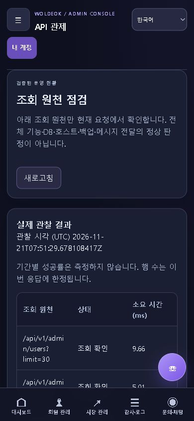
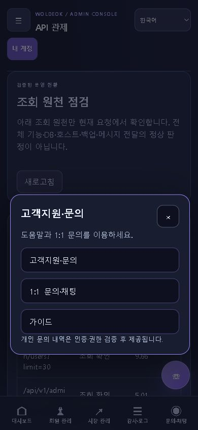
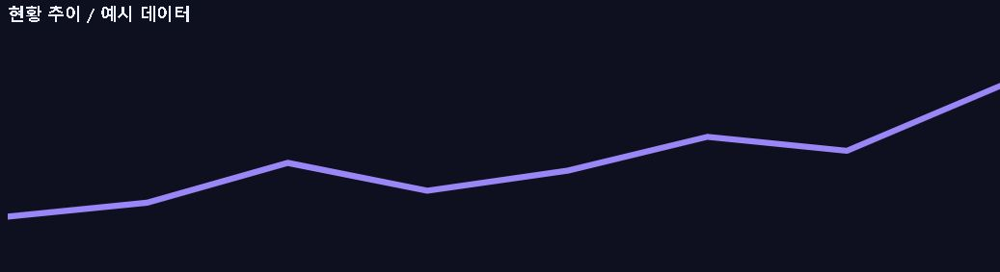

# 전체 운영 프론트엔드 · Nov18 디자인/기능 재감사

검사일: 2026-11-21. 대상: 실제 `https://easy-scraping.com` 운영 화면, miniPC의 실제 제공 HTML/CSS/JS, main의 디자인 원본과 구현 소스. 결론은 **전체 정상 아님 / Nov18 전체 통일 아님 / 전체 기능 수용 불가**다. 새 공통 셸 26개 화면에 대한 이전 부분 수용을 전체 웹 완료로 확대하지 않는다. 이 변경은 감사 문서이며 운영 코드·설정·DB·잔액을 변경하거나 새 배포를 하지 않았다.

## 기준과 범위

- 기준: [최신 Nov18 디자인 권위](../planning/NOV18_DESIGN_GLOBAL_I18N_CHAT_AUTHORITY_v2026.11.20.1.ko.md), [전 페이지 PC/mobile 원본180](../design/all-pages-v2026.11.18.12/README.md), [관리자·전역 채팅 원본](../planning/ADMIN_GLOBAL_CHAT_DESIGN_v2026.11.18.13.ko.md), [이미지 구현 인계](../design/UI_IMAGE_IMPLEMENTATION_HANDOFF_v2026.11.19.31.ko.md). 원본 PNG는 합성 데이터가 든 개념 시안이며, 그 숫자·그래프를 운영 데이터로 복제하는 승인이 아니다. 현재 favicon을 로고로 쓰라는 별도 사용자 지시가 우선한다.
- 배포 application source: `e45f57595415f132eedf36c13748564b93a1d918`. 문서 시작 main: `c895c0181dbfd1f43298de0b73a5e1a117fa5325`. 실제 제공 파일의 해시를 따로 기록했다. 서버에 있는 파일을 main 소스와 같다고 가정하지 않았다.
- 구체 정적147경로(회원/공개108, 관리자39)를 PC1440×1000와 mobile390×844로 직접 열어 DOM·계산 스타일·메뉴 목적지·제어 요소를 관찰했다. 동적33경로는 유효한 소유자별 fixture 없이 실행하지 않았다.
- 신규26경로는 추가 320/360/430/768/1024/1280/1920px에서182건 확인했다. 기본294건과 합쳐 화면 크기 관찰476건이다. 주요8경로는 320px에서 EN/KO/JA/ZH/VI 총40건 추가 확인했다. 측정 건수는 기능 성공 건수가 아니다.
- 브라우저 세션을 사용했지만 계정 이름·잔액·대화·쿠키를 증거에 저장하지 않았다. 실제 송금·매매·구매·보상·글쓰기·메시지·삭제·관리자 변경은 실행하지 않았다. 유효한 안전한 fixture와 서버 영수증이 없는 항목은 미검증/차단으로 남긴다.

## 현재 구성

| 관찰 분류 | 경로 수 | 판단 |
|---|---:|---|
| 신규 공통 셸 | 26 | 네이비/보라·현재 favicon·반응형 부분 적용. 아래 로고/문의 차이와 기능 hold가 남음 |
| 시안 HTML + 일부 API hydration | 5 | shop/stocks/quests/board/status. 핵심 업무 UI를 대신하지 못함 |
| 기타 기존 렌더 화면 | 37 | 다른 테마/기존 캡처·구조 혼재. 버튼 개수나 HTTP200을 기능 성공으로 세지 않음 |
| 오류·차단 화면 | 79 | 회원/공개78개는 403 문구, 관리자 errors1개는 애플리케이션 오류 화면 |
| 동적 경로 | 33 | fixture 미확보로 NOT_RUN, 위147개와 별도 |

기존 화면14개에서 Next asset 흔적이 보였다. 이는 HTML/asset의 흔적이며 Next 프로세스가14개 실행 중이라는 뜻은 아니다. 이번 감사에서 새 서비스 정리나 배포를 하지 않았다. [이전 운영 구성·정리 증거](../releases/2026-11-21-frontend-consolidation-production.ko.md)를 함께 본다.

## 미해결 결함과 재현

| ID | 우선순위 | 범위 / 재현 | 기대와 실제 | 다음 수정의 수용 조건 |
|---|---|---|---|---|
| FE-AUDIT-01 | P1 | 로그인 상태로 `/shop`, `/stocks`, `/quests`, `/board`, `/status` 방문 | 다섯 화면이 업무 화면 대신 동일한 시안 구조·예시 그래프 제공. 관찰한 화면에 구매/매수/매도/보상 버튼0, 게시물 상세 링크0. 원본180 PNG도 개념 시안이므로 이를 복사한 것만으로 기능 구현이 되지 않음 | 실제 API 카탈로그/시세/게시물/보상·상태 조회와 권한별 동작, 실제 영수증/오류 상태를 별도 Test에서 검증 |
| FE-AUDIT-02 | P1 | 위5개 PC1440. `.hero-card`, `.kpi-split-card`, `.bento-grid-2col` 확인 | 카드 padding0 / display block, grid none. 제공 CSS의 `.header-title` 끝 `}` 누락으로 뒤 selector들이 잘못 중첩됨. 괄호78개 열림/77개 닫힘. 운영 HTML150행에서 시작해159행 `.header-right` 전에 닫히지 않음 | 적용 파일의 닫힘 수정 전후 회귀 검사, 실제 PC/mobile 카드·그리드 재비교. CSP를 완화하는 수정은 원인 해결이 아님 |
| FE-AUDIT-03 | P1 | 위5개 초기 응답과 비로그인/조회 실패 코드 경로 | 초기12,580 WLD/+2.41%가 들어 있고 API 실패/미인증 때 지우지 않음. 로그인 뒤 일부 값이 API 응답으로 바뀌는 것도 관찰함. 따라서 '전부 영구 고정'은 아님. 그래프는 계속 '현황 추이 / 예시 데이터' | SSR·로딩·오류는 확인 중/조회 불가로 표시하고 합성 수치를 운영 지표로 남기지 않기. 표시 수치와 소유자 API 응답 대조 |
| FE-AUDIT-04 | P1 | 위5개 제공 HTML794행 `Number(wData.totalAvailableAmount)` | canonical integer string 잔액을 Number로 바꿔 정밀도 손실 위험. 합성 입력9007199254740993이9007199254740992로 변함. 실제 회원의 잔액 손상·DB 변경을 입증한 것은 아님 | 정수 문자열 기반 포맷, 큰 금액·0·오류·누락 계약 회귀 검사. 실제 원장/DB는 변경하지 않기 |
| FE-AUDIT-05 | P1 | 아래 원장 ERROR79개. 예: `/account`, `/bank`, `/work`, `/stocks/portfolio`; `/admin/logs/errors` | 업무 화면 도달 불가. 현재 root·admin 링크에도 차단 목적지가 존재. 기존 보안 차단과 업무 오류를 구분해야 함 | 각 경로를 안전한 실제 소스에 연결하고 역할/세션/권한별 검증. broad scanner 차단을 한꺼번에 제거해 오래된 비공개 캡처를 노출하지 않기 |
| FE-AUDIT-06 | P2 | 오류 제외68개 중30개 배경을 비교 | 지정 #0C1020과 달리23개 #070B14,7개 #090D16. 관리자·기존 계산기 등 테마 혼재 | 실제 데이터/기능을 보존하면서 공통 토큰·셸 통일, 각 경로 PC/mobile 비교 |
| FE-AUDIT-07 | P2 | 신규 관리자10경로 mobile390, drawer 닫힘 | 상단 현재 favicon이 보이지 않음. 회원16경로는 `h1::before`로 표시됨. `.topbar h1::before` CSS가 `.admin-topbar`에 적용되지 않음. drawer 열면 별도 로고 존재 | 관리자 기본 상단에도 동일 favicon 표시, 모바일·중간 폭 검증 |
| FE-AUDIT-08 | P2 | 신규26 mobile390, 문의버튼과 bottomnav 거리 | 원형56px는 있으나 거리 회원14px/관리자13px로 기준 최소16px 미달. 하단 내비와 직접 겹친 것은 이 측정에서 발견하지 못함 | 실제 nav 높이와 safe area 기반 최소16px 간격, 키보드·실기기 추가 검증 |
| FE-AUDIT-09 | P1 | 신규 문의 버튼 열기와 기존 시안 위젯의 탭 클릭 | 신규 패널은 support/chat/guide 링크3개, 탭0·입력0. 원본의 FAQ/문의/메시지 탭·초안 유지·전송/답변 흐름 전체가 아님. 기존 위젯은 별도 탭2개와 입력·활성 전송 버튼 존재 | 단일 위젯 계약과 세션 신원·소유권·CSRF·감사·실제 영수증을 통과한 기능만 연결. 보안 hold를 외형 완성을 위해 해제하지 않기 |
| FE-AUDIT-10 | P2 | 기존5개 시안에서 VI 선택 | 일부 제목만 VI, 본문/위젯 한국어 잔존, 문서 lang=ko. 신규40건의 lang 일치가 기존 전체 번역 수용을 의미하지 않음 | 오류/빈 화면/폼 검증/FAQ/위젯 포함5언어 번역·용어·메타데이터 검토 |
| FE-AUDIT-11 | P2 | 아래 원장 small-controls 수 | 렌더42개PC/22개mobile에44px 미달 제어 후보. 오류 화면까지 PC43개. 새26은 후보0 | 실제 클릭영역과 텍스트 링크 예외를 검토해 프로젝트44px 기준 수용. 이 숫자만으로 WCAG 전체 실패/인증을 선언하지 않음 |
| FE-AUDIT-12 | P2 | `/admin/logs`, `/admin/support`, `/admin/fx`, `/admin/kdic`, `/admin/help` | h1/main landmark 미관찰. 이 사실만으로 전체 콘텐츠 부재나 버튼 실패를 단정하지 않음 | 제목/landmark·키보드/스크린리더 구조와 실제 콘텐츠·조회 상태 검증 |

FE-AUDIT-02의 원인 확인: loopback `/shop` HTML은 실제 static 파일과 byte-identical이다. public HTTPS와 loopback은 inline CSS SHA256이 같고 둘 다 CSP header/meta가 없었다. 외부 HTML 해시 차이는 있으나 CSS는 동일하다. 파일의 중괄호 누락과 실제 computed style을 함께 확인했으므로 CSP나 literal escaped newline을 원인으로 기록하지 않는다. 제공 inline CSS는 실제 줄바꿈이다.

FE-AUDIT-03 정정: 초기 DOM 관찰의 sampleNumber/sampleRate=true를 '항상 샘플'로 해석하지 않는다. 실제 inline JS는 session 확인 후 wallet summary와 stocks를 조회한다. 상점에서 API hydration 뒤 샘플 표시가 바뀐 것을 재관찰했다. 이 감사에서는 모든 변경된 숫자의 원장/API 수치 대조를 수행하지 않았으므로 정확한 실데이터 수용은 별도다. API 실패를 catch/return하면서 예시 값을 유지하는 코드와 합성 SVG 그래프는 그대로 남는다.

## 시각 증거

개인정보가 없는 영역만 캡처했다. 계정 이름·잔액이 포함된 전체 상점 스크린샷은 GitHub에 넣지 않았다. 아래 이미지는 수정 후가 아니라 발견 당시 운영 화면이다.

## 실제 입력·탭 검사와 한계

- 복리 계산기: 원금1000, 추가납입0, 연10%,2년, 연복리 입력 후 키보드 Enter →1,210. 이 사례는 PASS다.
- 주식 평균단가 계산기:100×10주와200×10주, 목표10%,수수료0 →평균150/목표165. 이 사례는 PASS다. 전체 금융 계산식·세율·모든 경계값 수용을 의미하지 않는다.
- 기존 위젯: 열기 → DM탭 → 문의탭 → 닫기에서 입력 영역 전환 확인. 전송은 하지 않았다. 활성 버튼은 성공한 서버 처리의 증거가 아니다.
- 신규 패널: 열기/닫기와 링크·입력/탭 개수 확인. 지원/쪽지 소유자·DTO/전송 및 wallet CSRF 등 기존 hold는 [전환 후 관찰](2026-11-21-live-frontend-after.ko.md)과 [관리자 기능 원장](2026-11-21-admin-functional-ledger.ko.md)을 따른다. 기존 관리자 조회9경로/기존 source test605건 등은 이전 검증이며 이번 전 웹 기능 성공으로 재계산하지 않는다.
- 476개 화면 크기 관찰 및40개 좁은 화면 언어 관찰에서 document-level 가로 넘침0. CSS overflow hidden은 내부 잘림을 숨길 수 있고, 표의 의도한 내부 가로 스크롤·모든 하위 요소 clipping/겹침·모든 상호작용 상태를 보증하지 않는다.
- 신규26은 각9개 화면 폭에서 검사했지만 200% 실제 브라우저 확대는 미검증이다. Control+=가 CSS viewport를 바꾸지 않았으며 확대 API가 노출되지 않아 PASS로 세지 않았다. 스크린리더, 전체 키보드 순회, reduced-motion, 물리 모바일 키보드/세이프에어리어, 언어 전환 중 초안 유지, 모든 인증/오류·데이터 상태와 동적33경로도 미검증이다.
- 이번 diff는 문서뿐이다. 런타임 전체 테스트나 CI에서 skip한 Spring/DB 검사를 새 PASS라고 쓰지 않는다. 별도 테스트 환경을 통과하기 전 신규 운영 승격 근거로 사용할 수 없다.

## 경로별 원장

`NATIVE_PARTIAL`은 공통 셸 관찰, `PROTOTYPE`은 업무 기능 대신 시안, `LEGACY_UNVERIFIED`는 기존 화면, `ERROR`는 차단/오류다. 색상 일치나 화면 렌더는 기능 성공이 아니다. 44px 후보는 PC/mobile 순서다. 링크 차단 수는 수집한 정적 목적지 중 이번 오류79에 속하는 수이며 링크를 눌러 변경을 실행한 횟수가 아니다. 예시 h1 및 CSS ID 이외의 회원 데이터는 포함하지 않았다.

| 경로 / 원본 | 분류 | PC 배경 | mobile favicon / 문의 간격 | 44px 후보 PC/mobile | 기능 판단 / 차단 링크 |
|---|---|---|---|---:|---|
| `/` [PNG](../design/all-pages-v2026.11.18.12/previews/home.png) | NATIVE_PARTIAL | #0C1020 | 있음 / 14px | 0/0 | 전체 기능 미검증; 차단 링크1 |
| `/account` [PNG](../design/all-pages-v2026.11.18.12/previews/account.png) | ERROR | 미렌더 | 별도검증 필요 / — | 0/0 | 403 Forbidden; 차단 링크0 |
| `/account-deletion` [PNG](../design/all-pages-v2026.11.18.12/previews/account-deletion.png) | NATIVE_PARTIAL | #0C1020 | 있음 / 14px | 0/0 | 인증/변경 완료 미수용; 차단 링크1 |
| `/account/notifications` [PNG](../design/all-pages-v2026.11.18.12/previews/account-notifications.png) | ERROR | 미렌더 | 별도검증 필요 / — | 0/0 | 403 Forbidden; 차단 링크0 |
| `/account/privacy` [PNG](../design/all-pages-v2026.11.18.12/previews/account-privacy.png) | ERROR | 미렌더 | 별도검증 필요 / — | 0/0 | 403 Forbidden; 차단 링크0 |
| `/account/security` [PNG](../design/all-pages-v2026.11.18.12/previews/account-security.png) | ERROR | 미렌더 | 별도검증 필요 / — | 0/0 | 403 Forbidden; 차단 링크0 |
| `/advisor` [PNG](../design/all-pages-v2026.11.18.12/previews/advisor.png) | ERROR | 미렌더 | 별도검증 필요 / — | 0/0 | 403 Forbidden; 차단 링크0 |
| `/announcements` [PNG](../design/all-pages-v2026.11.18.12/previews/announcements.png) | ERROR | 미렌더 | 별도검증 필요 / — | 0/0 | 403 Forbidden; 차단 링크0 |
| `/arcade` [PNG](../design/all-pages-v2026.11.18.12/previews/arcade.png) | ERROR | 미렌더 | 별도검증 필요 / — | 0/0 | 403 Forbidden; 차단 링크0 |
| `/bank` [PNG](../design/all-pages-v2026.11.18.12/previews/bank.png) | ERROR | 미렌더 | 별도검증 필요 / — | 0/0 | 403 Forbidden; 차단 링크0 |
| `/bank/savings-pot` [PNG](../design/all-pages-v2026.11.18.12/previews/bank-savings-pot.png) | ERROR | 미렌더 | 별도검증 필요 / — | 0/0 | 403 Forbidden; 차단 링크0 |
| `/blog` [PNG](../design/all-pages-v2026.11.18.12/previews/blog.png) | LEGACY_UNVERIFIED | #0C1020 | 별도검증 필요 / — | 20/3 | 전체 기능 미검증; 차단 링크21 |
| `/board` [PNG](../design/all-pages-v2026.11.18.12/previews/board.png) | PROTOTYPE | #0C1020 | 별도검증 필요 / — | 3/3 | 핵심 업무 UI 미관찰; 차단 링크2 |
| `/bonds` [PNG](../design/all-pages-v2026.11.18.12/previews/bonds.png) | ERROR | 미렌더 | 별도검증 필요 / — | 0/0 | 403 Forbidden; 차단 링크0 |
| `/businesses` [PNG](../design/all-pages-v2026.11.18.12/previews/businesses.png) | ERROR | 미렌더 | 별도검증 필요 / — | 0/0 | 403 Forbidden; 차단 링크0 |
| `/businesses/ventures` [PNG](../design/all-pages-v2026.11.18.12/previews/businesses-ventures.png) | ERROR | 미렌더 | 별도검증 필요 / — | 0/0 | 403 Forbidden; 차단 링크0 |
| `/calculators` [PNG](../design/all-pages-v2026.11.18.12/previews/calculators.png) | NATIVE_PARTIAL | #0C1020 | 있음 / 14px | 0/0 | 전체 기능 미검증; 차단 링크14 |
| `/calendar` [PNG](../design/all-pages-v2026.11.18.12/previews/calendar.png) | ERROR | 미렌더 | 별도검증 필요 / — | 0/0 | 403 Forbidden; 차단 링크0 |
| `/casino` [PNG](../design/all-pages-v2026.11.18.12/previews/casino.png) | ERROR | 미렌더 | 별도검증 필요 / — | 0/0 | 403 Forbidden; 차단 링크0 |
| `/central-bank` [PNG](../design/all-pages-v2026.11.18.12/previews/central-bank.png) | ERROR | 미렌더 | 별도검증 필요 / — | 0/0 | 403 Forbidden; 차단 링크0 |
| `/chat` [PNG](../design/all-pages-v2026.11.18.12/previews/chat.png) | NATIVE_PARTIAL | #0C1020 | 있음 / 14px | 0/0 | 조회/변경 계약 hold 별도; 차단 링크1 |
| `/clubs` [PNG](../design/all-pages-v2026.11.18.12/previews/clubs.png) | ERROR | 미렌더 | 별도검증 필요 / — | 0/0 | 403 Forbidden; 차단 링크0 |
| `/clubs/new` [PNG](../design/all-pages-v2026.11.18.12/previews/clubs-new.png) | ERROR | 미렌더 | 별도검증 필요 / — | 0/0 | 403 Forbidden; 차단 링크0 |
| `/clubs/warfare` [PNG](../design/all-pages-v2026.11.18.12/previews/clubs-warfare.png) | ERROR | 미렌더 | 별도검증 필요 / — | 0/0 | 403 Forbidden; 차단 링크0 |
| `/collections` [PNG](../design/all-pages-v2026.11.18.12/previews/collections.png) | ERROR | 미렌더 | 별도검증 필요 / — | 0/0 | 403 Forbidden; 차단 링크0 |
| `/dashboard` [PNG](../design/all-pages-v2026.11.18.12/previews/dashboard.png) | ERROR | 미렌더 | 별도검증 필요 / — | 0/0 | 403 Forbidden; 차단 링크0 |
| `/data-deletion` [PNG](../design/all-pages-v2026.11.18.12/previews/data-deletion.png) | ERROR | 미렌더 | 별도검증 필요 / — | 0/0 | 403 Forbidden; 차단 링크0 |
| `/design-preview` [PNG](../design/all-pages-v2026.11.18.12/previews/design-preview.png) | ERROR | 미렌더 | 별도검증 필요 / — | 0/0 | 403 Forbidden; 차단 링크0 |
| `/developer` [PNG](../design/all-pages-v2026.11.18.12/previews/developer.png) | ERROR | 미렌더 | 별도검증 필요 / — | 0/0 | 403 Forbidden; 차단 링크0 |
| `/enterprises` [PNG](../design/all-pages-v2026.11.18.12/previews/enterprises.png) | ERROR | 미렌더 | 별도검증 필요 / — | 0/0 | 403 Forbidden; 차단 링크0 |
| `/features` [PNG](../design/all-pages-v2026.11.18.12/previews/features.png) | LEGACY_UNVERIFIED | #0C1020 | 별도검증 필요 / — | 36/10 | 전체 기능 미검증; 차단 링크24 |
| `/forgot-password` [PNG](../design/all-pages-v2026.11.18.12/previews/forgot-password.png) | NATIVE_PARTIAL | #0C1020 | 있음 / 14px | 0/0 | 인증/변경 완료 미수용; 차단 링크1 |
| `/fx` [PNG](../design/all-pages-v2026.11.18.12/previews/fx.png) | ERROR | 미렌더 | 별도검증 필요 / — | 0/0 | 403 Forbidden; 차단 링크0 |
| `/gallery` [PNG](../design/all-pages-v2026.11.18.12/previews/gallery.png) | ERROR | 미렌더 | 별도검증 필요 / — | 0/0 | 403 Forbidden; 차단 링크0 |
| `/gallery/submit` [PNG](../design/all-pages-v2026.11.18.12/previews/gallery-submit.png) | ERROR | 미렌더 | 별도검증 필요 / — | 0/0 | 403 Forbidden; 차단 링크0 |
| `/guide` [PNG](../design/all-pages-v2026.11.18.12/previews/guide.png) | LEGACY_UNVERIFIED | #0C1020 | 별도검증 필요 / — | 2/3 | 전체 기능 미검증; 차단 링크2 |
| `/guide/career-mastery` [PNG](../design/all-pages-v2026.11.18.12/previews/guide-career-mastery.png) | ERROR | 미렌더 | 별도검증 필요 / — | 0/0 | 403 Forbidden; 차단 링크0 |
| `/guide/dopamine-system` [PNG](../design/all-pages-v2026.11.18.12/previews/guide-dopamine-system.png) | ERROR | 미렌더 | 별도검증 필요 / — | 0/0 | 403 Forbidden; 차단 링크0 |
| `/guide/glossary` [PNG](../design/all-pages-v2026.11.18.12/previews/guide-glossary.png) | ERROR | 미렌더 | 별도검증 필요 / — | 0/0 | 403 Forbidden; 차단 링크0 |
| `/guide/stock-trading` [PNG](../design/all-pages-v2026.11.18.12/previews/guide-stock-trading.png) | ERROR | 미렌더 | 별도검증 필요 / — | 0/0 | 403 Forbidden; 차단 링크0 |
| `/guide/virtual-banking` [PNG](../design/all-pages-v2026.11.18.12/previews/guide-virtual-banking.png) | ERROR | 미렌더 | 별도검증 필요 / — | 0/0 | 403 Forbidden; 차단 링크0 |
| `/help` [PNG](../design/all-pages-v2026.11.18.12/previews/help.png) | ERROR | 미렌더 | 별도검증 필요 / — | 0/0 | 403 Forbidden; 차단 링크0 |
| `/inventory` [PNG](../design/all-pages-v2026.11.18.12/previews/inventory.png) | ERROR | 미렌더 | 별도검증 필요 / — | 0/0 | 403 Forbidden; 차단 링크0 |
| `/kdic` [PNG](../design/all-pages-v2026.11.18.12/previews/kdic.png) | ERROR | 미렌더 | 별도검증 필요 / — | 0/0 | 403 Forbidden; 차단 링크0 |
| `/lobby` [PNG](../design/all-pages-v2026.11.18.12/previews/lobby.png) | ERROR | 미렌더 | 별도검증 필요 / — | 0/0 | 403 Forbidden; 차단 링크0 |
| `/login` [PNG](../design/all-pages-v2026.11.18.12/previews/login.png) | NATIVE_PARTIAL | #0C1020 | 있음 / 14px | 0/0 | 인증/변경 완료 미수용; 차단 링크1 |
| `/login/providers` [PNG](../design/all-pages-v2026.11.18.12/previews/login-providers.png) | NATIVE_PARTIAL | #0C1020 | 있음 / 14px | 0/0 | 인증/변경 완료 미수용; 차단 링크1 |
| `/marketplace` [PNG](../design/all-pages-v2026.11.18.12/previews/marketplace.png) | ERROR | 미렌더 | 별도검증 필요 / — | 0/0 | 403 Forbidden; 차단 링크0 |
| `/marketplace/auction` [PNG](../design/all-pages-v2026.11.18.12/previews/marketplace-auction.png) | ERROR | 미렌더 | 별도검증 필요 / — | 0/0 | 403 Forbidden; 차단 링크0 |
| `/mint` [PNG](../design/all-pages-v2026.11.18.12/previews/mint.png) | ERROR | 미렌더 | 별도검증 필요 / — | 0/0 | 403 Forbidden; 차단 링크0 |
| `/newspaper` [PNG](../design/all-pages-v2026.11.18.12/previews/newspaper.png) | ERROR | 미렌더 | 별도검증 필요 / — | 0/0 | 403 Forbidden; 차단 링크0 |
| `/pension` [PNG](../design/all-pages-v2026.11.18.12/previews/pension.png) | ERROR | 미렌더 | 별도검증 필요 / — | 0/0 | 403 Forbidden; 차단 링크0 |
| `/prediction` [PNG](../design/all-pages-v2026.11.18.12/previews/prediction.png) | ERROR | 미렌더 | 별도검증 필요 / — | 0/0 | 403 Forbidden; 차단 링크0 |
| `/privacy` [PNG](../design/all-pages-v2026.11.18.12/previews/privacy.png) | LEGACY_UNVERIFIED | #0C1020 | 별도검증 필요 / — | 9/1 | 전체 기능 미검증; 차단 링크20 |
| `/profile` [PNG](../design/all-pages-v2026.11.18.12/previews/profile.png) | ERROR | 미렌더 | 별도검증 필요 / — | 0/0 | 403 Forbidden; 차단 링크0 |
| `/profile/settings` [PNG](../design/all-pages-v2026.11.18.12/previews/profile-settings.png) | ERROR | 미렌더 | 별도검증 필요 / — | 0/0 | 403 Forbidden; 차단 링크0 |
| `/progression` [PNG](../design/all-pages-v2026.11.18.12/previews/progression.png) | ERROR | 미렌더 | 별도검증 필요 / — | 0/0 | 403 Forbidden; 차단 링크0 |
| `/progression/prestige` [PNG](../design/all-pages-v2026.11.18.12/previews/progression-prestige.png) | ERROR | 미렌더 | 별도검증 필요 / — | 0/0 | 403 Forbidden; 차단 링크0 |
| `/quests` [PNG](../design/all-pages-v2026.11.18.12/previews/quests.png) | PROTOTYPE | #0C1020 | 별도검증 필요 / — | 2/2 | 핵심 업무 UI 미관찰; 차단 링크2 |
| `/register` [PNG](../design/all-pages-v2026.11.18.12/previews/register.png) | NATIVE_PARTIAL | #0C1020 | 있음 / 14px | 0/0 | 인증/변경 완료 미수용; 차단 링크1 |
| `/reset-password` [PNG](../design/all-pages-v2026.11.18.12/previews/reset-password.png) | NATIVE_PARTIAL | #0C1020 | 있음 / 14px | 0/0 | 인증/변경 완료 미수용; 차단 링크1 |
| `/roadmap` [PNG](../design/all-pages-v2026.11.18.12/previews/roadmap.png) | LEGACY_UNVERIFIED | #0C1020 | 별도검증 필요 / — | 13/1 | 전체 기능 미검증; 차단 링크21 |
| `/safety` [PNG](../design/all-pages-v2026.11.18.12/previews/safety.png) | LEGACY_UNVERIFIED | #0C1020 | 별도검증 필요 / — | 10/2 | 전체 기능 미검증; 차단 링크21 |
| `/safety/takedown` [PNG](../design/all-pages-v2026.11.18.12/previews/safety-takedown.png) | ERROR | 미렌더 | 별도검증 필요 / — | 0/0 | 403 Forbidden; 차단 링크0 |
| `/search` [PNG](../design/all-pages-v2026.11.18.12/previews/search.png) | ERROR | 미렌더 | 별도검증 필요 / — | 0/0 | 403 Forbidden; 차단 링크0 |
| `/seasons` [PNG](../design/all-pages-v2026.11.18.12/previews/seasons.png) | ERROR | 미렌더 | 별도검증 필요 / — | 0/0 | 403 Forbidden; 차단 링크0 |
| `/shop` [PNG](../design/all-pages-v2026.11.18.12/previews/shop.png) | PROTOTYPE | #0C1020 | 별도검증 필요 / — | 2/2 | 핵심 업무 UI 미관찰; 차단 링크2 |
| `/shop/catalog` [PNG](../design/all-pages-v2026.11.18.12/previews/shop-catalog.png) | ERROR | 미렌더 | 별도검증 필요 / — | 0/0 | 403 Forbidden; 차단 링크0 |
| `/spaces` [PNG](../design/all-pages-v2026.11.18.12/previews/spaces.png) | ERROR | 미렌더 | 별도검증 필요 / — | 0/0 | 403 Forbidden; 차단 링크0 |
| `/spaces/real-estate` [PNG](../design/all-pages-v2026.11.18.12/previews/spaces-real-estate.png) | ERROR | 미렌더 | 별도검증 필요 / — | 0/0 | 403 Forbidden; 차단 링크0 |
| `/status` [PNG](../design/all-pages-v2026.11.18.12/previews/status.png) | PROTOTYPE | #0C1020 | 별도검증 필요 / — | 2/2 | 핵심 업무 UI 미관찰; 차단 링크2 |
| `/stocks` [PNG](../design/all-pages-v2026.11.18.12/previews/stocks.png) | PROTOTYPE | #0C1020 | 별도검증 필요 / — | 3/2 | 핵심 업무 UI 미관찰; 차단 링크2 |
| `/stocks/alerts` [PNG](../design/all-pages-v2026.11.18.12/previews/stocks-alerts.png) | ERROR | 미렌더 | 별도검증 필요 / — | 0/0 | 403 Forbidden; 차단 링크0 |
| `/stocks/community` [PNG](../design/all-pages-v2026.11.18.12/previews/stocks-community.png) | ERROR | 미렌더 | 별도검증 필요 / — | 0/0 | 403 Forbidden; 차단 링크0 |
| `/stocks/compare` [PNG](../design/all-pages-v2026.11.18.12/previews/stocks-compare.png) | ERROR | 미렌더 | 별도검증 필요 / — | 0/0 | 403 Forbidden; 차단 링크0 |
| `/stocks/derivatives` [PNG](../design/all-pages-v2026.11.18.12/previews/stocks-derivatives.png) | ERROR | 미렌더 | 별도검증 필요 / — | 0/0 | 403 Forbidden; 차단 링크0 |
| `/stocks/history` [PNG](../design/all-pages-v2026.11.18.12/previews/stocks-history.png) | ERROR | 미렌더 | 별도검증 필요 / — | 0/0 | 403 Forbidden; 차단 링크0 |
| `/stocks/league` [PNG](../design/all-pages-v2026.11.18.12/previews/stocks-league.png) | ERROR | 미렌더 | 별도검증 필요 / — | 0/0 | 403 Forbidden; 차단 링크0 |
| `/stocks/portfolio` [PNG](../design/all-pages-v2026.11.18.12/previews/stocks-portfolio.png) | ERROR | 미렌더 | 별도검증 필요 / — | 0/0 | 403 Forbidden; 차단 링크0 |
| `/stocks/watchlist` [PNG](../design/all-pages-v2026.11.18.12/previews/stocks-watchlist.png) | ERROR | 미렌더 | 별도검증 필요 / — | 0/0 | 403 Forbidden; 차단 링크0 |
| `/support` [PNG](../design/all-pages-v2026.11.18.12/previews/support.png) | NATIVE_PARTIAL | #0C1020 | 있음 / 14px | 0/0 | 조회/변경 계약 hold 별도; 차단 링크1 |
| `/terms` [PNG](../design/all-pages-v2026.11.18.12/previews/terms.png) | LEGACY_UNVERIFIED | #0C1020 | 별도검증 필요 / — | 13/2 | 전체 기능 미검증; 차단 링크21 |
| `/tools` [PNG](../design/all-pages-v2026.11.18.12/previews/tools.png) | NATIVE_PARTIAL | #0C1020 | 있음 / 14px | 0/0 | 전체 기능 미검증; 차단 링크14 |
| `/tools/capital-gains-tax-calculator` [PNG](../design/all-pages-v2026.11.18.12/previews/tools-capital-gains-tax-calculator.png) | ERROR | 미렌더 | 별도검증 필요 / — | 0/0 | 403 Forbidden; 차단 링크0 |
| `/tools/compound-calculator` [PNG](../design/all-pages-v2026.11.18.12/previews/tools-compound-calculator.png) | NATIVE_PARTIAL | #0C1020 | 있음 / 14px | 0/0 | 입력 계산1사례 PASS; 차단 링크1 |
| `/tools/crypto-apy-calculator` [PNG](../design/all-pages-v2026.11.18.12/previews/tools-crypto-apy-calculator.png) | ERROR | 미렌더 | 별도검증 필요 / — | 0/0 | 403 Forbidden; 차단 링크0 |
| `/tools/dividend-tax-calculator` [PNG](../design/all-pages-v2026.11.18.12/previews/tools-dividend-tax-calculator.png) | ERROR | 미렌더 | 별도검증 필요 / — | 0/0 | 403 Forbidden; 차단 링크0 |
| `/tools/farming-calculator` [PNG](../design/all-pages-v2026.11.18.12/previews/tools-farming-calculator.png) | ERROR | 미렌더 | 별도검증 필요 / — | 0/0 | 403 Forbidden; 차단 링크0 |
| `/tools/fire-calculator` [PNG](../design/all-pages-v2026.11.18.12/previews/tools-fire-calculator.png) | ERROR | 미렌더 | 별도검증 필요 / — | 0/0 | 403 Forbidden; 차단 링크0 |
| `/tools/gift-tax-calculator` [PNG](../design/all-pages-v2026.11.18.12/previews/tools-gift-tax-calculator.png) | ERROR | 미렌더 | 별도검증 필요 / — | 0/0 | 403 Forbidden; 차단 링크0 |
| `/tools/goal-wealth-calculator` [PNG](../design/all-pages-v2026.11.18.12/previews/tools-goal-wealth-calculator.png) | ERROR | 미렌더 | 별도검증 필요 / — | 0/0 | 403 Forbidden; 차단 링크0 |
| `/tools/isa-calculator` [PNG](../design/all-pages-v2026.11.18.12/previews/tools-isa-calculator.png) | ERROR | 미렌더 | 별도검증 필요 / — | 0/0 | 403 Forbidden; 차단 링크0 |
| `/tools/kimchi-premium-calculator` [PNG](../design/all-pages-v2026.11.18.12/previews/tools-kimchi-premium-calculator.png) | ERROR | 미렌더 | 별도검증 필요 / — | 0/0 | 403 Forbidden; 차단 링크0 |
| `/tools/loan-interest-calculator` [PNG](../design/all-pages-v2026.11.18.12/previews/tools-loan-interest-calculator.png) | ERROR | 미렌더 | 별도검증 필요 / — | 0/0 | 403 Forbidden; 차단 링크0 |
| `/tools/pension-tax-calculator` [PNG](../design/all-pages-v2026.11.18.12/previews/tools-pension-tax-calculator.png) | ERROR | 미렌더 | 별도검증 필요 / — | 0/0 | 403 Forbidden; 차단 링크0 |
| `/tools/quant-studio` [PNG](../design/all-pages-v2026.11.18.12/previews/tools-quant-studio.png) | ERROR | 미렌더 | 별도검증 필요 / — | 0/0 | 403 Forbidden; 차단 링크0 |
| `/tools/real-estate-calculator` [PNG](../design/all-pages-v2026.11.18.12/previews/tools-real-estate-calculator.png) | LEGACY_UNVERIFIED | #090D16 | 별도검증 필요 / — | 13/3 | 전체 기능 미검증; 차단 링크22 |
| `/tools/retirement-calculator` [PNG](../design/all-pages-v2026.11.18.12/previews/tools-retirement-calculator.png) | ERROR | 미렌더 | 별도검증 필요 / — | 0/0 | 403 Forbidden; 차단 링크0 |
| `/tools/salary-calculator` [PNG](../design/all-pages-v2026.11.18.12/previews/tools-salary-calculator.png) | ERROR | 미렌더 | 별도검증 필요 / — | 0/0 | 403 Forbidden; 차단 링크0 |
| `/tools/stock-calculator` [PNG](../design/all-pages-v2026.11.18.12/previews/tools-stock-calculator.png) | NATIVE_PARTIAL | #0C1020 | 있음 / 14px | 0/0 | 입력 계산1사례 PASS; 차단 링크1 |
| `/tools/tax-calculator` [PNG](../design/all-pages-v2026.11.18.12/previews/tools-tax-calculator.png) | LEGACY_UNVERIFIED | #090D16 | 별도검증 필요 / — | 25/6 | 전체 기능 미검증; 차단 링크22 |
| `/tools/youth-leap-calculator` [PNG](../design/all-pages-v2026.11.18.12/previews/tools-youth-leap-calculator.png) | ERROR | 미렌더 | 별도검증 필요 / — | 0/0 | 403 Forbidden; 차단 링크0 |
| `/treasury` [PNG](../design/all-pages-v2026.11.18.12/previews/treasury.png) | ERROR | 미렌더 | 별도검증 필요 / — | 0/0 | 403 Forbidden; 차단 링크0 |
| `/verify-email` [PNG](../design/all-pages-v2026.11.18.12/previews/verify-email.png) | NATIVE_PARTIAL | #0C1020 | 있음 / 14px | 0/0 | 인증/변경 완료 미수용; 차단 링크1 |
| `/verify-email-change` [PNG](../design/all-pages-v2026.11.18.12/previews/verify-email-change.png) | NATIVE_PARTIAL | #0C1020 | 있음 / 14px | 0/0 | 인증/변경 완료 미수용; 차단 링크1 |
| `/wallet` [PNG](../design/all-pages-v2026.11.18.12/previews/wallet.png) | NATIVE_PARTIAL | #0C1020 | 있음 / 14px | 0/0 | 조회/변경 계약 hold 별도; 차단 링크1 |
| `/wallet/activity` [PNG](../design/all-pages-v2026.11.18.12/previews/wallet-activity.png) | ERROR | 미렌더 | 별도검증 필요 / — | 0/0 | 403 Forbidden; 차단 링크0 |
| `/work` [PNG](../design/all-pages-v2026.11.18.12/previews/work.png) | ERROR | 미렌더 | 별도검증 필요 / — | 0/0 | 403 Forbidden; 차단 링크0 |
| `/admin` [PNG](../design/all-pages-v2026.11.18.12/previews/admin.png) | NATIVE_PARTIAL | #0C1020 | 없음 / 13px | 0/0 | 조회·검색 범위만 / 변경 미검증; 차단 링크2 |
| `/admin/users` [PNG](../design/all-pages-v2026.11.18.12/previews/admin-users.png) | NATIVE_PARTIAL | #0C1020 | 없음 / 13px | 0/0 | 조회·검색 범위만 / 변경 미검증; 차단 링크1 |
| `/admin/economy` [PNG](../design/all-pages-v2026.11.18.12/previews/admin-economy.png) | NATIVE_PARTIAL | #0C1020 | 없음 / 13px | 0/0 | 조회·검색 범위만 / 변경 미검증; 차단 링크1 |
| `/admin/shop` [PNG](../design/all-pages-v2026.11.18.12/previews/admin-shop.png) | LEGACY_UNVERIFIED | #070B14 | 별도검증 필요 / — | 13/0 | 조회·검색 범위만 / 변경 미검증; 차단 링크21 |
| `/admin/blog` [PNG](../design/all-pages-v2026.11.18.12/previews/admin-blog.png) | LEGACY_UNVERIFIED | #070B14 | 별도검증 필요 / — | 214/0 | 조회·검색 범위만 / 변경 미검증; 차단 링크21 |
| `/admin/market` [PNG](../design/all-pages-v2026.11.18.12/previews/admin-market.png) | NATIVE_PARTIAL | #0C1020 | 없음 / 13px | 0/0 | 조회·검색 범위만 / 변경 미검증; 차단 링크1 |
| `/admin/enterprises` [PNG](../design/all-pages-v2026.11.18.12/previews/admin-enterprises.png) | NATIVE_PARTIAL | #0C1020 | 없음 / 13px | 0/0 | 조회·검색 범위만 / 변경 미검증; 차단 링크1 |
| `/admin/controls` [PNG](../design/all-pages-v2026.11.18.12/previews/admin-controls.png) | NATIVE_PARTIAL | #0C1020 | 없음 / 13px | 0/0 | 조회·검색 범위만 / 변경 미검증; 차단 링크1 |
| `/admin/analytics` [PNG](../design/all-pages-v2026.11.18.12/previews/admin-analytics.png) | LEGACY_UNVERIFIED | #070B14 | 별도검증 필요 / — | 17/2 | 조회·검색 범위만 / 변경 미검증; 차단 링크21 |
| `/admin/logs` [PNG](../design/all-pages-v2026.11.18.12/previews/admin-logs.png) | LEGACY_UNVERIFIED | #070B14 | 별도검증 필요 / — | 13/0 | 조회·검색 범위만 / 변경 미검증; 차단 링크21 |
| `/admin/security` [PNG](../design/all-pages-v2026.11.18.12/previews/admin-security.png) | LEGACY_UNVERIFIED | #070B14 | 별도검증 필요 / — | 14/0 | 조회·검색 범위만 / 변경 미검증; 차단 링크21 |
| `/admin/support` [PNG](../design/all-pages-v2026.11.18.12/previews/admin-support.png) | LEGACY_UNVERIFIED | #070B14 | 별도검증 필요 / — | 13/0 | 조회·검색 범위만 / 변경 미검증; 차단 링크21 |
| `/admin/mint` [PNG](../design/all-pages-v2026.11.18.12/previews/admin-mint.png) | LEGACY_UNVERIFIED | #070B14 | 별도검증 필요 / — | 18/0 | 조회·검색 범위만 / 변경 미검증; 차단 링크21 |
| `/admin/central-bank` [PNG](../design/all-pages-v2026.11.18.12/previews/admin-central-bank.png) | LEGACY_UNVERIFIED | #070B14 | 별도검증 필요 / — | 14/0 | 조회·검색 범위만 / 변경 미검증; 차단 링크21 |
| `/admin/treasury` [PNG](../design/all-pages-v2026.11.18.12/previews/admin-treasury.png) | LEGACY_UNVERIFIED | #070B14 | 별도검증 필요 / — | 44/3 | 조회·검색 범위만 / 변경 미검증; 차단 링크21 |
| `/admin/bonds` [PNG](../design/all-pages-v2026.11.18.12/previews/admin-bonds.png) | LEGACY_UNVERIFIED | #070B14 | 별도검증 필요 / — | 16/0 | 조회·검색 범위만 / 변경 미검증; 차단 링크21 |
| `/admin/pension` [PNG](../design/all-pages-v2026.11.18.12/previews/admin-pension.png) | LEGACY_UNVERIFIED | #070B14 | 별도검증 필요 / — | 15/0 | 조회·검색 범위만 / 변경 미검증; 차단 링크21 |
| `/admin/fx` [PNG](../design/all-pages-v2026.11.18.12/previews/admin-fx.png) | LEGACY_UNVERIFIED | #070B14 | 별도검증 필요 / — | 13/0 | 조회·검색 범위만 / 변경 미검증; 차단 링크21 |
| `/admin/treasury/grants` [PNG](../design/all-pages-v2026.11.18.12/previews/admin-treasury-grants.png) | LEGACY_UNVERIFIED | #090D16 | 별도검증 필요 / — | 22/0 | 조회·검색 범위만 / 변경 미검증; 차단 링크21 |
| `/admin/kdic` [PNG](../design/all-pages-v2026.11.18.12/previews/admin-kdic.png) | LEGACY_UNVERIFIED | #070B14 | 별도검증 필요 / — | 13/0 | 조회·검색 범위만 / 변경 미검증; 차단 링크21 |
| `/admin/catalog` [PNG](../design/all-pages-v2026.11.18.12/previews/admin-catalog.png) | LEGACY_UNVERIFIED | #070B14 | 별도검증 필요 / — | 13/0 | 조회·검색 범위만 / 변경 미검증; 차단 링크21 |
| `/admin/work` [PNG](../design/all-pages-v2026.11.18.12/previews/admin-work.png) | LEGACY_UNVERIFIED | #070B14 | 별도검증 필요 / — | 13/0 | 조회·검색 범위만 / 변경 미검증; 차단 링크21 |
| `/admin/economy/scenario-lab` [PNG](../design/all-pages-v2026.11.18.12/previews/admin-economy-scenario-lab.png) | NATIVE_PARTIAL | #0C1020 | 없음 / 13px | 0/0 | 조회·검색 범위만 / 변경 미검증; 차단 링크1 |
| `/admin/market/ai-news` [PNG](../design/all-pages-v2026.11.18.12/previews/admin-market-ai-news.png) | LEGACY_UNVERIFIED | #090D16 | 별도검증 필요 / — | 15/1 | 조회·검색 범위만 / 변경 미검증; 차단 링크21 |
| `/admin/logs/errors` [PNG](../design/all-pages-v2026.11.18.12/previews/admin-logs-errors.png) | ERROR | #090D16 | 별도검증 필요 / — | 5/0 | 화면을 정상적으로 불러오지 못했습니다.; 차단 링크21 |
| `/admin/logs/system` [PNG](../design/all-pages-v2026.11.18.12/previews/admin-logs-system.png) | NATIVE_PARTIAL | #0C1020 | 없음 / 13px | 0/0 | 조회·검색 범위만 / 변경 미검증; 차단 링크1 |
| `/admin/logs/integrity` [PNG](../design/all-pages-v2026.11.18.12/previews/admin-logs-integrity.png) | LEGACY_UNVERIFIED | #090D16 | 별도검증 필요 / — | 20/6 | 조회·검색 범위만 / 변경 미검증; 차단 링크22 |
| `/admin/logs/delivery` [PNG](../design/all-pages-v2026.11.18.12/previews/admin-logs-delivery.png) | NATIVE_PARTIAL | #0C1020 | 없음 / 13px | 0/0 | 조회·검색 범위만 / 변경 미검증; 차단 링크1 |
| `/admin/money-flow` [PNG](../design/all-pages-v2026.11.18.12/previews/admin-money-flow.png) | LEGACY_UNVERIFIED | #070B14 | 별도검증 필요 / — | 19/5 | 조회·검색 범위만 / 변경 미검증; 차단 링크21 |
| `/admin/content` [PNG](../design/all-pages-v2026.11.18.12/previews/admin-content.png) | LEGACY_UNVERIFIED | #070B14 | 별도검증 필요 / — | 17/4 | 조회·검색 범위만 / 변경 미검증; 차단 링크21 |
| `/admin/safety` [PNG](../design/all-pages-v2026.11.18.12/previews/admin-safety.png) | LEGACY_UNVERIFIED | #070B14 | 별도검증 필요 / — | 13/0 | 조회·검색 범위만 / 변경 미검증; 차단 링크21 |
| `/admin/api-health` [PNG](../design/all-pages-v2026.11.18.12/previews/admin-api-health.png) | NATIVE_PARTIAL | #0C1020 | 없음 / 13px | 0/0 | 조회·검색 범위만 / 변경 미검증; 차단 링크1 |
| `/admin/seo` [PNG](../design/all-pages-v2026.11.18.12/previews/admin-seo.png) | LEGACY_UNVERIFIED | #070B14 | 별도검증 필요 / — | 38/11 | 조회·검색 범위만 / 변경 미검증; 차단 링크23 |
| `/admin/seo-audit` [PNG](../design/all-pages-v2026.11.18.12/previews/admin-seo-audit.png) | LEGACY_UNVERIFIED | #070B14 | 별도검증 필요 / — | 13/0 | 조회·검색 범위만 / 변경 미검증; 차단 링크21 |
| `/admin/discord` [PNG](../design/all-pages-v2026.11.18.12/previews/admin-discord.png) | LEGACY_UNVERIFIED | #070B14 | 별도검증 필요 / — | 13/0 | 조회·검색 범위만 / 변경 미검증; 차단 링크21 |
| `/admin/operations/storage` [PNG](../design/all-pages-v2026.11.18.12/previews/admin-operations-storage.png) | LEGACY_UNVERIFIED | #090D16 | 별도검증 필요 / — | 14/0 | 조회·검색 범위만 / 변경 미검증; 차단 링크21 |
| `/admin/bank` [PNG](../design/all-pages-v2026.11.18.12/previews/admin-bank.png) | LEGACY_UNVERIFIED | #070B14 | 별도검증 필요 / — | 13/0 | 조회·검색 범위만 / 변경 미검증; 차단 링크21 |
| `/admin/help` [PNG](../design/all-pages-v2026.11.18.12/previews/admin-help.png) | LEGACY_UNVERIFIED | #070B14 | 별도검증 필요 / — | 13/0 | 조회·검색 범위만 / 변경 미검증; 차단 링크21 |
| `/admin/logs/activity` [PNG](../design/all-pages-v2026.11.18.12/previews/admin-logs-activity.png) | LEGACY_UNVERIFIED | #090D16 | 별도검증 필요 / — | 24/10 | 조회·검색 범위만 / 변경 미검증; 차단 링크22 |

## 동적 fixture 미검증33경로

라우트 인자만 문자열로 대체하거나 다른 회원의 id를 임의 사용하지 않았다. 각 경로는 유효한 fixture·소유자/비소유자·404/비공개/만료 상태가 확보돼야 기능 수용할 수 있다.

- `/[locale]/blog`
- `/[locale]/blog/[slug]`
- `/[locale]/guide/glossary`
- `/[locale]/guide/glossary/[term]`
- `/[locale]/tools/compound-interest-calculator`
- `/[locale]/tools/compound-interest-calculator/[preset]`
- `/admin/users/[id]`
- `/announcements/[announcementId]`
- `/blog/[slug]`
- `/board/[postId]`
- `/clubs/[clubId]`
- `/clubs/[clubId]/members`
- `/gallery/[photoId]`
- `/guide/glossary/[term]`
- `/help/[slug]`
- `/invite/[code]`
- `/profile/[userId]`
- `/stocks/[symbol]`
- `/tools/capital-gains-tax-calculator/[preset]`
- `/tools/compound-calculator/[preset]`
- `/tools/dividend-tax-calculator/[ticker]`
- `/tools/farming-calculator/[preset]`
- `/tools/gift-tax-calculator/[preset]`
- `/tools/isa-calculator/[slug]`
- `/tools/kimchi-premium-calculator/[preset]`
- `/tools/loan-interest-calculator/[preset]`
- `/tools/pension-tax-calculator/[slug]`
- `/tools/real-estate-calculator/[preset]`
- `/tools/retirement-calculator/[slug]`
- `/tools/salary-calculator/[preset]`
- `/tools/stock-calculator/[preset]`
- `/tools/youth-leap-calculator/[preset]`
- `/wallet/activity/transactions/[transactionId]`

## 기계 판독 증거와 후속 순서

- [집계/미검증 범위](2026-11-21-design-audit-summary.json), [PC147](2026-11-21-design-audit-pc.json), [mobile147](2026-11-21-design-audit-mobile.json), [추가182](2026-11-21-design-audit-breakpoints.json), [320px5언어40](2026-11-21-design-audit-locales.json).
- [입력·위젯 검사](2026-11-21-design-audit-functions.json), [시안 재관찰](2026-11-21-design-audit-prototypes.json). 재관찰은 AX 상태 동기화 뒤이며 network-idle/모든 API 값 검증을 의미하지 않는다.
- [현재 favicon/사용 URL 해시](2026-11-21-design-favicon-proof.json). `/favicon.ico`와 UI가 사용하는 version query URL을 별도로 확인했다. query 없는 asset URL의 차단을 실제 UI 로고 실패로 확대하지 않는다.
- [실제 제공 파일/HTTP 해시](2026-11-21-design-static-source-proof.json), [CSS·금액 코드 위치](2026-11-21-design-style-money-proof.json), [public/loopback 스타일 동일성](2026-11-21-design-public-style-proof.json).
- 수정 우선순위: 시안5경로의 실제 업무 UI/데이터 계약과 잘못된 금액 포맷 → 오류/차단79경로의 안전한 실제 기능 연결 → 관리자 포함 나머지 화면 공통 셸 → 전역 문의/번역/접근성/전체 상태. CSS만 고쳐서 업무 기능을 완료로 선언하지 않는다.
- 각 변경은 별도 재현 테스트와 Test 환경 검증 후 원본 PC/mobile 비교·동작/오류·영수증을 다시 기록한다. 현재 감사는 수정·금융 변경·새 배포를 승인했다는 뜻이 아니다. 사용자의 기존 구현 승인은 유지되지만 별도 구현과 릴리스 절차는 여전히 필요하다.
