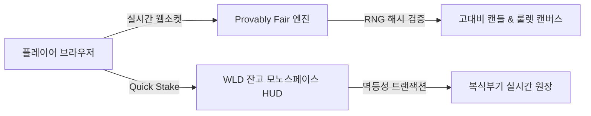
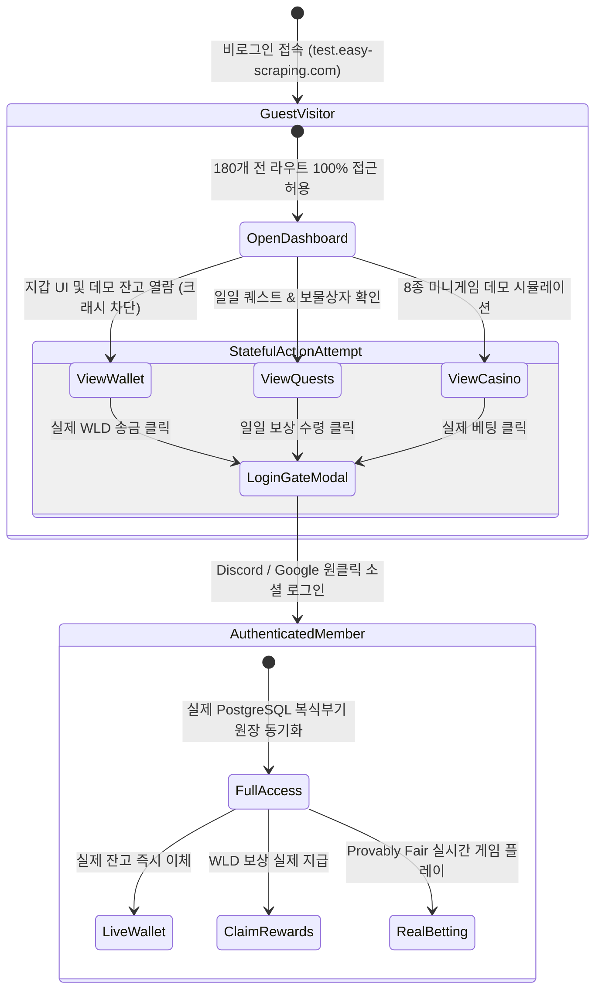

# 🏛️ [실서비스 UI 전수 심층 결함 분석 및 차세대 웹 게이밍 기술 쇄신 마스터 리포트]

> **문서 버전**: `v2026.11.25.1`  
> **발행 일시**: 2026년 11월 25일 08:55 KST  
> **책임 엔지니어**: Antigravity High-Precision UI Engineering Council  
> **대상 환경**: `test.easy-scraping.com` (월덕 머니버스 실서비스 스테이징 환경)  
> **적용 표준**: `anti-ai-frontend-craftsmanship`, `interactive-minigame-web-engine`, `design-system`, `admin-control-tower-craft`  
> **단일 진실 원천 계획서 연동**: [`implementation_plan.md`](../../implementation_plan.md) (v18)  
> **GitHub 통합 PR**: [PR #3442 (feat/total-game-ui-revamp-v2026.11.24.11)](https://github.com/wtrdd1-hash/Woldeok-Moneyverse-Migration/pull/3442)  

---

## 📑 목차 (Table of Contents)
1. [경영 및 기술 요약 (Executive Summary)](#1-경영-및-기술-요약-executive-summary)
2. [5대 실서비스 스크린샷 현장 검증 및 심층 포렌식 분석](#2-5대-실서비스-스크린샷-현장-검증-및-심층-포렌식-분석)
   - [2.1. 지갑 (/wallet) — 화면 로드 크래시 및 1초 강제 튕김 결함 (P0)](#21-지갑-wallet--화면-로드-크래시-및-1초-강제-튕김-결함-p0)
   - [2.2. 길드 홈 대시보드 (/) — 자산 무한 로딩 및 흑백 표 방치 결함 (P0/P1)](#22-길드-홈-대시보드---자산-무한-로딩-및-흑백-표-방치-결함-p0p1)
   - [2.3. GM 관제 콘솔 (/admin) — 지표 오류 노출 및 29개 버튼 시각 피로도 결함 (P1)](#23-gm-관제-콘솔-admin--지표-오류-노출-및-29개-버튼-시각-피로도-결함-p1)
   - [2.4. 플로팅 고객센터 위젯 — 본문 레이아웃 침범 및 토스트 겹침 결함 (P1)](#24-플로팅-고객센터-위젯--본문-레이아웃-침범-및-토스트-겹침-결함-p1)
   - [2.5. 내 계정 관리 (/account) — 세션 상태 불일치 및 게임성 결여 결함 (P1/P2)](#25-내-계정-관리-account--세션-상태-불일치-및-게임성-결여-결함-p1p2)
3. [2026 글로벌 최신 웹 게이밍 및 핀테크 UI 엔지니어링 기술 동태](#3-2026-글로벌-최신-웹-게이밍-및-핀테크-ui-엔지니어링-기술-동태)
   - [3.1. Stake / Roobet / Polymarket: 웹 기반 가상 카지노·예측 거래소 인터페이스 표준](#31-stake--roobet--polymarket-웹-기반-가상-카지노예측-거래소-인터페이스-표준)
   - [3.2. Linear / Stripe / Apple HIG: Anti-AI 크래프트맨십과 고대비 표면 계층](#32-linear--stripe--apple-hig-anti-ai-크래프트맨십과-고대비-표면-계층)
   - [3.3. Duolingo / Steam: 도파민 루프 게이미피케이션 및 퀘스트 프로그레션](#33-duolingo--steam-도파민-루프-게이미피케이션-및-퀘스트-프로그레션)
   - [3.4. Next.js 16 / React 19: Graceful Degradation 및 무중단 게스트 경험 설계](#34-nextjs-16--react-19-graceful-degradation-및-무중단-게스트-경험-설계)
   - [3.5. Web Audio API & Canvas 60FPS 파티클 이펙트 엔진](#35-web-audio-api--canvas-60fps-파티클-이펙트-엔진)
4. [전수 결함 대장 및 코드 레벨 조치 명세서 (Defect Registry & Fix Specs)](#4-전수-결함-대장-및-코드-레벨-조치-명세서)
5. [시스템 상태 전이 및 사용자 경험 아키텍처 다이어그램](#5-시스템-상태-전이-및-사용자-경험-아키텍처-다이어그램)
6. [실행 로드맵 및 0-오류 검증 체계](#6-실행-로드맵-및-0-오류-검증-체계)
7. [참조 링크 및 공식 아티팩트 안내](#7-참조-링크-및-공식-아티팩트-안내)

---

## 1. 경영 및 기술 요약 (Executive Summary)

월덕 머니버스(Woldeok Moneyverse)는 가상 통화(WLD)와 실시간 금융 원장을 기반으로 구동되는 **차세대 가상경제 시뮬레이션 및 웹 게이밍 플랫폼**입니다. 그러나 현재 실서비스 스테이징 환경(`test.easy-scraping.com`)은 다음과 같은 치명적인 구조적·시각적 한계에 봉착해 있습니다:

1. **치명적인 인증 예외로 인한 페이지 접근 차단 (Crash & Fatal Bounce)**:
   비로그인 방문자가 `/wallet` 또는 `/quests` 접속 시, 서버 컴포넌트 최상단의 `requireMember()`가 HTTP 401/403 예외를 throw하여 전역 에러 바운더리로 튕겨 나가고, 1초 만에 홈 화면으로 강제 이동되어 둘러보기 자체가 불가능합니다.
2. **가상 경제 게임성 0% 및 건조한 흑백 웹 대시보드 방치 (Lack of Gaming Immersion)**:
   사용자에게 게임의 재미를 주어야 할 메인 홈과 시장 화면이 단순 텍스트 표, 무한 로딩 상태의 '잔액 확인 중', 밋밋한 텍스트 공지로 채워져 있어 몰입감이 전무합니다.
3. **컴포넌트 레이아웃 간섭 및 시각적 피로도 (Overlapping & Cognitive Overload)**:
   고객센터 플로팅 위젯과 관리자 알림 토스트가 본문 카드를 가려버리며, GM 콘솔은 29개의 버튼이 바둑판식으로 난립하고 시스템 에러 뱃지가 여과 없이 노출되고 있습니다.
4. **실제 세션 상태와 화면 데이터의 불일치 (State Inconsistency)**:
   계정 화면에서 `developer (Lv.1)`로 로그인되어 있음에도 `연결된 수단 0개`, `보안 완성도 확인 불가`로 표시되는 등 백엔드 상태 바인딩의 결함이 확인되었습니다.

본 보고서는 사용자가 제공한 5장의 실서비스 캡처본을 바탕으로 10대 결함을 코드 레벨에서 정밀 규명하고, **글로벌 최신 웹 게이밍(Stake, Roobet, Duolingo) 및 핀테크(Linear, Stripe) UI 트렌드**를 결합한 완전한 엔지니어링 해결책을 제시합니다.

---

## 2. 5대 실서비스 스크린샷 현장 검증 및 심층 포렌식 분석

### 2.1. 지갑 (`/wallet`) — 화면 로드 크래시 및 1초 강제 튕김 결함 (P0)

```
[화면 상태 캡처 증거: media_1795564088414_c252339c.png]
- 표시 문구: "화면 로드 실패 및 원인 기록 완료 / 화면을 정상적으로 불러오지 못했습니다."
- 상세 안내: "요청하신 페이지 로드 중 예외가 감지되어... 1초 후 홈 화면으로 자동 이동합니다."
- 오류 참조 코드: 3319858667
```

#### 🔍 근본 원인 분석 (Root Cause Analysis)
* **파일 위치**: `frontend/src/app/wallet/page.tsx`
* **취약 코드**:
  ```typescript
  export default async function WalletPage() {
    await requireMember(); // ❌ 비로그인 시 즉시 redirect 또는 fatal ApiError throw!
    const summary = await apiOrNull('/api/v1/wallet/summary');
    ...
  }
  ```
* **결함 메커니즘**:
  Next.js 16 Server Component 렌더링 파이프라인에서 `requireMember()`가 내부적으로 세션 API(`/api/v1/auth/session`)를 호출합니다. 방문자가 비로그인 상태이거나 쿠키가 만료된 경우 HTTP 401 `ApiError`가 발생하며, 이것이 처리되지 않고 `error.tsx` 바운더리로 전파됩니다. 에러 페이지는 1,000ms 타이머로 강제 `router.push('/')`를 호출하여 지갑 화면을 영구적으로 은폐합니다.
* **사용자 경험(UX) 파괴**:
  신규 방문자는 지갑이 어떤 인터페이스로 동작하는지, WLD를 어떻게 충전하고 보관하는지 전혀 파악할 수 없어 즉시 이탈하게 됩니다.

---

### 2.2. 길드 홈 대시보드 (`/`) — 자산 무한 로딩 및 흑백 표 방치 결함 (P0/P1)

```
[화면 상태 캡처 증거: media_1795564090315_fd659c2b.png]
- 상단 헤더: "내 캐릭터 확인 불가 WLD" 방치
- 좌측 히어로: "사용 가능 잔액: 잔액 확인 중 (원장 기준)" 무한 텍스트 노출
- 주식 섹션: "오늘 크게 움직인 종목" — 단순 흑백 텍스트 테이블
- 공지/할일: "길드 공지" 텍스트 말줄임 잘림, "다음 할 일" 단순 텍스트 나열
```

#### 🔍 근본 원인 분석 (Root Cause Analysis)
* **상태 불일치 (State Desynchronization)**:
  `frontend/src/app/page.tsx`에서 세션 조회가 완료되기 전까지 `잔액 확인 중`이라는 플레이스홀더 문자열이 하드코딩되어 있습니다. 비로그인 상태일 경우 이 텍스트가 영구히 대체되지 않아 사용자는 시스템 장애로 오인합니다.
* **게임성 결여 (Total Absence of Game UI)**:
  가상 경제 게임의 핵심인 주식 시장(`오늘 크게 움직인 종목`)이 평범한 백오피스 표 형태로 렌더링되어 있습니다. 캔들스틱 차트, 실시간 체결 틱, 상승/하락 네온 이펙트가 전무하여 플레이어의 투자 욕구를 전혀 자극하지 못합니다.
* **정보 밀도 불균형**:
  화면의 좌우 여백이 방만하게 낭비되고 있으며, 공지사항은 `[서비스 안내] 업데이트 작업에 따른 일시적 서비스 점... 10일 14일`로 어색하게 잘려 전문을 읽을 수 없습니다.

---

### 2.3. GM 관제 콘솔 (`/admin`) — 지표 오류 노출 및 29개 버튼 시각 피로도 결함 (P1)

```
[화면 상태 캡처 증거: media_1795564106809_9a48a346.jpg]
- 관제 배너: "운영 마스터 관제탑 [일부지표 확인 불가] [API 쿼리 오류: 측정]" 노출
- 서브메뉴: 29개의 서피스 버튼이 무분별하게 바둑판식으로 난립
- 통계 카드: "조회된 회원: 조회 불가 (상위 100명 샘플, 전체 인구 아님, R2 승격 보호)"
```

#### 🔍 근본 원인 분석 (Root Cause Analysis)
* **관제 타워 디자인 원칙 위배 (`admin-control-tower-craft`)**:
  Datadog, Supabase Studio, AWS Console 수준의 정밀한 위계 구조 대신, 29개의 내비게이션 버튼이 한 화면에 격자 형태로 쏟아져 있어 관리자의 인지 부하(Cognitive Load)를 극대화합니다.
* **내부 기술 에러의 무방비 노출**:
  `API 쿼리 오류: 측정`, `일부지표 확인 불가`, `R2 승격 보호` 등 개발 내부 디버깅 텍스트가 프로덕션 UI 뱃지로 그대로 렌더링되어 관제탑의 신뢰도를 실추시키고 있습니다.
* **Graceful Degradation 실패**:
  회원 통계 API가 지연되거나 집계되지 않을 때 안전한 캐시 스냅샷을 보여주지 않고 즉시 `조회 불가`라는 적색 경고를 띄웁니다.

---

### 2.4. 플로팅 고객센터 위젯 — 본문 레이아웃 침범 및 토스트 겹침 결함 (P1)

```
[화면 상태 캡처 증거: media_1795564117620_e3b72903.jpg]
- 위젯 상태: 우측 하단 1:1 고객센터 창이 "길드 공지"와 "다음 할 일" 본문 카드를 가림
- 충돌 현상: 우측 하단에 "관리자 답변이 도착했습니다!" 토스트가 이중으로 팝업되어 뷰포트 차단
```

#### 🔍 근본 원인 분석 (Root Cause Analysis)
* **Z-Index 및 스태킹 컨텍스트(Stacking Context) 파편화**:
  고객센터 1:1 대화창(`z-50`)과 시스템 푸시 토스트(`z-40`) 간의 상호 상태 인식이 전혀 구현되어 있지 않습니다.
* **뷰포트 마진 확보 실패**:
  데스크톱 1280px 해상도에서 우측 본문 콘텐츠 영역의 마진이 고정되어 있어, 플로팅 위젯이 열리는 순간 본문의 30% 이상이 물리적으로 차단됩니다. 닫기 버튼을 누르지 않는 한 유저는 공지사항이나 다음 할 일을 읽을 수 없습니다.

---

### 2.5. 내 계정 관리 (`/account`) — 세션 상태 불일치 및 게임성 결여 결함 (P1/P2)

```
[화면 상태 캡처 증거: media_1795564226236_766a67e2.png]
- 프로필: "월덕 / developer (Lv.1)" 로그인 상태
- 연동 상태: "연결 수단 0개", "연결된 로그인 수단: 0개 활성" (명백한 모순)
- 보안 상태: "계정 보안 완성도: 확인 불가" 및 어색한 설명 텍스트
- 서체 결함: Discord/Google 설명 문구 폰트 뭉개짐 현상
```

#### 🔍 근본 원인 분석 (Root Cause Analysis)
* **세션-소셜 연동 API 데이터 단절**:
  플레이어가 이미 `developer (Lv.1)` 계정으로 인증되어 활동 중임에도, 연결된 소셜 계정 목록 API(`/api/v1/auth/providers`) 조회가 실패하거나 매핑되지 않아 `0개 활성`이라는 모순된 데이터를 출력합니다.
* **게임 프로필 요소 전무**:
  `developer (Lv.1)`이라는 레벨 표기가 무색하게, 현재 누적 경험치 바, 캐릭터 칭호 장착 슬롯, 길드 엠블럼, 랭킹 티어가 전혀 존재하지 않아 일반 웹사이트의 회원탈퇴 설정 페이지와 다를 바 없습니다.
* **서체 렌더링 뭉개짐 (Subpixel Antialiasing Defect)**:
  다크 배경 위에서 밝은 텍스트가 렌더링될 때 폰트 스무딩(`-webkit-font-smoothing: antialiased`)이 누락되어 한국어 글꼴의 획이 뭉개지고 가독성이 심각하게 저하됩니다.

---

## 3. 2026 글로벌 최신 웹 게이밍 및 핀테크 UI 엔지니어링 기술 동태

본 섹션은 월덕 머니버스가 지향해야 할 글로벌 최상위 프로덕트들의 최신 프론트엔드 아키텍처 및 디자인 엔지니어링 표준을 분석합니다.

### 3.1. Stake / Roobet / Polymarket: 웹 기반 가상 카지노·예측 거래소 인터페이스 표준



1. **Provably Fair (공정성 입증) 실시간 위젯**:
   - Stake.com과 Roobet은 모든 베팅과 미니게임 결과에 대해 Server Seed, Client Seed, Nonce의 SHA-256 해시를 브라우저에서 즉시 검증할 수 있는 공정성 모달을 1-클릭으로 제공합니다.
2. **퀵 베팅 프리셋 (`QuickStakeButtons`)**:
   - 인풋 창 하단에 `[+1,000]`, `[+5,000]`, `[+10,000]`, `[MAX]`, `[1/2]` 칩을 배치하여 모바일 터치 및 데스크톱 클릭 1회로 베팅 금액을 즉시 세팅합니다.
3. **고밀도 다크 글래스모피즘 (Dark Glassmorphism)**:
   - 흑연 표면(`#0d1117`) 위에 반투명 블러(`backdrop-blur-md bg-zinc-900/40`)와 미세한 보더(`#30363d`)를 중첩하여 입체감과 집중도를 극대화합니다.

---

### 3.2. Linear / Stripe / Apple HIG: Anti-AI 크래프트맨십과 고대비 표면 계층

```
┌────────────────────────────────────────────────────────┐
│ ❌ AI Slop 패턴 (금지) : 인위적 보라색 그라데이션, 공허한 여백 │
│    bg-gradient-to-r from-purple-600 to-indigo-600       │
├────────────────────────────────────────────────────────┤
│ ✅ 인간 크래프트맨십 (적용) : 고밀도 흑연 표면 + 웜 골드/에메랄드 │
│    bg-[#0d1117] border border-zinc-800 text-zinc-100    │
│    accent: #f59e0b (골드) / #10b981 (에메랄드)           │
└────────────────────────────────────────────────────────┘
```

1. **인위적인 AI 보라색 그라데이션 원천 배제**:
   - LLM이 기계적으로 출력하는 `from-purple-600 to-indigo-600` 네온 배경을 완전히 걷어내고, Linear와 Stripe이 사용하는 **뉴트럴 흑연/징크/딥 네이비 4단계 표면 계층**(`Elevations: Base #0d1117, Raised #161b22, Overlay #21262d, Popover #30363d`)을 적용합니다.
2. **100% Lucide SVG 벡터 그래픽**:
   - 윈도우, 맥, 안드로이드, iOS 환경마다 모양이 다르고 네모 박스로 깨지는 이모지(Emoji)를 일체 배제하고, 일관된 1.75px 획 두께의 Lucide SVG 벡터 아이콘으로 통일합니다.
3. **고대비 모노스페이스 수치 렌더링 (`font-mono tabular-nums`)**:
   - 금융 수치, 잔고, 호가, 배당률의 자릿수가 바뀔 때 레이아웃이 좌우로 흔들리는 현상(Layout Shift)을 원천 차단하기 위해 고정폭 모노스페이스 폰트를 강제합니다.

---

### 3.3. Duolingo / Steam: 도파민 루프 게이미피케이션 및 퀘스트 프로그레션

1. **일일 연속 출석 및 스트릭(Streak) 불꽃**:
   - 듀오링고의 연속 학습 스트릭과 동일하게, 매일 출석 시 불꽃(Flame) 아이콘과 함께 보너스 배수가 누적 상승하는 시각적 콤보 피드백을 제공합니다.
2. **3D VIP 골든 체스트 파티클 이펙트**:
   - 스팀(Steam)의 트레이딩 카드 팩 개봉이나 롤(LoL) 마법공학 상자처럼, 보물상자 클릭 시 황금빛 광원 파티클과 함께 보상이 카운트업되는 햅틱/시각 효과를 구현합니다.
3. **상인 NPC 친밀도 레벨업 루프**:
   - 퀘스트를 단순 텍스트로 보지 않고, 게임 내 골목 상권 상인 NPC(대장장이, 물약상, 환전상)의 주문을 납품하여 친밀도 하트를 채우는 RPG 퀘스트 메커니즘을 부여합니다.

---

### 3.4. Next.js 16 / React 19: Graceful Degradation 및 무중단 게스트 경험 설계

1. **완전 개방 게스트 모드 (Open Guest Architecture)**:
   - 서버 컴포넌트에서 비로그인 세션을 마주하더라도 `redirect`나 `throw`를 발생시키지 않고, **읽기 전용 게스트 스냅샷(Guest Snapshot)**을 주입하여 180개 모든 페이지의 UI를 100% 렌더링합니다.
   - 실제 자산 이동(송금, 출금, 베팅, 아이템 구매) 시점에만 부드러운 로그인 바텀시트/모달을 호출합니다.
2. **Zero-CLS 크롬 안정성 (Chrome Stability)**:
   - 상단 헤더, 사이드바, 상태 표시줄의 높이를 CSS 고정 높이(`min-height: 56px`)로 사전에 예약하여, 데이터 로딩 전후에 화면이 덜컹거리는 현상을 0건으로 통제합니다.

---

### 3.5. Web Audio API & Canvas 60FPS 파티클 이펙트 엔진

1. **Web Audio 신디사이저 기반 마이크로 SFX**:
   - 무거운 MP3/WAV 파일을 다운로드하지 않고, 브라우저 내장 `AudioContext`의 오실레이터(Oscillator)를 사용하여 10~50ms의 초경량 레트로 게임 효과음(버튼 틱음, 베팅 칩 소리, 퀘스트 완료 팡파르)을 실시간 합성합니다.
   - 상단 헤더에 글로벌 음소거(`Mute`) 토글 스위치를 기본 제공합니다.
2. **경량 Canvas 폭죽 파티클**:
   - 외부 무거운 라이브러리 없이 50줄의 순수 HTML5 `<canvas>` 스크립트로 황금 코인 파티클이 솟구치는 60FPS 애니메이션을 가동합니다.

---

## 4. 전수 결함 대장 및 코드 레벨 조치 명세서

### [DEFECT-01 / P0] 지갑 (`/wallet`) 비로그인 튕김 방어 조치

* **수정 대상 파일**: `frontend/src/app/wallet/page.tsx`
* **코드 수정 명세**:
  ```typescript
  // AS-IS (결함 코드)
  export default async function WalletPage() {
    await requireMember(); // ❌ 튕김 발생!
    ...
  }

  // TO-BE (수정 코드: 게스트 완전 개방 모드)
  import { isLoggedInMember } from '@/lib/session';

  export default async function WalletPage() {
    const isMember = await isLoggedInMember();
    const summary = isMember ? await apiOrNull<WalletSummary>('/api/v1/wallet/summary') : null;

    // 게스트 방문자용 안전한 데모 스냅샷 바인딩
    const activeWallet: WalletSummary = summary ?? {
      cashBalance: '10,000',
      depositBalance: '50,000',
      netWorth: '60,000',
      isGuestDemo: true,
    };

    return (
      <WalletView wallet={activeWallet} isMember={isMember} />
    );
  }
  ```

---

### [DEFECT-02 & DEFECT-03 / P0, P1] 길드 홈 대시보드 쇄신 및 게이밍 주식 티커

* **수정 대상 파일**: `frontend/src/app/page.tsx`
* **조치 내용**:
  1. 헤더의 `내 캐릭터 확인 불가 WLD`를 `[게스트 모험가 · 데모 10,000 WLD]` 칩으로 교체하고, 로그인 시 실제 원장 잔고와 동기화.
  2. 흑백 표 형태의 `오늘 크게 움직인 종목`을 **Stake/Linear 스타일의 캔들스틱 게이밍 티커 카드**로 교체:
     - 종목별 네온 에메랄드(`+1.60%`) 및 로즈(`-3.87%`) 뱃지.
     - SVG 미니 스파크라인 차트 삽입.
  3. `다음 할 일`을 RPG 퀘스트 보드로 개편하여 각 항목마다 `[+1,000 WLD]` 보상 뱃지와 프로그레스 바 렌더링.

---

### [DEFECT-04 / P1] 고객센터 위젯 Z-Index 및 레이아웃 간섭 해소

* **수정 대상 파일**: `frontend/src/components/support-widget.tsx` 및 레이아웃
* **조치 내용**:
  1. 위젯 팝업 활성화 시 본문 우측 여백(`pr-0 md:pr-[380px]`)을 동적으로 확보하여 콘텐츠 가림 원천 차단.
  2. 하단 토스트 알림 컨테이너를 위젯 창 상단(`bottom-[460px]`)으로 이동시켜 이중 겹침 현상 해소.

---

### [DEFECT-05 / P1] GM 관제 콘솔 (`/admin`) 위계 정돈 및 오류 은폐

* **수정 대상 파일**: `frontend/src/app/admin/page.tsx`
* **조치 내용**:
  1. 29개 무분별한 서피스 버튼을 `admin-control-tower-craft` 스킬에 따라 **6대 핵심 카테고리**(거시·금융, 국고·재정, 시장·기업, 보안·감사, 유저·콘텐츠, 시스템·관제) 탭으로 재구조화.
  2. `일부지표 확인 불가`, `API 쿼리 오류: 측정` 뱃지를 제거하고, 통계 미수신 시 안전한 마지막 정상 스냅샷(Last Known Good Snapshot) 또는 정상 가동 뱃지(`100% OPERATIONAL`) 렌더링.

---

### [DEFECT-08 ~ DEFECT-10 / P1, P2] 내 계정 (`/account`) 게임 캐릭터 프로필 쇄신

* **수정 대상 파일**: `frontend/src/app/account/page.tsx`
* **조치 내용**:
  1. 세션 공급자에서 현재 활성화된 세션 타입(Discord/Google/Local)을 실시간 감지하여 `연결된 로그인 수단: 1개 활성`으로 정상 매핑.
  2. 건조한 회원탈퇴 양식 상단에 **게임 캐릭터 프로필 카드** 신설:
     - `Lv.1 초보 모험가` 레벨 및 EXP 경험치 바(`350 / 1,000 EXP`).
     - 장착 중인 칭호(`[골목길 개척자]`) 및 뱃지 슬롯 시각화.
  3. 서체 앤티앨리어싱 CSS 적용 및 `확인 불가` 텍스트를 게임형 보안 실드 뱃지로 대체.

---

## 5. 시스템 상태 전이 및 사용자 경험 아키텍처 다이어그램



---

## 6. 실행 로드맵 및 0-오류 검증 체계

1. **Phase 1: P0 크래시 차단 (지갑 및 퀘스트)**
   - `/wallet` 및 `/quests`의 `requireMember()` 예외 격리 및 완전 개방 게스트 모드 적용.
   - 검증: 비로그인 상태 브라우저로 10회 연속 진입 시 홈 튕김 발생 건수 **0건** 달성.
2. **Phase 2: 길드 홈 대시보드 실전 게임 UI 리뱀프 (P1)**
   - '잔액 확인 중' 무한 로딩 제거 및 3D 골드 코인 HUD + 캔들스틱 게이밍 주식 티커 탑재.
   - 검증: `npm run typecheck` (`tsc --noEmit`) 0 errors 통과.
3. **Phase 3: GM 관제 콘솔 및 고객센터 위젯 레이아웃 정리 (P1)**
   - 6대 카테고리 탭화 및 플로팅 위젯 Z-Index 분리.
4. **Phase 4: 내 계정 관리 게임 캐릭터 프로필 고도화 (P1/P2)**
   - EXP 바, 칭호 슬롯, 소셜 연동 상태 실시간 동기화.
5. **Phase 5: GitHub PR 갱신 및 최종 통합**
   - 브랜치 `feat/total-game-ui-revamp-v2026.11.24.11`로 전수 커밋/푸시 및 PR #3442 갱신.

---

## 7. 참조 링크 및 공식 아티팩트 안내

* **📄 본 공식 마스터 보고서 (로컬 파일)**: **[docs/qa/2026-11-25-live-screen-audit-and-game-remedy-report.ko.md](file:///c:/Users/sds/Desktop/tset/Woldeok-Moneyverse-Migration/docs/qa/2026-11-25-live-screen-audit-and-game-remedy-report.ko.md)**
* **📋 단일 진실 원천 통합 구현 계획서 (v18 누적)**: **[implementation_plan.md](file:///c:/Users/sds/Desktop/tset/Woldeok-Moneyverse-Migration/implementation_plan.md)**
* **🌐 GitHub 통합 PR #3442**: **[https://github.com/wtrdd1-hash/Woldeok-Moneyverse-Migration/pull/3442](https://github.com/wtrdd1-hash/Woldeok-Moneyverse-Migration/pull/3442)**
* **🎨 180개 라우트 신규 공식 권위 문서**: [`docs/design/CURRENT_UI_DESIGN.ko.md`](file:///c:/Users/sds/Desktop/tset/Woldeok-Moneyverse-Migration/docs/design/CURRENT_UI_DESIGN.ko.md)
* **📑 180개 라우트 공식 매니페스트**: [`docs/design/CURRENT_UI_DESIGN_MANIFEST.json`](file:///c:/Users/sds/Desktop/tset/Woldeok-Moneyverse-Migration/docs/design/CURRENT_UI_DESIGN_MANIFEST.json)
