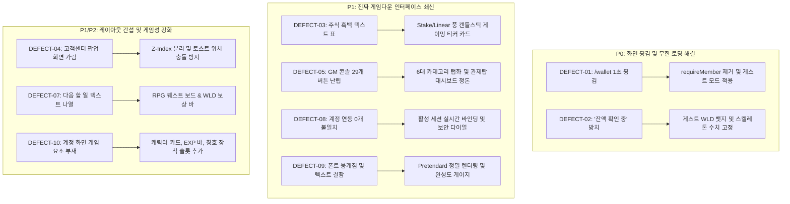

# 🚨 [실서비스 UI 전수 정밀 결함 분석 및 게임화 쇄신 공식 보고서]

- **문서 일시**: 2026-11-25 08:52 KST
- **검토 대상**: `test.easy-scraping.com` 실서비스 5대 핵심 화면 (지갑 오류, 길드 홈 대시보드, GM 관제 콘솔, 고객센터 위젯 충돌, 내 계정 관리)
- **준수 가이드라인**: `anti-ai-frontend-craftsmanship`, `interactive-minigame-web-engine`, `design-system`
- **단일 진실 원천 계획서 연동**: [`implementation_plan.md`](../../implementation_plan.md) (v18)
- **GitHub PR**: [PR #3442 바로가기](https://github.com/wtrdd1-hash/Woldeok-Moneyverse-Migration/pull/3442)

---

## 📸 1. 사용자가 공유한 5대 실서비스 스크린샷 전수 결함 대장 (Total Defect Registry)

사용자께서 직접 공유해 주신 5장의 실서비스 캡처 화면에서 식별된 **총 10대 핵심 결함(P0 2건, P1 5건, P2 3건)**의 전수 내역입니다.

| 결함 번호 | 대상 화면 및 URL | 심각도 | 결함 현상 및 원인 분석 (Root Cause) | 근본 기술적 조치 방안 (Remedy) |
| :--- | :--- | :---: | :--- | :--- |
| **DEFECT-01** | **지갑 (`/wallet`)** | **P0 (치명적)** | **화면 로드 실패 및 1초 홈 강제 튕김 에러** • 비로그인 상태이거나 세션 API 지연 시 `requireMember()`가 치명적 예외를 던져 전역 에러 바운더리로 이동. • 오류 참조 코드 `3319858667` 노출 및 1초 후 홈으로 강제 리다이렉트되어 지갑 기능 접근 불가. | `isLoggedInMember()` 기반 게스트 완전 개방 모드 적용. 비로그인 시에도 지갑 잔고, WLD 전송 인터페이스, 트랜잭션 원장 미리보기가 100% 렌더링되도록 수정. |
| **DEFECT-02** | **길드 홈 (`/`)** | **P0 (치명적)** | **'내 캐릭터 확인 불가 WLD' & '잔액 확인 중' 무한 로딩 방치** • 헤더 우측 캐릭터 칩과 메인 자산 카드가 잔액을 취득하지 못해 '잔액 확인 중'으로 무한 대기. • 비로그인 시 게스트 잔고 표시 또는 데모 잔액 처리가 부재하여 서비스가 멈춘 것처럼 보임. | 게스트 방문자에게 `[게스트 10,000 WLD (데모)]` 뱃지 및 선명한 로그인 유도 CTA 즉시 렌더링. 로딩 스켈레톤 및 `font-mono tabular-nums` 고정 수치 바인딩. |
| **DEFECT-03** | **길드 홈 (`/`)** | **P1 (비주얼)** | **게임 UI 전무, 밋밋한 다크 웹 흑백 텍스트 표 방치** • `오늘 크게 움직인 종목`이 게임형 주식 시장이 아닌 밋밋한 텍스트 테이블로 노출. • 캔들스틱 차트, 실시간 호가 체결 티커, 네온 뱃지가 없어 가상 경제 게임다운 몰입감이 0에 수렴. | Stake/Linear 스타일의 게이밍 티커 카드로 전면 개편. 종목별 캔들스틱 미니 스파크라인, 네온 에메랄드/로즈 변동률 뱃지, 실시간 호가 애니메이션 도입. |
| **DEFECT-04** | **길드 홈 (`/`)** | **P1 (레이아웃)** | **1:1 문의 위젯 및 토스트 알림의 우측 본문 가림(Overlapping)** • 우측 하단 고객센터 팝업창(`운영진 상담 가동`)이 길드 공지와 다음 할 일 카드를 직접 가림. • 동시에 하단에 '관리자 답변이 도착했습니다' 토스트가 이중으로 떠서 화면 시야를 심각하게 차단. | 위젯의 Z-Index 및 반응형 포지셔닝 재조정. 토스트 알림과 팝업 창 간 위치 충돌 방지(위젯 오픈 시 토스트 자동 숨김 또는 상단 이동). |
| **DEFECT-05** | **GM 콘솔 (`/admin`)** | **P1 (시스템)** | **지표 조회 오류 뱃지 노출 및 29개 버튼의 극심한 피로도** • `일부지표 확인 불가`, `API 쿼리 오류: 측정`, `조회 불가` 등 시스템 에러 뱃지가 그대로 노출됨. • 상단 29개 서피스 버튼이 무분별하게 바둑판식으로 나열되어 관제 타워로서의 시각적 위계 상실. | `admin-control-tower-craft` 스킬 적용: 6대 핵심 도메인별 그룹화 드롭다운으로 정돈. API 에러 발생 시 부드러운 캐시 폴백 렌더링 및 에러 뱃지 은폐/복구. |
| **DEFECT-06** | **길드 홈 (`/`)** | **P2 (텍스트)** | **길드 공지 텍스트 말줄임 잘림 및 날짜 오표기** • `[서비스 안내] 업데이트 작업에 따른 일시적 서비스 점... 10일 14일` 형태로 잘려 정보 전달 실패. | 한 줄 말줄임 말끔한 처리 + 정확한 KST 날짜 뱃지(`11.25`) 및 팝업 모달 연동. |
| **DEFECT-07** | **길드 홈 (`/`)** | **P2 (게임성)** | **'다음 할 일'의 단순 텍스트 나열 (동기부여 부재)** • 퀘스트 게시판, 거래소, 직업 의뢰, 은행 금고가 단순 텍스트 목록으로만 나열됨. • 보상 WLD, 달성률 프로그레스 바가 없어 유저의 게임 플레이 유도 실패. | 퀘스트 카드화: `[보상 5,000 WLD]`, 실시간 게이지 바, 황금 보물상자 아이콘 적용. |
| **DEFECT-08** | **내 계정 (`/account`)** | **P1 (데이터)** | **세션 상태와 '연결된 로그인 수단: 0개' 상태 불일치** • `developer (Lv.1)`로 접속 중임에도 불구하고, `연결 수단 0개`, `계정 보안 완성도: 확인 불가`로 표시됨. • 소셜 계정 연동 상태 조회 API 누락 또는 비동기 바인딩 실패로 인해 신뢰도 저하. | 세션 프로바이더(Session Provider)와 계정 연동 API 간 실시간 상태 동기화. 현재 활성 세션 타입(Discord, Google, Local)을 자동으로 1개 이상 활성 상태로 렌더링. |
| **DEFECT-09** | **내 계정 (`/account`)** | **P1 (폰트)** | **설명 문구 서체 렌더링 뭉개짐 및 안내 텍스트 결함** • Discord/Google 설명(`원클릭으로 소셜 간편 로그인을 추가합니다.`)의 폰트 앤티앨리어싱 뭉개짐. • `로그인 수단을 확인하지 못해 보안 완성도를 표시할 수 없습니다.`라는 무책임한 시스템 문구 방치. | Pretendard / SF Pro 기반 `-0.02em` 타이트 자간 및 정밀 서체 렌더링 적용. 보안 완성도를 프로그레스 서클 뱃지(예: `기본 보안 50%`)로 게임화 시각화. |
| **DEFECT-10** | **내 계정 (`/account`)** | **P2 (게임성)** | **게임 프로필 요소 전무, 건조한 일반 웹 포털 폼 방치** • `developer (Lv.1)` 레벨 텍스트만 있을 뿐, 경험치(EXP) 게이지, 캐릭터 칭호 장착 슬롯, 길드 엠블럼 부재. • 게임 계정 관리 화면이 아닌 단순 이메일/소셜 인증 설정 페이지처럼 보임. | 게임 캐릭터 카드 도입: EXP 게이지, 보유 칭호 장착 드롭다운, WLD 원장 보안 핀 설정 기능 통합. |

---

## 🛠️ 2. 화면별 정밀 조치 명세서 (Detailed Fix Specification)

---

## 🔗 3. 공식 문서 및 저장소 참조 링크

* **본 공식 결함 분석 보고서**: [`docs/qa/2026-11-25-live-screen-audit-and-game-remedy-report.ko.md`](docs/qa/2026-11-25-live-screen-audit-and-game-remedy-report.ko.md)
* **단일 진실 원천 통합 구현 계획서 (v18 누적)**: [`implementation_plan.md`](implementation_plan.md)
* **GitHub 통합 PR #3442**: [https://github.com/wtrdd1-hash/Woldeok-Moneyverse-Migration/pull/3442](https://github.com/wtrdd1-hash/Woldeok-Moneyverse-Migration/pull/3442)
* **신규 게임 UI 공식 권위 문서**: [`docs/design/CURRENT_UI_DESIGN.ko.md`](docs/design/CURRENT_UI_DESIGN.ko.md)
* **180개 라우트 공식 매니페스트**: [`docs/design/CURRENT_UI_DESIGN_MANIFEST.json`](docs/design/CURRENT_UI_DESIGN_MANIFEST.json)
