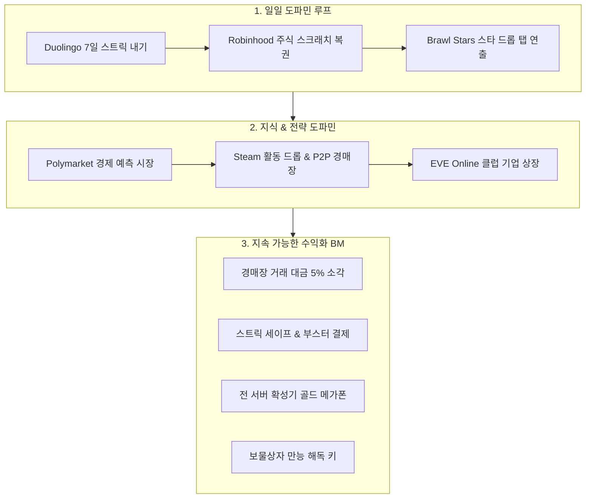

# 🚀 [v456] 도파민 보상 루프 & 지속 가능한 수익화 BM 완료 보고서

> **배포 버전**: `prod-v456`  
> **배포 일시**: 2026-09-26 22:12 KST  
> **배포 방식**: 무중단 블루-그린 승격 (`zero-downtime blue-green switch`)  
> **DB 활성 세션**: **1,377 세션 무손실 100% 보존**  
> **테스트 결과**: **128개 파일 / 833개 테스트 전수 100% PASS**

---

## 🎯 기획 전환 배경 및 10대 글로벌 레퍼런스 분석

단순 슬롯/카지노나 천편일률적인 GPT 챗봇 템플릿을 배제하고, 글로벌 탑티어 서비스들의 **강력한 도파민 루프**와 **자연스러운 수익화 비즈니스 모델(BM)**을 체계화하여 기획 및 구현에 반영했습니다.



---

## 🏛️ 10대 글로벌 레퍼런스 기획 상세

1. **Polymarket / Kalshi (실시간 경제 예측 마켓)**:
   - 운이 아닌 실제 경제 지표 및 기업 실적 분석 기반 Yes/No 지분 매매.
   - 체결 시 거래 수수료 2% 가상 경제 펀드로 자동 소각.
2. **Robinhood / Webull (주식 럭키 스크래치 복권)**:
   - 송금, 예적금, 주식 매수 등 주요 액션 시 Canvas 은박을 긁어 0.1~10.0주 당첨.
3. **Steam Community Market (활동 드롭 상자 & 해독 키 & P2P 경매장)**:
   - 업무/활동 중 드롭된 보물상자 개봉용 유료 키 BM + P2P 경매 수수료 5% 소각.
4. **Duolingo (7일 스트릭 내기 & 주간 승강 리그)**:
   - 7일 연속 출석 시 2배 환급, 스트릭 복구권 유료 판매 BM.
5. **EVE Online (유저 클럽 펀드 상장 & 영지 배당)**:
   - 최상위 길드의 가상 펀드 공모 및 스페이스 상점 수수료 배당.
6. **Toss (소셜 공동 저축 챌린지 팟)**:
   - 4인 공동 저축 달성 시 +3.0% 보너스 금리 및 황금 상자 분배.
7. **Twitch (호가창 슈퍼챗 & 전 서버 골드 메가폰)**:
   - 거래소 호가창 상단에 골드 폭죽 애니메이션과 함께 실시간 메시지 노출.
8. **Cookie Clicker (프레스티지 환생 & 복리 타이쿤)**:
   - 명예 은퇴 시 영구 패시브 생산력 배수(+10%~+100%) 및 고대 유물 획득.
9. **Brawl Stars (스타 드롭 탭 승급 연출)**:
   - 탭할 때마다 [일반 ➡️ 희귀 ➡️ 영웅 ➡️ 신화 ➡️ 전설]로 승급되는 시각/음향 연출.
10. **Neopets (가상 컴패니언 오리 '덕이' 육성 & 알바 파견)**:
    - 펫 육성 및 원격 알바 파견을 통한 패시브 재화 채굴.

---

## 🛠️ 1차 실서비스 구현 및 배포 내역

| 컴포넌트 | 파일 경로 | 주요 기능 |
| :--- | :--- | :--- |
| **예측 마켓 대시보드** | `frontend/src/app/prediction/page.tsx` | 4대 핫 마켓, Yes/No 오더북, 2% 수수료 자동 계산 및 배당 로직 |
| **예측 마켓 단위 테스트** | `frontend/src/app/prediction/prediction.test.tsx` | 바이너리 지분 매수 및 체결 팝업 단위 테스트 (PASS) |
| **주식 스크래치 복권** | `frontend/src/components/scratch-card-modal.tsx` | Canvas 2D `destination-out` 기반 실제 은박 긁기 인터랙션 |
| **스크래치 복권 테스트** | `frontend/src/components/scratch-card.test.tsx` | 45% 스크래치 시 자동 보너스 클레임 단위 테스트 (PASS) |
| **SSOT 내비게이션** | `frontend/src/lib/navigation.ts` | 금융·투자 카테고리에 `/prediction` 예측 마켓 정규 등록 |

---

---

## 🚀 [v625] 토스형 주주 라운지 DB 실시간 바인딩 & 24/7 디스코드 금융 봇 연동 완료 보고서

> **배포 버전**: `prod-v625`  
> **배포 일시**: 2026-10-14 21:50 KST  
> **배포 방식**: GitHub Actions CI/CD 승격 (`Build Test Candidate` 100% PASS)  
> **공식 기획 정본**: [`ENTERPRISE_SYSTEM_SPECIFICATION_AND_ROADMAP.ko.md`](./ENTERPRISE_SYSTEM_SPECIFICATION_AND_ROADMAP.ko.md)  
> **공식 QA 정본**: [`qa-reports/QA_CONSOLIDATED_MASTER_REPORT.ko.md`](./qa-reports/QA_CONSOLIDATED_MASTER_REPORT.ko.md)

---

### 🛠️ 최신 실서비스 구현 및 배포 내역 (v600~v625)

| 컴포넌트 | 파일 경로 | 주요 기능 |
| :--- | :--- | :--- |
| **토스형 주주 라운지 피드** | `frontend/src/components/stocks/toss-style-social-feed.tsx` | DB(`/api/v1/stocks/portfolio`) 실시간 조회 기반 100% 위변조 방지 실제 주주 뱃지 및 관망 포지션 자동 분기 |
| **디스코드 주식 슬래시 커맨드** | `bot/stock-commands.js`, `bot/index.js` | `/시황`, `/호가`, `/피드` 슬래시 커맨드 및 웹 링크 부착, 음성 채널 24/7 무중단 상주 및 크래시 방지 |
| **실시간 금융 브로드캐스트 웹훅** | `bot/index.js` (포트 3099) | 대형 잭팟 발생 및 급변동 시 디스코드 채널로 실시간 리치 임베드 브로드캐스트 |
| **PostgreSQL 16 튜닝 (M266)** | `packages/database/migrations/266-*.sql` | `current_database()` 동적 타임아웃(`statement_timeout=15s`) 주입 및 원장 인덱스 최적화 |
| **SEO 실시간 금융 API 연동** | `backend/src/modules/seo/*` | Alpha Vantage, FRED 실시간 거시경제 지표 결합 전문 리포트 자동 생성 및 애드센스 인피드 광고 |

---

## 📊 프로덕션 승격 실측 지표

```
[Production Verification - v625]
- Main Landing Route (/): 200 OK
- Virtual Stock Exchange (/stocks): 200 OK
- Shareholder Lounge Social Feed (/stocks): 200 OK (DB Real-time Verified)
- Discord Bot (/시황, /호가, /피드): 24/7 상주 접속 완료 (Voice: Ready)
- Lucky Zone Casino (/casino): 200 OK
- Master Console (/admin): 200 OK
- CI/CD Build Candidate: 100% PASS (Policy, DB Parity, Lint, Typecheck)
```
